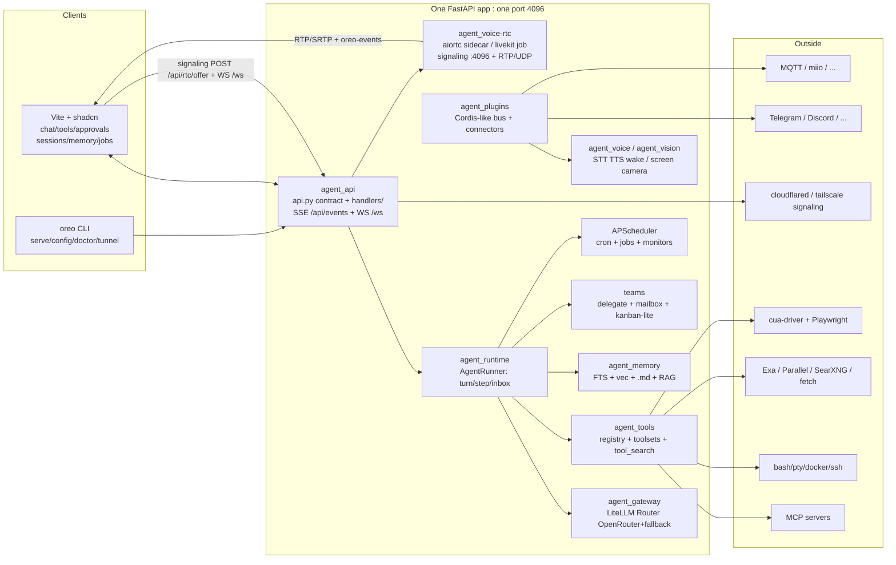
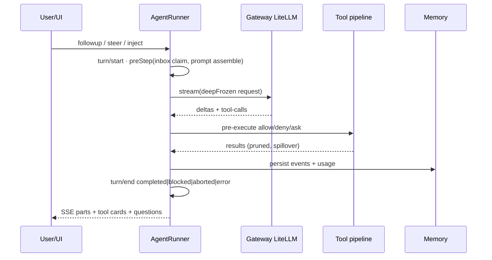
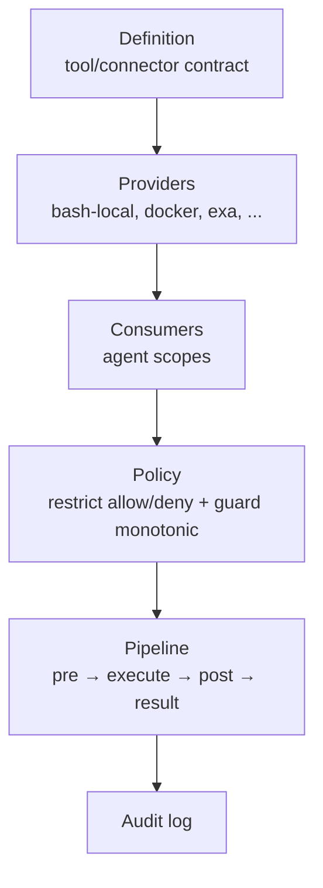

# OREO — Build Spec

> Project: **OREO** — Unified AI control layer. One Python core, one Vite web UI, thin CLI, everything else a plugin.
> Root: `H:\CODEFILES\harness's\OREO` · Status: **SPEC APPROVED — steering review gates hold per milestone.**
> Note: OREO `skills/` reference `plan.md` (Parts B/C/D/E/G/K). **This `spec.md` IS that plan** — same role, same invariants.
> Currency: validated Sept 2026 against official docs + release notes (FastAPI 0.141.1, Pydantic 2.13+, SQLAlchemy 2.0.52, Typer 0.27.2, LiteLLM 1.85+, Vite 8.2.2, React 19.2, Tailwind 4.3, MCP spec 2026-07-28) and 5 harness codebases as ground truth (`HARNESS_COMPARISON.md` §8). Context7 MCP was unavailable during validation — re-run the Context7 pass per dependency at build.

---

## 0. Master prompt (paste first when coding with any agent)

> You are building OREO in `H:\CODEFILES\harness's\OREO`.
> Stack: Python `>=3.12,<3.15` (CI 3.12+3.13; 3.14 experimental; forbid free-threaded/`PYTHON_JIT`), uv, FastAPI `>=0.141.1,<0.142`, Pydantic v2 `>=2.13,<3`, SQLAlchemy 2 `>=2.0.52,<2.1`, Typer `>=0.27.2,<0.28` (forbid `import click`), LiteLLM `>=1.85` Router-only (OpenRouter-first).
> Workflow (`AGENTS.md`): Isolate (`new-feature` worktree per task, never build on `main`) → Build (`code-structure`: actions own the why/when, services own the how; explicit inputs, structured returns) → Prove (`evidence-driven-testing` + pytest pyramid + live runtime evidence, before/after pairs) → Ship (`before-and-after` + `greploop` until 5/5, zero unresolved comments).
> Use `OREO/skills/`: `python, uv, pydantic, sqlalchemy, fastapi, sse-events, litellm, mcp, cli-typer, pytest, react-vite, typescript, sdk-codegen, observability, auth-oauth, docker, langgraph`.
> Use Context7 MCP for every library (FastAPI, LiteLLM, Pydantic, SQLAlchemy, MCP SDK, Vite, shadcn) before writing code against it. Use Exa/web + GitHub (stars, commit recency, issues, license, tests) for any open-spike decision in §22.
> Keep the relevant harness sources open for the subsystem you touch (`HARNESS_COMPARISON.md` §8 + §3 below). Never copy code blind — port the idea, write it OREO-native.
> Invariants: **one FastAPI app, one port** (default 4096); event store append-only; Pydantic models are the wire contract (`agent_schema` → OpenAPI → SDKs, run `sdk.yml` guard on change); LiteLLM imported ONLY in `agent_gateway`; secrets ONLY from env/keyring/encrypted store, never code; no god files; no `elif>=4` (dict dispatch); every claim needs pytest + live evidence.

---

## 1. Vision

OREO is the single control plane for a personal AI system: natural voice + chat, long/short memory, personal RAG, autonomous and scheduled agents, sub-agent teams, full tool/MCP/computer use, vision and sensors, messaging and smart-home, coding and ops automation — all behind one web UI, one API, one encrypted home directory.

---

## 2. Feature catalog (every requested feature, mapped to a milestone)

Legend: **P0** = first working system · **P1** = next wave · **P2** = later. Source = harness/idea it is ported from.
Status legend (2026-09-09): ✅ = fully delivered · 🔶 = partially delivered (done part noted) · unmarked = not started. See §2.0 build status.

### 2.0 Build status (2026-09-09)

- ✅ **M0** — spec + AGENTS.md/CLAUDE.md + `.env.example` + `memory/` + git init (no push) (`11dd5bd`)
- ✅ **M1a scaffold** — pyproject/uv.lock + 10-package `src/agent_*` layout + `agent_schema` wire contract + settings/config loader + `GET /api/health` (`31d89d4`); follow-ups: aware-UTC timestamps, frozen WsServerEvent, StreamChunk contract (`d3d0215`, `d80b2a4`)
- ✅ **M1b loop+gateway** — turn/step/inbox loop (§8.1–8.3, §8.9 minimal-real) + SessionRunCoordinator + append-only EventStore (per-aggregate seq, replay) + LiteLLM Router gateway (lazy import, typed GatewayError §10.5, FakeGateway) + resolve_model chain + `evaluate()`/audit/redaction stubs (`80b93cc`); integration-caught abort-routing bug fixed (`d3d3e69`)
- ✅ **§26.0 Context7 validation** — 0 MISMATCH across 15 libs; fixes: litellm stream usage, pydantic validate_by_name, mypy pydantic plugin, PRAGMA recipe (`5e1c47d`)
- ✅ **M1c 5 tools+SSE** — read/write/edit/bash/web_fetch + `POST /api/chat` → loop → `GET /api/events` SSE (Last-Event-ID) + protocol/server split + sdk.yml guard (`ca86091`); §10.4 retryable-codes policy landed with it
- ✅ **M2** — memory/RAG (§11: FTS5+vec0 store, chunking, RRF retriever, memory tools) + permissions (§19.1-19.4/19.9: layered evaluate, floors, modes, approvals) + P0 tools (16 in registry: + glob/grep/str_replace/codebase_map/http_request/todo/ask_user/plan-trio/apply_patch) + secrets read-path (env→keyring→file) + §10.3 routing groups + embeddings adapter — deferrals: compaction §11.9, curator §11.10, rerank, sandbox §19.8, /ws

### 2.1 Voice & conversation
| Feature | MS | Implementation |
|---|---|---|
| 🔶 Natural voice conversation, context-aware dialogue | P0 chat / P1 full-duplex+barge-in | M1 chat loop; M4 `agent_voice` connector + WebRTC — 🔶 chat loop + `POST /api/chat` + SSE events done (M1c); voice M4 |
| Continuous listening / wake-word | P1, M4 | `sherpa-onnx` KWS default (Apache, open-vocab) > `openwakeword` NC opt-in > `porcupine` keyed. Opt-in only; local VAD default; transcripts → session log; §19 redaction |
| TTS natural voice | P1, M4 | `KittenTTS` local default (Apache, 25MB) > `piper` GPL-isolated > `edge-tts` GPL-isolated opt-in > `elevenlabs` > `openai` |
| STT | P1, M4 | `faster-whisper base int8` local > `groq whisper-large-v3-turbo` > `openai whisper-1/gpt-transcribe` (+mistral/xai/elevenlabs/deepinfra P1) |
| Real-time speech processing, voice command execution | P1, M4 | Streaming STT deltas → `inject` → runner; barge-in via VAD + `response.cancel` |
| Meeting transcription + assistance | P1 listen-only, P2 speak, M4/M5 | Long-form + diarization (`sherpa` default local; `WhisperX+pyannote community-1` GPU meeting path) + summarizer agent |
| Translation, multilingual interaction | P1, M5 | LLM-native + `{{locale}}` prompt var |
| Emotion/tone-aware, personalized responses | P1 tone classifier → style var (M4); P2 affect-adaptive policy (M6) | — |
| Full-duplex voice over WebRTC (browser mic ↔ OREO) | P1, M4 | `aiortc>=1.15,<2` sidecar + OpenAI Realtime WebRTC (ephemeral) alt; `POST /api/rtc/offer`, `oreo-events` data-channel |
| Barge-in via VAD + endpointing | P1, M4 | Port Hermes `_BargeDetector` (80% trip, 500ms grace, 1200ms pre-roll, 1250ms endpoint) + `SPEECH_INTERRUPTED_NOTE` TTL 120s |
| Realtime speech (streaming STT, turn detection) | P1, M4 | `gpt-live-transcribe` deltas or Deepgram/Nova via plugin; local faster-whisper batch fallback; keyterms biasing (Claude list) |
| Camera / video track (1:1) | P1 signaling, P2 effects, M4 | `getUserMedia` → VP8/H264 → `vision_understand`; local-only default, privacy gate |
| Screen share | P1 view, P2 control, M4/M5 | `getDisplayMedia` → throttled frames → vision LLM; control via computer-use winner only |
| Remote teleop voice/video via tunnels | P2, M6 | Signaling via tunnels :4096; media via TURN or LiveKit Cloud SFU; `oreo doctor` ICE check |
| Telephony (SIP), self-host SFU | P2, M6 | LiveKit SIP only; `coturn` self-host opt-in only |

WebRTC realtime (Codex `voice-host`) deferred from P0 for local-first + cost reasons; explicit P1 via §13/§22-6.

### 2.2 Memory & personalization
| Feature | MS | Implementation |
|---|---|---|
| 🔶 Short-term conversational memory | P0, M1/M2 | Session event log + working compaction (§11) — 🔶 event store + memory store (FTS5+vec0, RRF) done (M1b/M2); compaction §11.9 remains |
| Long-term memory | P0, M2 | SQLite FTS5 + `sqlite-vec==0.1.*` hybrid + `.md` files (§11) |
| Personal knowledge base, personal RAG | P0, M2 | Ingest → chunk → embed → RRF k=60 → rerank → cite (§11) |
| Knowledge retrieval, semantic search | P0, M2 | `session_search` + `knowledge_search` tools (800 default / 2000 max tokens) |
| User preference learning | P1, M5 | `PREFS.md` + curator proposals (human-approve, approval event id in entry) |
| Research automation, autonomous web research | P1, M5 | Research subagent + Exa/SearXNG + citations |

### 2.3 Agency & planning
| Feature | MS | Implementation |
|---|---|---|
| 🔶 Multi-step reasoning, task planning + decomposition | P0, M1/M2 | `ask_user` + plan mode (`enter/exit_plan_mode`, `update_plan`) + `todo` + plan-agent (§8, §9) — 🔶 loop (M1b) + plan tools/todo/ask_user shape done (M2); plan-agent + interactive UI M3 |
| 🔶 Autonomous task execution, autonomous workflows | P0 runner+approvals (M1); P1 scheduler+workflows (M5) | §8 guards + §19 policy — 🔶 runner + approval store/channel + ask-flow seam done (M1b–M2); scheduler M5 |
| Goal-based agents | P1, M5 | `goals` table + `get/create/update_goal` tools |
| Background / scheduled / event-triggered agents | P1, M5 | APScheduler + jobs registry + event bus (§16) |
| Continuous system monitoring | P1, M5 | Monitor loop + monitor tools (Claude `MonitorTool` idea) + `ops` toolset |
| Proactive notifications + task suggestions | P1, M5 | Suggestion engine + notification fan-out (Telegram/Discord first) |
| 🔶 Self-checking / verification, error recovery, retry/fallback | P0, M1/M2 | §8 guards + §19 permission/retry policy; `verify_plan` gate — 🔶 doom-loop/error caps + §10.4 fail-fast + floors done (M1b/c/M2); verify_plan M2+ |

### 2.4 Multi-agent
| Feature | MS | Implementation |
|---|---|---|
| Sub-agent delegation | P1 behavior (M5), schema P0-compatible | `delegate_task` (goal+context or tasks[], concurrency 3, leaf/orchestrator, depth<2) |
| Agent-to-agent communication | P1 (M5), mailbox schema P0 | `send_message(to=name\|"*")`, presence, Claude-compatible API |
| Multi-agent orchestration, teams/swarms | P1 kanban-lite+mailbox (M5); P2 full swarm (M6) | Teams mailbox + kanban-lite board; swarm deferred with reason |
| Creator mode / self mode (define live plugins) | P1, M5 | `cordis_define/run/stop/undefine` tools, session-scoped, gated + audited (§15) |

### 2.5 Tools & integration
| Feature | MS | Implementation |
|---|---|---|
| 🔶 Tool calling (files, shell, search, edit) | P0, M1/M2 | §9 catalog: bash/pwsh, persistent shell, read/write/edit, glob/grep, str-replace, terminal PTY, jobs — 🔶 16 P0 tools live (M1c+M2); pwsh/persistent-shell/PTY/jobs/web_search M2+ |
| `ask_user` / clarify / questions + elicitation | P0, M2 | `ask_user_question` (+elicitation); denied non-interactive; plan-review channel |
| MCP integration | P0 tools (M2); P1 resources/sampling (M5) | Python MCP SDK `mcp>=1.12,<2` (`MCPServer`), `mcp__<server>__<tool>`, 30s default + per-tool `timeoutMs` override |
| API integration | P0, M2 | `http_request` tool + per-integration connectors as plugins |
| 🔶 Web browsing, real-time retrieval | P0 `web_fetch` (M2); P1 browser `navigate/snapshot/click/type` (M4) | Turndown, pin, caps; browser via Playwright (spike winner, web-only) — 🔶 web_fetch + http_request done (M1c/M2); turndown/pin + browser M2+/M4 |
| Web search (Exa + free SearXNG) | P0, M2 | Chain Exa → Parallel (A/B) → SearXNG self-host; 60s override for search/delegate |
| Webhook ingress (generic HMAC + GitHub adapter) | P1, M5a | Generic `WebhookRuntime` (register/dispatch/dispose, 202-after-dispatch) + `webhook-github` adapter (exact path, CredentialRef secret, body cap, HMAC-SHA256 verify) |

### 2.6 Coding / SWE
| Feature | MS | Implementation |
|---|---|---|
| ✅ Terminal + filesystem, read/write/edit/glob/grep | P0, M1/M2 | Ripgrep-based map (bundled binary pattern); literal `edit` (unique-match, must-read-first) — ✅ read/write/edit/bash/glob/grep/str_replace/codebase_map done (M1c+M2) |
| `codebase_map` | P0, M2 | Ripgrep index (files/symbols-regex/tests/entrypoints, cached, spillover) |
| `apply_patch` (Codex Lark grammar) | P0 named tool, M2 | Port Lark grammar via `lark` pkg (Add/Update/Delete/Move); verify→ask→apply→format→LSP-diagnostics-back |
| Code generation/debugging/understanding, SWE automation | P0 core (M2); P1 depth (M5) | Runner + tools + review chain (§9, §20) |
| `gh` + `git` wrappers, GitHub connector | P0/P1 | `gh_*` thin wrappers over `gh api` (auth via gh/env/secrets.db); no GitPython/pygit2 P0 |
| Automated testing (`pytest`/`npm test` runners) | P0, M2 | `ruff check/format`, `mypy`, `eslint` (web), `pytest+coverage/npm test` |
| Deployment automation (docker/ssh backends) | P1, M5 | `local+docker` P0; `ssh+modal/daytona` P1 (Hermes `environments/` ABC) |
| Code review agent + `review` slash (`subtask:true`) | P1, M5 | research→impl→verify chain on isolated worktree; `babysit-pr` thread policy; greploop 5/5 |
| LSP precise nav | P1, M5 | stdio LSP client (pyright/ts-server/rust-analyzer, read-only 9 ops, 1-based UTF-16); search/read first, LSP only when ambiguous |
| Symbols via tree-sitter | P1, M5 | `py-tree-sitter` wheels; no ctags/pygls/multilspy/jedi |

### 2.7 Ops & infra
| Feature | MS | Implementation |
|---|---|---|
| `ops` toolset + monitor loop | P1, M5 | `terminal_pty+jobs` streaming + `grep` pruner → `troubleshoot` agent |
| Server/infra monitoring, `db_query` | P1, M5 | `db_query` allow-listed SELECT + row-cap + redaction; `psutil` + `pynvml` (reject GPUtil) + `ping3` behind `ops_*` with `check_fn` |
| Log analysis, error detection, auto-troubleshoot, diagnostics | P1, M5 (GPU/predictive hardening M6) | Doom-loop 3×, `_MAX_OUTER_LOOP_ERRORS=8`, suggestion engine |
| Hardware/GPU/CPU/RAM/network monitoring, resource optimization | P1, M5 | Same `ops_*` toolset; continuous monitoring via scheduler |

### 2.8 Vision & perception
| Feature | MS | Implementation |
|---|---|---|
| Computer vision, image/screen understanding | P1, M4 | `vision_understand` tool (native multimodal envelope or aux-vision) + `mss` capture + Pillow normalize |
| OCR | P1, M4 | `pytesseract` default + vision-LLM transcribe fallback (Paddle/Easy P2) |
| Document/PDF/spreadsheet | P1, M5 | `pypdf` + `pdfplumber` (+`pdftoppm` render fallback); `openpyxl` + pandas opt-in; 5MiB fetch / 20MiB media caps |
| Object detection, face recognition | P2, M6 | `RF-DETR-nano` + `Grounding-DINO-tiny` (Apache) default; `YOLO26n-ONNX` AGPL-isolated sidecar only; face `MediaPipe` default local-only, `sherpa-face` fallback, InsightFace NC-gated |
| Environment perception, sensor-data, event/threat detection, camera | P1 framework (M4); P2 depth (M6) | `SensorProbe` ABC (capabilities/start/stop/sample, lazy imports), session-scoped enable |
| Magic-byte sniff, SVG gate, SSRF-safe download | P0, M2 | Sniff-before-embed, reject-or-rasterize SVG, 50MB stream cap + redirect re-validate |

### 2.9 Security & control
| Feature | MS | Implementation |
|---|---|---|
| 🔶 Permission management + sandboxing + audit + activity | P0, M1(stubs)/M2 | opencode `evaluate()` + manual/smart/yolo + §19 floors/matrix/redaction — 🔶 layered evaluate + floors + modes + approvals done (M2); sandbox matrix §19.8 remains |
| Security monitoring, access control | P1, M5 | Same §19 + monitor loop |
| Computer/mouse/kb/app control | P1 implement (M4); P2 hardening (M6) | `cua-driver` winner (37/40) desktop + Playwright web-only; background default, foreground separately approved |

### 2.10 Home & IoT
Smart-home/IoT/lights P2, M6 (connector plugins: `paho-mqtt v2 VERSION2` API, `miio` P2); camera P1 sensor framework (M4). Starlark ExecPolicy + Guardian reviewer: P2 spike, deferred (LiteLLM-neutral policy first).

### 2.11 Productivity
| Feature | MS | Implementation |
|---|---|---|
| Calendar/email/messaging/reminders | P1, M5 (Telegram/Discord first, rest via plugins) | Ingress `POST /hooks/*` + fan-out `deliver` (§5.1, §18) |
| Document analysis/PDF/sheets/extraction/viz | P1, M5 | §2.8 stacks |
| Decision support/simulation/predictive | P2, M6 | Analyst subagent + bandit signals (§12.5) |
| Skills discovery + lazy load | P0, M2 | SKILL.md frontmatter, 7-source catalogs, user-message injection |
| Skill-writer / curator | P1, M5 | §11.10 ledgered curator |
| Slash/chat commands | P1, M3–M5 | Markdown+frontmatter, `plan/compact/goal/model` first; `SlashDef` registry |
| Hooks engine | P1, M5 | Pre/PostToolUse, PermissionRequest, SessionStart/End, Pre/PostCompact, SubagentStop, transform |
| Observability (OTel/cost/Usage/ctx_viz/db-inspect) | P1, M5 | §20; heap/perf P2-deferred |
| ACP/OpenAI-compat/webhook + TS+Py SDK parity + share/fork/retry/revert/attach | P1, M5 | Compat adapters; remote bridge/daemon/UDS/multi-env P2-deferred (M6) |

### 2.12 Unified layer
All of the above behind: one web UI (§17), one API + event stream (§5), one CLI for serve/ports/tunnels (§18), one encrypted home (§7).

---

## 3. Best-of-breed picks (conflicts resolved by reading the code)

| Decision | Winner + source | Rejected alternative + why |
|---|---|---|
| Agent loop | Hermes sync tool loop (`hermes-agent/agent/conversation_loop.py`) + DeepSeek turn/step/inbox (`deepseek-harness/packages/core/agent-loop/src/agent.ts:70-589`) + Codex retry/stream guards (`codex/codex-rs/core/src/session/turn.rs`) | opencode dual V1+V2 engines — two of everything is a migration liability |
| Tool registry | Hermes registry + toolsets (`tools/registry.py:368-943`, `toolsets.py:1-469`) + Codex 3-tier exposure Direct/Deferred/Hidden (`core/src/tools/`) + BM25 `tool_search` deferral | Claude static 57-dir list — no progressive disclosure |
| LLM access | LiteLLM Router OpenRouter-first (§10), fallback chain, per-task aux routing (Hermes `auxiliary_client.py` idea) | Native multi-SDK sprawl (opencode 20+32 providers); LangChain/LlamaIndex (38/37 — workflow frameworks, prompt-mangling risk) |
| STT order | `faster-whisper` (25.3k★ MIT) local > `groq` > `openai` (+deepgram optional streaming) | Cloud-only voice |
| TTS default | **`KittenTTS` (15.4k★ Apache-2.0, 25MB) local default** > `piper` GPL-isolated > `edge-tts` GPL-isolated opt-in > `elevenlabs` > `openai` | `edge-tts` as default — GPL-3.0 infects `agent_voice` + unofficial scrape |
| Wake default | **`sherpa-onnx` KWS (14.6k★ Apache, open-vocab)** > `openwakeword` NC opt-in > `porcupine` keyed | `openwakeword` default — models CC BY-NC-SA + stale (Feb 2024) + macOS-ARM ONNX-deaf |
| Memory | **Better than any single source**: SQLite FTS5 + `sqlite-vec` hybrid (RRF k=60) + versioned `.md` (§11) | Any single-harness store alone |
| Compaction | Hermes in-place + soft-archive + Claude multi-signal (auto/micro/snip/pruner/token-meter), pipeline S0–S7 | Single-threshold compact |
| Permissions | opencode `evaluate()` algebra (`packages/opencode/src/permission/index.ts:28-38`) + Hermes manual/smart/yolo + unbypassable floors | Claude matcher-only or Codex policy-only; Starlark/Guardian deferred P2 |
| Plugins | Cordis-like Python bus (DeepSeek Definition/Provider/Consumer triple, scoped layers) + pip discovery | Static imports; TS-only plugin SDK; pluggy/stevedore-as-bus (too weak) |
| Self-mode tools | DeepSeek `tool-cordis` (`cordis_inspect_*/define/run/stop/undefine`) ported to Python, gated + audited | Unrestricted self-modification |
| Subagents | Hermes `delegate_task` (`tools/delegate_tool.py:348-432`) + Claude mailbox API (`SendMessageTool`) | Full Claude swarm day one — defer to P2 |
| Server shape | opencode protocol-groups/handlers + FastAPI native SSE (`fastapi.sse`, skills `fastapi`+`sse-events`) | Multi-port services; Socket.IO (non-standard framing) |
| System prompt | Hermes byte-stable 3-tier (cache-sacred) + opencode per-model variants, data-driven (§12) | Single static prompt |
| Scheduler | APScheduler trigger-only + Hermes cron semantics (own sessions, delivery queue) | Claude daemon-only; Celery/Temporal/systemd (broker/infra/portability) |
| Board | Hermes kanban-lite (SQLite) | No board (others) |
| Vector store | `sqlite-vec` (31/40: zero-infra + WAL + FTS5-JOIN + MIT/Apache) | qdrant/lancedb/chroma/pgvector/weaviate/milvus-lite (daemon or 2nd-DB tax) |
| Computer-use | **`cua-driver` (37/40, MIT) desktop + Playwright (Apache) web-only** | Lightpanda (15/40, AGPL viral + no render), Selenium/CDP-direct/Chrome-bridges |
| TUI | **None in P0** (user: web UI only) | Ink/OpenTUI — P2 reference only |

How each harness is used while coding: claude-code → loop guards, tool shape (`src/Tool.ts`), compaction (`src/services/compact/`), teams/bridge API; codex → `turn.rs` retry, `spec_plan.rs` exposure tiers, PTY exec, app-server protocol; deepseek → `agent.ts` inbox machine, `core/tools` pipeline, `llm-deepseek` adapter error mapping, `tool-cordis`; hermes → `conversation_loop.py`, `registry.py`, `toolsets.py`, `providers/base.py`, `delegate_tool.py`, curator, kanban, cron; opencode → `runner/llm.ts` event publishing, `permission/index.ts`, `provider/transform.ts` shaping idea, protocol/server split.

---

## 4. Tech stack (Python, decided + pinned)

| Layer | Choice | Why |
|---|---|---|
| Lang/runtime | Python `>=3.12,<3.15` (CI 3.12+3.13; 3.14 experimental), `uv`, Ruff, mypy, pytest + pytest-asyncio | Skills `python/uv/pytest`; forbid free-threaded/`PYTHON_JIT`/PEP-594 stdlib (native wheels lag) |
| Async | asyncio loop + anyio façade (`task groups`, `move_on_after`, `to_thread`) | FastAPI/uvicorn/aiosqlite/LiteLLM native; trio rejected as main loop |
| API | FastAPI `>=0.141.1,<0.142` + `uvicorn[standard]`, native `fastapi.sse` (`EventSourceResponse`), WS `/ws` | Skill `fastapi`; one-port invariant; native SSE floor 0.135.0; `sse-starlette` fallback import only |
| WS transport | `websockets` (NOT `wsproto`), uvicorn `--ws websockets --ws-max-size 16777216 --ws-max-queue 32 --ws-ping-interval 20 --ws-ping-timeout 60 --ws-per-message-deflate True` | `wsproto` lacks deflate/max-queue/native keepalive; loopback `ping=None`, remote 20/20, tunnels 30/60 |
| Contracts | Pydantic v2 `>=2.13,<3`, `pydantic-settings>=2.14.2,<3` | Skill `pydantic`; forbid `pydantic.v1.*`, `.dict()/.parse_obj()`, `Constrained*`; `extra="forbid"`, `Literal` discriminators |
| Store | SQLAlchemy 2 `>=2.0.52,<2.1` (not 2.1 beta), `aiosqlite>=0.20`, `alembic>=1.14` | Skill `sqlalchemy`; `Mapped+mapped_column`, `select()`, short-lived sessions, `agent_core/alembic/` + `schema_version` refuse-to-start |
| Memory/RAG | SQLite FTS5 + `sqlite-vec==0.1.*` exact (+FTS5-only fallback on `vec0` load fail), embeddings via LiteLLM, rerank spike (qwen3-0.6b local vs bge vs Cohere v4) | Zero-infra hybrid; pre-v1 break risk → pin + guard; weights tunable not contract |
| LLM | LiteLLM `>=1.85` Router-only in `agent_gateway`, OpenRouter-first + fallbacks + budgets | User-mandated; `Router.acompletion()` streaming; SDK retries 0, gateway owns backoff |
| CLI | Typer `>=0.27.2,<0.28` + `rich>=14`, `oreo` entry point | Skill `cli-typer`; forbid `import click` (vendored); snapshot `--help` |
| Schedule | APScheduler `>=3.10,<4` (explicitly NOT 4.x — docs 404) `AsyncIOScheduler` + `SQLAlchemyJobStore` | Trigger only; Hermes owns store/tick/delivery; `coalesce/misfire_grace_time/max_instances=1` |
| MCP | Python `mcp>=1.12,<2` (`from mcp.server import MCPServer`, not legacy `FastMCP`) | stdio/SSE/streamable-HTTP (remote prefers streamable); 30s timeout (opencode value; DeepSeek uses 60s — cite both); sampling/roots off by default |
| Voice | `faster-whisper` + `KittenTTS` default (+`piper`/`edge-tts` isolated) + `sherpa-onnx` wake; `sounddevice+soundfile` lazy, 16kHz mono int16, Silero VAD | §13; license-safe defaults |
| WebRTC P2P | `aiortc>=1.15,<2` + `av`, `numpy`, `cryptography` (DTLS cert) in sidecar | Python-native peer; BSD-3; 1.15 Jul 2026; asyncio fits FastAPI |
| Vision/sensors | `mss` + `Pillow` (hard dep) + `opencv-python-headless` capture; `pytesseract`, `pypdf`, `pdfplumber`, `openpyxl`, `mediapipe`; system `tesseract-ocr`, `poppler-utils` | §14; never in core: `ultralytics`, `pymupdf`, `insightface` (AGPL/NC) |
| Code intel | `ripgrep` binary + `py-tree-sitter` P1 + `lark` (apply_patch) + `unidiff` (parse) + `gh`+`git` wrappers | §2.6; reject ctags/pygls/multilspy/jedi/GitPython/pygit2 P0 |
| Shell/ops | `asyncssh` primary (+`paramiko` fallback), `psutil`, `pynvml` (reject GPUtil), `ping3` | Backends local/docker/ssh; degraded warn/fail |
| Computer-use | `cua-driver` (MCP stdio) winner; Playwright for web+e2e; agent-browser CLI ergonomics only | Lightpanda fetch-only w/ Chrome fallback (AGPL, never core) |
| Web UI | Vite `^8.2.2` + React `^19.2.7` + react-router 8 + TS `~6.0` + `tailwindcss ^4.3` + `@tailwindcss/vite`, `node >=20.19 \|\| >=22.12` | `@tailwindcss/vite` plugin + `@import "tailwindcss"` + `@utility`; forbid `rollupOptions/manualChunks{}` (use `rolldownOptions/codeSplitting`); shadcn via 21st-dev snapshot date |
| Tunnels | `cloudflared` binary + `tailscale serve` (optional, runtime-detected) | Signaling only for WebRTC media exception |
| Secrets | `cryptography>=48.0.1` (Fernet) + `keyring>=25` (KEK only) | §7, §19 |
| Search | Exa API + self-host SearXNG (`searxng/searxng` docker) | Chain Exa → Parallel (A/B) → SearXNG |
| Sensors/IoT | `paho-mqtt` (v2 `CallbackAPIVersion.VERSION2`), `miio` P2 | capability-advertised connectors |
| Packaging | `uv` workspaces (`uv.lock` committed), PyPI `oreo-cli`, npm `@oreo/cli` + `bin/oreo.cjs` launcher (musl/AVX2 fallbacks), PyInstaller `--onefile` matrix (signed), Docker GHCR, shell installer | Never ship bare wheel without `web/dist`; version==git tag==`oreo --version` |
| Observability | OTel OTLP (off-by-default in unit) + structlog JSON + OTLP-receiver metrics + `/metrics` fallback | No vendor SDK in core; sentry/Langfuse-via-OTLP P2 |

M0 adds root `pyproject.toml` with `requires-python=">=3.12,<3.15"` + `uv.lock` committed. Every row pins `>=floor,<ceiling`; ceiling bumps only after `ruff+format+mypy+pytest+SSE replay` green.

---

## 5. Architecture



Normative split: **SSE `GET /api/events` = durable tail/replay** (ordered by DB `seq`, resumable via `Last-Event-ID`, proxy-friendly, one-way; default for thread history, tool cards, usage, audit). **WS `/ws` = low-latency bidirectional control** (approvals, edits, cancel/interrupt, presence, live deltas while a turn runs; ephemeral — durability still in `events`). **POST = mutate** (idempotent creates). Never invent a second event model for WS. Mirror Claude's hybrid (HTTP POST user messages + WS subscribe/control).

Tool flow: `register → restrict → guard(monotonic deny) → presentAs → pre-execute → execute → post-execute → finalize → materialize → result → audit`. `register()` returns disposer; waterfall `next()` mandatory; guards cannot be re-allowed by ordering.

Event bus: in-process `dict[channel,set[Queue]] + Lock`; channels `session:{id} | job:{id} | server`; `events` table is source of truth, bus is fan-out only; `seq` per-aggregate monotonic, never `time.time()`.

Execution plane: `exec_command{cmd,workdir,tty,yield_time_ms,max_output_tokens,sandbox_permissions,justification}` + `write_stdin(session_id,chars)` + sandbox context. No gateway multiplex in P0–M5 (single-user; state explicitly).

### 5.1 Webhook ingress (same app, same port)

```mermaid
flowchart LR
  GH[GitHub / Stripe / Supabase] -->|POST /hooks/...| API[agent_api: hooks router :4096]
  API -->|verify → 202| Q[(delivery queue: state.db)]
  Q --> R[agent_runtime: own session per delivery]
  R -->|send| DL[deliver: github_comment|telegram|discord|log]
```

1. Same FastAPI app, same port 4096. `agent_api/routes/hooks.py` (`APIRouter(prefix="/hooks")`): `POST /hooks/github/{route}`, `POST /hooks/{route}`, `GET /hooks/health`. No second server. To expose only hooks publicly, reverse-proxy/tunnel `/hooks/*`.
2. Raw-body-first: `raw = await request.body()` before JSON parsing; `Content-Length` pre-check + streamed cap (`max_body_bytes` default 1_048_576 → 413); then HMAC → then `json.loads` (strict UTF-8, top-level object; form-encoding rejected for GitHub, 415 on wrong `Content-Type`).
3. 202 + async dispatch: verify → enqueue delivery row → `BackgroundTasks`/`asyncio.create_task` → `{"status":"accepted","route","event","delivery_id"}` 202. Never await the agent loop in the request path.
4. Status map: `202 accepted | 200 delivered (deliver_only) | 200 ignored/duplicate | 400 bad body/header | 401 bad signature | 403 disabled/no-secret | 404 unknown route/profile mismatch (same body) | 405 non-POST + Allow: POST | 413 too large | 429 rate-limit | 502 deliver_only target failed | 503 secret/runtime unavailable`.
5. Challenge hook for messaging callbacks: provider `verify_challenge(query, body)` runs before HMAC when route declares `challenge: true`.

### 5.2 WS envelope schema (`agent_schema/ws.py`, contract-first, `sdk.yml` guard)

Text JSON frames only; binary frames dropped with warn. Durable server→client event = SAME SSE envelope:

```python
class WsServerEvent(BaseModel):
    id: str  # str(seq) — monotonic DB seq, never time.time()
    type: str  # server.connected | session.* | message.* | tool.* | permission.requested | question.asked | run.* | error
    seq: int
    aggregate_id: str  # session_id
    data: dict[str, Any]
    created_at: datetime


class WsHello(BaseModel):
    type: Literal["hello"]
    token: str
    last_seq: int | None = None


class WsControlResponse(BaseModel):  # approval / question answer
    type: Literal["control_response"]
    request_id: str
    response: WsAllow | WsDeny  # allow{updatedInput} | deny{message} (Claude RemotePermissionResponse shape)


class WsControlRequest(BaseModel):  # client-initiated interrupt
    type: Literal["control_request"]
    request_id: str
    request: WsInterrupt | WsSteer | WsEdit


class WsPing(BaseModel):
    type: Literal["ping"]
    tick: int
```

Unknown subtypes: client MUST reply `control_response{subtype:error}`, never silent-drop (DirectConnect rule). One JSON object per WS message; clients tolerate `\n`-joined batches when reading.

### 5.3 `/ws` handler

Single route `/ws?token=<fallback>&last_event_id=<seq>` (no per-session paths v1; multiplex by `aggregate_id`). 1. `Depends(get_cookie_or_token)` BEFORE `accept()` — header Bearer, else `?token=`, else Cookie (browsers can't set Authorization on `new WebSocket()`). 2. `authorize_upgrade`: reject Origin-headered browser cross-origin unless allow-listed (→403); refuse non-loopback listener without auth. 3. `accept()` → register in ConnectionManager + WebSocketTracker. 4. Replay: `SELECT * FROM events WHERE seq > last_seq ORDER BY seq` → send. 5. Split inbound/outbound asyncio tasks + CancellationToken; `finally` ConnectionClosed + unsubscribe. 6. Inbound Text → Pydantic validate → dict-dispatch; Binary → drop+warn; Ping → immediate Pong via control queue. 7. Outbound per-connection `asyncio.Queue(maxsize=256)`.

Close codes (normative): `1000 OK · 1001 going away/server closing · 1008 policy violation (auth) · 1011 keepalive ping timeout · 1013 try again later (backpressure shed) · 4001 session not found/transient (retry ≤3) · 4003 unauthorized/permanent (no retry) · 4401 revoked after handshake/terminal`.

Heartbeat: uvicorn `--ws-ping-interval 20 --ws-ping-timeout 60` + app JSON `ping{tick, server_seq}` ≤15–30s; client replies `pong{tick}`. Client backoff `2000ms ×5`; `request_id` UUID dedup; pending approvals re-sent on reconnect; `interrupt` advisory + idempotent.

Backpressure: one Queue per connection (never shared); `put_nowait`; on Full drop/coalesce `message.partial/tool.progress/log/ping` first; never drop `permission.requested/question.asked/run.failed/error`; still full → close `1013` + `retry=3000` (durable replay recovers). Pongs bypass via control channel.





---

## 6. Repo layout (target; spec phase creates docs only)

```
OREO/
  AGENTS.md  CLAUDE.md -> AGENTS.md  spec.md  prompt.md
  .env.example  pyproject.toml  uv.lock
  memory/MEMORY.md  memory/USER.md  memory/PROJECT.md  memory/PREFS.md
  src/agent_schema/ (incl. ws.py)  src/agent_core/ (incl. alembic/, event_service.py)
  src/agent_runtime/  src/agent_gateway/ (incl. transform.py, variants.yaml)
  src/agent_memory/  src/agent_tools/ (incl. registry, toolsets, sandbox.py, executor.py, delegate.py, slash_registry.py)
  src/agent_mcp/  src/agent_api/ (api.py contract + handlers/ + ws.py + routes/hooks.py)
  src/agent_cli/  src/agent_sdk/ (generated, never hand-edit)  src/agent_voice/ (incl. -rtc sidecar)
  src/agent_vision/  src/agent_plugins/ (bus.py)
  plugins/<name>/plugin.yaml + pyproject.toml  plugins/_examples/  skills/
  web/ (Vite+shadcn, sdk/openapi.json + types.gen.ts)  web/sdk/openapi.json
  containers/Dockerfile  .github/workflows/sdk.yml
  tests/ (incl. fixtures/cassettes/)  scripts/evidence.py  scripts/run_tests.sh
```

`~/.oreo/` (runtime, never repo; `%LOCALAPPDATA%\oreo` on Windows): `settings.json`, `secrets.db` (0600, encrypted), `state.db`, `sessions/`, `skills/`, `plugins/`, `memory/`, `cron/jobs.json`, `kanban.db`, `cache/`, `webhook_subscriptions.json` (non-secret fields only). `app.mount("/", StaticFiles(dist))` AFTER API routers so `/api/*`, `/ws`, `openapi.json` win.

---

## 7. Config

`.env.example` (repo; real `.env` never committed) — see `OREO/.env.example` (model IDs marked placeholders, resolved against OpenRouter/`models.dev` at build):

`settings.json` (home): non-secret config — `{models{default,small,vision,embed}, providers{openrouter{baseUrl}}, mcp{servers[]}, skillsDirs[], pluginsDirs[], agents{defaults,maxDepth:2,maxConcurrentChildren:3,childTimeout,orchestratorEnabled:false,forkCacheExact:true}, kanban{...}, cron{...}, tunnels{provider,hostname}, permissions{mode}, memory{...}, messaging{telegram:{enabled}}, voice{...}, webhook routes (non-secret fields)}`. **API keys + messaging tokens + webhook secrets + TURN creds live ONLY in encrypted `secrets.db`** (Fernet, key held by OS keyring; `cryptography` + `keyring`). Settings holds names/URLs/refs, secrets holds credentials.

Precedence: `process env (per-run, read-only, wins) > secrets.db (managed, writable) > <cwd>/.env (project fallback, fills gaps) > ~/.oreo/.env (fills gaps)`. Managed doc never materialized into `process.env`. `0600` + `0700` dir, `assertOwnerOnly()` (POSIX), atomic write + cross-process lock, hot-reload wholesale replace. `get_secret()` per-turn scope, fail-closed under multiplex; never union profiles into `os.environ`.

`OREO_SERVER_PASSWORD`: warn `server is unsecured` if unset (opencode `serve.ts:15-16`); require when bind ≠ loopback; `--mdns` forces `0.0.0.0` → password effectively required. `OREO_PORT=4096` + `DATABASE_URL` + `cors_origins` in settings. `keyring` holds the Fernet key, not secrets; fallback `env → keyring → file 0600 (test/local only)`. `security.redact_secrets` default true. `schema_version` guard: refuse start if DB newer than code. Telemetry opt-out: any non-empty `OREO_TELEMETRY_DISABLED` disables.

Webhook secrets: `secrets.db` key `webhook/<route>` + `webhook/<route>#prev` (rotation grace 24h, log `rotated` on use). `oreo webhook rotate <route>` demotes old. TURN creds: prefer TURN REST HMAC time-limited per-session; static TURN password in `secrets.db` only if provider lacks REST. Ephemeral Realtime `client_secrets` minted server-side per session, TTL minutes, never persisted; audit `{session_id, minted_at, model, outcome}` only.

---

## 8. Agent loop

States: `idle → running{turn,step} → (completed|blocked|aborted|error|max-tokens)` + `maintenance` (non-model work). `status=idle` iff `idle|maintenance`.

### 8.1 Inbox (followup/steer/inject)
Dual lists `next-turn[] + next-step[]`. `followup=next-turn+wake, steer=next-step+wake, inject=next-step+no-wake`. `claim(next-turn)` drains all next-step + one next-turn; `claim(next-step)` drains next-step only. Waking input during aborted phase retargets to next-turn. `cancel(cause,keepInbox?)` clears next-step→next-turn unless kept. `steer` promotes at next safe provider-turn boundary; `queue` (if added) promotes one only at would-otherwise-idle. Single local drain per Session (`SessionRunCoordinator`); resumes join, wakes coalesce. Promoting new user input resets step allowance to 1.

### 8.2 preStep
`inbox.claim → systemPrompt.assemble() → runtime snapshot → agent/pre-step waterfall enter|reject`. `reject→blocked` appends nothing. `enter` appends full batch before next claim. Empty-enter still owns turn boundary but spends no model call. `max-tokens` sticky.

### 8.3 Step / request
Freeze `{provider,model,reasoningEffort,maxTokens,system,tools}` (`deepFreeze`); log `request/header` only on `initial|resume|change|series`. Turn-scoped gateway session caches routing/token, fresh per turn, reused across retries, never across turns. Persist user batch before streaming (resumable if killed pre-response). Pre-sampling compact before build when `token_limit|comp_hash change|model-downgrade overfill` (missing hash = no-op). Pending-input drain deferred at turn-start and post-auto-compact.

### 8.4 Tool round
Exclusive = barrier, parallel-safe = rolling pool 10; re-classify after ordered commits. Record call before side effects; start eagerly (`FiberSet`); model-order commit; `additionalContexts→next-step`. Abort/scheduler-failure → ordered synthetic `AbortedBeforeDispatch` results for unstarted calls; settle started. Single `Step.Ended{snapshot,files,tokens,finish}` per step. `MAX_STEPS_PROMPT + toolChoice:none` on last step. Declined permission halts loop via interrupt, never model-facing output.

### 8.5 Stop gates + stop hooks
Text-stop gates `verify-on-stop→pre_verify→kanban`: interim answer + synthetic user nudge + `pending_verification_response` fallback. Then `handleStopHooks→{blockingErrors,preventContinuation}`; blocking appends and continues with `maxOutputTokensRecoveryCount=0` but preserved `hasAttemptedReactiveCompact`; prevent stops. Never run hooks on `isApiErrorMessage` (else compact→error→hook death spiral).

### 8.6 Overflow / OTK recovery
Withhold `prompt-too-long|max-output|media-size` until recovery known (don't yield). Order: collapse-drain (cheap) → reactive-compact (single-shot each, `transition` guards). Dual-withhold must agree. `taskBudgetRemaining` carryover across compacts. OTK: `8k→64k` same-request escalate once (no meta message), then ≤3 `isMeta` resume nudges (`no apology, pick up mid-thought, smaller pieces`), then surface. Length-continuation boost `2/4/8/16x cap 32768`, never below original floor. Tombstone orphaned partials + fresh executor + strip thinking signatures on model fallback.

### 8.7 Budgets
`IterationBudget{consume|refund}` per agent (parent 500, subagent 50; programmatic/refunded restarts don't consume) + exactly one grace call on exhaustion (one message, summarise-forcing fallback, no intermediate warnings) + 80% wall-clock wrap-up into newest tool result (multimodal-safe, latched). Token-budget: 90% continuation nudge + diminishing stop (`3x <500tok deltas`) + completion event. `maxTurns` checked also on abort path.

### 8.8 Interrupts, liveness, coalescing
`_pending_steer` (tool-result, `[OUT-OF-BAND]` markers, cache-safe) vs `_pending_redirect` (checkpoint+correction, `api_content`-only scaffold) separate locks; per-iteration ghost-drop + arg-sanitise + alternation repair (`repair_message_sequence_with_cursor`). Liveness `600s timeout / 15s poll` generation-bound watchdog; pre-commit observational, post-commit deactivates lease.

### 8.9 Doom-loop / error caps
`3x identical tool-call` guard + diminishing + insufficient-progress blocker on fully assembled requests (consume-then-rearm). Outer-loop cap `min(8,max(1,max_iterations))` counting every escaped exception; traceback `local vs API` classification (local = no retry); unanswered tool_calls filled with error results; interpreter-shutdown immediate break.

### 8.10 Config knobs (all validated, warn+fallback, never raise)
`max_iterations, delegation.max_iterations, max_parallel_tool_calls=10, turn_liveness{timeout_s=600,poll_s=15}, run_budget_seconds, token_budget, otk_escalate{8k→64k}, mot_recovery_limit=3, outer_loop_errors=8, length_boost_cap=32768, diminishing{count=3,delta=500}, completion_threshold=0.9`. Deployment-varying = validated config; protocol constants (`TOOL_ABORTED_BEFORE_DISPATCH`, marker strings, sticky header name) stay fixed.

---

## 9. Tool catalog

### 9.1 Definition contract (`build_tool`)
Fail-closed defaults: `is_enabled=true`, `is_concurrency_safe=false`, `is_read_only=false`, `is_destructive=false`, `check_permissions→allow`. Required: `name, toolset, description, parameters (Pydantic→JSON Schema), handler(sync|async), check_fn, requires_env[], emoji, max_result_size_chars, search_hint(3-10w), aliases[], output_schema?, timeoutMs?, interrupt(block|cancel), is_search_or_read`. Handlers return `str | {_multimodal, content[]}`. `backfillObservableInput` idempotent on clone (never mutate API-bound input). `strict=True` default.

### 9.2 Registry + pool
`ToolRegistry`: global + per-profile overlay, `RLock`, `_generation` bump on mutate, `register(override=False)` cross-toolset shadow reject (plugin shadow needs `override=True+allow_tool_override`), `deregister/restore_registration` CAS. `assemble_pool()`: deny-prefilter (`mcp__server` prefix strips server) → builtins sorted + MCP sorted concat → `uniqBy` builtins-win → `isEnabled()` filter (cache-stable two-partition sort is normative). `get_tool_definitions` memo key `(scope,enabled,disabled,generation,config mtime/size,kanban,skip_search,child)`, 8-entry LRU, `check_fn` TTL 30s.

### 9.3 Catalog
P0: `bash`, `pwsh`, `persistent-shell`, `read`, `write`, `edit`, `glob`, `grep`, `str_replace`, `apply_patch` (Lark: verify→ask→apply→format→LSP-diagnostics-back), `codebase_map` (ripgrep index), `terminal_pty (+send/read/signal/close/list)`, `jobs (output/list/kill)`, `exec_command(tty/yield_time_ms/max_output_tokens)+write_stdin` shape, `web_search` (Exa → Parallel A/B → SearXNG; 60s override), `web_fetch` (resolve+validate+pin, turndown), `ask_user_question` (+elicitation; denied non-interactive), `enter/exit_plan_mode`, `update_plan`, `skill`, `todo`, `session_search`, `knowledge_search`, `git_gh` (`gh` wrapper), `http_request`, `mcp__<server>__<tool>`, `tool_search/describe/call` (BM25 exact-first; core never deferred).
P1: `run_code`/`execute_code` (sandbox allowlist), `lsp-stdio` (read-only 9 ops, 1-based UTF-16), `list_mcp_resources/read_mcp_resource`, `goals`, `delegate_task`, `workflow` + `ralph-lite`, `vision/screen`, `computer/*` (cua-driver: `capture/click/type/scroll/drag/key/wait + verify`), `db_query` (allow-listed SELECT), `calendar/email/reminder` connectors, `image/understand`, `review` (working_diff+diagnostics).
Each tool: JSON schema, `isConcurrencySafe`, cooperative `timeoutMs`, pure presenters, output pruner (spillover-first: 64k inline + 64MB spill to `~/.oreo/sessions/<id>/tool-results/`, `truncated+outputPath+preview`; legacy 8k/4k/1k pruner for chat-visible results), audit entry. `question/plan_enter/plan_exit` denied non-interactive. WS client→server frames are transport only — every frame maps to existing runner input or tool call; unknown `type` → `control_response{subtype:error}`.

Exposure tiers: `direct|deferred|hidden` per tool; `direct_only_namespaces`; `error_on_collision` (strict in dev/CI, warn+first-wins prod). Core `alwaysLoad`, never deferred.

### 9.4 Validation (two-stage + self-correct)
Stage 1 shape: Pydantic `safeParse` → `InvalidArgumentsError{tool,detail}` with `format_validation_error()` prose as `is_error` result. Stage 2 values: `validateInput()` (paths, URLs, JSON-lossless) before permission/hook side effects. Sanitization for llama.cpp grammar; error text strip role/CDATA/fences + bound. Speculative Bash `side_query` classifier parallel with hooks (no UI flash on auto-allow). Per-path `asyncio.Semaphore(1)` for `edit/write/patch`.

### 9.5 Permissions + guards (in-tool)
`preparePermissionMatcher()` per tool (`Bash(git *)`). Monotonic `guard()->reason|None` (deny-only; global-then-scope). Scoped `restrict(allow/deny)` intersect. `ctx.ask({permission})` inside bodies for `edit/write/shell/webfetch` + ACP edit approval fail-closed. MCP elicitation `-32042` via approval channel (`accept=no-op` retry).

### 9.6 Execution + concurrency
`StreamingToolExecutor`: per-call `isConcurrencySafe` post-parse (`try→False`); `canExecute` empty-or-all-safe; non-safe breaks queue (ordered barrier); `maxParallelSubCalls=10`; reclassify at start; HOL in-order commit; sibling abort child controller on Bash error with synthetic results; progress immediate. Cooperative `timeoutMs` per tool (MCP 30s default). `interruptBehavior`: `block` default, `cancel` for long `bash/pty/jobs`.

---

## 10. LLM gateway (LiteLLM Router, OpenRouter-first)

```python
# agent_gateway/gateway.py — the ONLY module importing litellm
import litellm

gateway = litellm.Router(
    model_list=[
        {
            "model_name": "oreo-default",
            "litellm_params": {
                "model": "openrouter/<placeholder — resolve at build>",
                "api_key": "...",
                "api_base": "...",
            },
        },
        {"model_name": "oreo-small", "litellm_params": {"model": "openrouter/<placeholder>"}},
    ],
    routing_strategy="simple-shuffle",
    fallbacks=[{"oreo-default": ["oreo-small"]}],
    context_window_fallbacks=[{"oreo-default": ["oreo-small"]}],
    enable_weighted_failover=True,
    enable_pre_call_checks=True,
    allowed_fails=3,
    cooldown_time=5,
    max_fallbacks=5,
)


async def stream_chat(model: str, messages: list[dict], **kwargs):
    resp = await gateway.acompletion(
        model=model,
        messages=messages,
        stream=True,
        temperature=kwargs.get("temperature", 0.4),
        num_retries=0,  # gateway owns backoff; SDK retries OFF
        max_cost=kwargs.get("max_cost"),
        metadata={"session_id": kwargs.get("session_id")},
    )
    async for chunk in resp:
        delta = chunk.choices[0].delta
        if delta and delta.content is not None:
            yield delta.content
```

(Previous `palm-2-chat-bison` snippet was a stale docs-copy — replaced. Real key from secrets.db/env, never code.)

### 10.1 Ownership + transport
`litellm` (SDK + `Router`) imported ONLY in `agent_gateway`. All server paths use `Router.acompletion()` streaming. `httpx` keep-alive client; disable keep-alive on ECONNRESET/EPIPE. In-flight streams use frozen connection+credential snapshot; config change applies next call only. Fake-Router injection for pytest.

### 10.2 Model resolution
Chain (first hit wins): session override (`/model`) → `--model` flag → `OREO_MODEL` env → `settings.json models.default` → built-in default. Aliases `{sonnet, opus, haiku, best, sonnet[1m], opus[1m], opusplan}` + family wildcards. `[1m]` = 1M-context variant (separate deployment, own thresholds).

### 10.3 Deployments + routing groups
`groups: {default, small, vision, embed, aux-*}` with `order` tiers (order:1 primary → order:2 on retryable fail), `weight`, `max_parallel_requests` semaphore, `model_info{max_input_tokens,base_model}` per deployment. Session affinity pre-call check pins `metadata.session_id`/`x-litellm-session-id` → deployment (TTL 3600s idle); per-turn token (`x-oreo-turn-state`, Codex pattern) wins within turn.

### 10.4 Retry + fallback chains
`retry: {mode: normal, maxRetries: 5, retryableCodes: [EMPTY_RESPONSE, RATE_LIMIT, SERVER, TIMEOUT, TRANSPORT], backoff: {initialDelayMs: 500, maxDelayMs: 10000, jitterRatio: 0.1}}`. `fallbacks` + `context_window_fallbacks` (CONTEXT never retries same deployment) + content-policy separate path. Turn-scoped fallback; primary restored next turn. 529: 3× consecutive → `FallbackTriggeredError` on foreground only; background (compact/title/curator) fails fast. `Retry-After` honored, capped at `maxDelayMs`. 402/quota jumps chain. `maxTokensFloor: 3000; overflowBuffer: 1000`.

### 10.5 Error codes
Typed `GatewayError{code,message,provider,status,retryAfterMs,requestId,cause}`. Codes: `AUTH,RATE_LIMIT,QUOTA,BILLING,PAYLOAD_TOO_LARGE,CONTEXT,INVALID_REQUEST,CONTENT_POLICY,MODEL_NOT_FOUND,FORMAT,SERVER,TIMEOUT,TRANSPORT,EMPTY_RESPONSE,ABORTED` (= DeepSeek `httpErrorCode` verbatim). Route on `code`, never parse `message`. `ABORTED`/non-retryable never retry. Preserve `providerRetryAfterMs`, `requestId`, raw body in `cause`. Auth recovery hook (clear key cache, OAuth 401 refresh) before retry.

### 10.6 Per-model variants + shaping (`agent_gateway/variants.yaml`, data not code)
Per `(provider, modelRegex)` → `{reasoningVocab, sampling{temperature,topP,topK}, omitFields[], thinkingDisplay, blockBinding, interleavedField}`. Tri-state reasoning: `null`=keep default, `[]`=omit all reasoning fields, list=clamp weaker-only. Message pipeline `unsupportedParts→normalizeMessages→applyCaching→providerOptionsRemap`, dict-dispatched per provider. Effort `low|medium|high|max` (`OREO_EFFORT→session→model-default`; `max→high` clamp off Opus-class). Task budget `{type:tokens,total,remaining?}` decremented across the loop (distinct from runner iteration budget).

### 10.7 Aux routing
```yaml
auxiliary:
  free_only: false
  text_chain: [main, openrouter, custom, anthropic-native, direct]
  vision_chain: [main-if-vision, openrouter, anthropic-native, custom]
  tasks:
    compression: {provider: auto, model: small, reasoning_effort: off}
    title_generation: {prefer_fast_model: true}
    vision: {provider: auto}
    memory_extract: {model: cheap}
    memory_consolidate: {model: cheap}
```
Skills/curator/vision/embeddings call aux router, never main model directly. `oreo doctor` uses probe mode (no client construction).

### 10.8 Images, timeouts, stickiness, budgets
Images: capability-gated, Files-API → base64 fallback, stale-mapping invalidate + 1 retry, ≤100 media (oldest stripped). Timeouts: stream-idle 300s, WS-connect 15s (P1), Files-API shorter deadline. OpenRouter params: `model`, `models[]+route:fallback`, `provider{order,only,allow_fallbacks}`, `HTTP-Referer`, `X-Title: Oreo`, `reasoning{effort}`, `usage{include:true}`, stable `user` ID. Budgets: `max_cost`/session, usage incl. `cached_tokens/reasoning_tokens/cost` persisted per turn. Tests: fake gateway + VCR fixtures (`VCR_RECORD=1` to re-record).

---

## 11. Memory & RAG (better than any single harness)

### 11.1 Store
`state.db` (SQLAlchemy 2, `aiosqlite`): `events` (append-only, per-aggregate `seq`, SSE replay via `Last-Event-ID`), `sessions`, `messages` projection, `facts` (content UNIQUE, scope/category/tags, `trust_score DEFAULT 0.5`, counts, `embedding BLOB`), `chunks` (doc_id/scope/path/lines/text/tokens/embedding), `entities` + `fact_entities`, `facts_fts`/`chunks_fts` (FTS5, `unicode61` + trigram for CJK) + `facts_vec`/`chunks_vec` (`vec0`), `prefs`, `jobs`, `audit`, `.curator_ledger.jsonl` (append-only). WAL with fallback; single-writer lock; `UNIQUE(content)` dedup (`INSERT ... ON CONFLICT DO NOTHING RETURNING`). `vec_dims` in `settings.json:memory{embed_model, dims, alpha}`; `EMBED_MODEL` change requires background re-embed job (resumable). Never store `.env`/`secrets.db` content; threat-scan on write.

### 11.2 File contracts (`memory/`)
`MEMORY.md` = index only (`- [Title](topics/x.md) — hook ≤150-200ch`), ≤200 lines AND ≤25000 bytes (Claude `memdir.ts`); topic files with `name/description/type` frontmatter. Frozen snapshot budgets injected in stable prompt tier: `MEMORY.md ≤2200ch`, `USER.md ≤1375ch` (combined excerpt ≤2000ch); full files on-demand via `memory_read`. `PROJECT.md` = repo conventions (hash pinned in Tier2). `PREFS.md` = human-approved (`since + evidence:session_id, approval:event_id`; no entry acts without approval). Truncation appends `> WARNING … Only part loaded` naming which cap fired, cut at last newline. Curator summarizes oldest low-salience facts, never silently drops. Pre-create dirs; prompt says "already exists — write directly". Drift guard: unparseable file → snapshot `.bak.<ts>`, refuse flush.

### 11.3 Types
Closed taxonomy `user|feedback|project|reference`. Save `user` always private; `feedback` default private → team only if project-wide convention and no contradiction; `project` bias team, absolute dates; `reference` usually team (external pointers). Never save derivable code/architecture/git history, `CLAUDE.md` dupes, ephemeral task state, raw dumps. Explicit-save gate: ask what was surprising/non-obvious.

### 11.4 Chunking (tokens, recursive, per-scope)
Knowledge 512tok/50 overlap; docs tier 900tok/15% heading-aware (never split code blocks); session 1 turn = 1 chunk; facts 1=1 ≤280ch; instructions 64KB total (spill 50KB). Recursive paragraph→sentence→word, 0.3× floor, `[continued]` prefix. Token counting via `litellm.token_counter`. FTS sanitize: strip operators, drop stopwords/<2ch, phrase-quote, OR-join; nothing survives → return raw query (zero results, not SQL error).

### 11.5 Embeddings
Via `agent_gateway` only (LiteLLM OpenRouter-first). Default `text-embedding-3-small` (1536d); upgrade path `large`/`bge-m3`/`qwen3-embedding` via `EMBED_MODEL` swap. Batch at ingest, lazy query encode (encode only on first vector-carrying candidate). Store `BLOB` + `vec0`; cosine `distance ORDER BY` for vector arm.

### 11.6 Retrieval (RRF k=60, not fixed linear)
`is_trivial → skip` → `rewrite_memory_query` (aux temp0 ≤96tok, ≤320ch single grounded question, else raw) → FTS `limit*3` + vec KNN `limit*3` → **RRF(k=60)** → `×trust_score` (`min_trust=0.3`, `default=0.5`; `helpful +0.05`, `unhelpful -0.10`, clamp `[0,1]`; decay `0.5^(age/half_life)` disabled default) → top-20 → cross-encoder rerank (local `qwen3-0.6b-q8_0` default / `bge` fallback / Cohere opt-in) → top 5-8 → cite `path:start-end` + `rollout_ids`. (Old fixed `0.35/0.65` linear blend demoted to pre-filter/z-normed blend only.) Auto-inject ≤2000tok; tool search 800 default/2000 max. Contradiction detector P1 (`entity_overlap≥0.3` + score `≥0.3`, top-500 cap).

### 11.7 Injection (cache-safe)
Byte-stable system prompt for life of conversation. Recall rides user/tool message as `<memory-context>` + system note (authoritative reference). Sanitize nested blocks + streaming scrubber; strip leaks from user input. Deterministic `🧠 memory — recalled N facts + M chunks` (last prefetch only). `ignore/not-use memory` → as-if-empty, no cite/compare/mention. Verify file/function claims (`exists`/`grep`) before acting.

### 11.8 Writes + nudge
Single `memory` tool batch-atomic against FINAL budget; TERMINAL success (usage%, count, do-not-repeat); `old_text` unique-substring (ambiguous → 80ch previews; missing → `current_entries` + retry); ≤3 consolidation failures/turn then stop-and-answer. Nudge every 10 user turns (`memory.nudge_interval`, 0=disable; skipped on trivial prompts, subagent/cron contexts). Background single-worker FIFO; external prefetch 8s timeout; shutdown 5s bounded drain. Mirror committed writes only with `old_text`+provenance. `write_approval.MEMORY` gate; PREFS always human-approved.

### 11.9 Compaction (pipeline S0–S7, cheapest first)
- **S0 meter:** `effective = window - min(model_max_output, 20k)`; `auto = effective-13k`; `warn/err = auto-20k`; `blocking = effective-3k`. Config `{threshold_ratio:0.80 (profile 0.50, floor 0.75 raise-only if window<512K), retain_ratio:0.16, threshold_tokens?:null (absolute first-fires-wins), buffer:20k, per-model substring overrides (longest wins)}`. Pressure check pre-step + per-turn.
- **S1 spillover:** `mcp_*` at 50K chars / generic 100K to home cache dir first (zero cache impact at write time).
- **S2 prune (no LLM):** only `bash/pwsh/shell, read, grep, glob, web_search/fetch, edit/write` results over 8000 chars → head 4096 + marker + tail 1024 (codepoint-safe); commit only if reclaim ≥4096 tokens (hysteresis); never split tool-call/result pairs; never prune `skill_view` <5000 chars or within last 10 msgs (canonical `[SKILL_PRUNED: reload with skill_view(name='x')]`, cap 20). Spill reservation invariant + `read`-skip. Remeasure after prune.
- **S3 server edits passthrough:** gateway-only optional (Anthropic `context-management` `trigger:180k→target:40k`; OpenAI explicit breakpoints). Default OFF, per-provider after spike. Client retains full history locally.
- **S4 triggers:** (a) pressure pre-step; (b) overflow on `CONTEXT_WINDOW_EXCEEDED` — bypass threshold, `retain=0`, ≤1 retry, retry only if surface generation advanced, else token-budget fresh-window fallback (no summarization, hooks still fire); (c) idle (`idle_compact_after_seconds`, e.g. 1800); (d) manual `/compact` (requires idle, durability flush) + partial `up_to` (cache-friendly) / `from`. Recursion guards: never auto-compact inside `compact/session_memory/subagent`. Circuit breaker: 3 consecutive failures → stop + `oreo doctor` hint. Timeout ladder 60→300→900s.
- **S5 summarize (ONE aux call, KV-aware):** replay `system+tools+leading messages` verbatim, instruction as final user msg, `purpose='compaction'`, thinking disabled, input cap 160K chars sampled, output cap `min(8192, modelMax)` (ceiling 10K). Strip images→markers, drop re-injectable attachments. Template: `NO_TOOLS_PREAMBLE` + `<analysis>` scratchpad (stripped) + Objective/Intent+quotes, Concepts, Files+Code (path:why+snippets), Errors+Fixes (+feedback), Pending/Blocked, Current Work, Next Step (single, latest-aligned, verbatim quote), Critical Context. Merge prior checkpoint (conversation wins). Hermes handoff prefix + end marker + reverse-signal clause + verbatim newest-first users (24K/4K) + 4K session-log + 7K anchor index + `session_search(session_id)` footer. PTL retry: drop oldest API-round groups (max 3, synthetic marker if assistant-first); `finish_reason=length` → abort, preserve session.
- **S6 replace txn + soft-archive:** `compaction/start` (lock; unmatched start = busy) → summarize off deep-snapshot on worker → stability check (auto: whole-surface deep-equal; manual: span-stable) + shrink proof → `compaction/summary` + checkpoint `user/message` with `replace{start,end}` → `compaction/end` (always attempt close, with error). In-place single session id; full pre-compact transcript soft-archived (SQLite + `sessions/`), re-accessible via `session_search`. Protect head (system + first 3) + tail (ratio budget + ≥1 real user msg wins + ≥20 msgs). ONLY sanctioned cache break.
- **S7 post-restore:** try session-memory compact first (10k min / 5 msgs / 40k max). Restore ≤5 files (≤5K each, ≤50K total) + skills (≤5K each, ≤25K) + deltas + plan/mode attachments; re-run SessionStart hooks; re-append session metadata (16KB resume window); `notifyCompaction()` + `markPostCompaction()`. Gateway hygiene (85%) on snapshot with 10s turn-hold. Pre/post-compact hooks frame lifecycle. Emit `oreo_compact{preTokens,truePostTokens,threshold,trigger,retries,cacheRead/Creation,prunedChars,summaryModel,failureClass}`.

### 11.10 Curator (P1)
Deterministic prune always-on (stale 30d/archive 90d, pinned/cron-referenced never, `use_count==0` not evidence, archive-never-delete to `.archive/`); LLM umbrella-consolidation opt-in (`consolidate:false`; per-invocation `--consolidate`). Ledger every mutation (actor `user|curator`, `.curator_ledger.jsonl`); `logs/curator/YYYYMMDD-HHMMSS/run.json+REPORT.md`; `absorbed_into` authoritative; rewrite cron refs. Interval 7d, min-idle 2h, seed-first-run defer. Subagent `leaf` strips memory; parent-only `on_delegation`.

### 11.11 Config (`settings.json:memory{...}`)
`{provider:"builtin", nudge_interval:10, memory_char_limit:2200, user_char_limit:1375, index:{max_lines:200,max_bytes:25000}, embed_model, dims, hybrid_alpha:0.35 (tunable), rrf_k:60, chunk:{tokens:512,overlap:50}, recall:{min_trust:0.3,default_trust:0.5,auto_inject_tokens:2000,tool_default:800,tool_max:2000}, rerank:{backend:"qwen3-local",fallback:"cohere"}, spill:{maxInlineBytes:50000}, instructions:{maxBytes:65536}, curator:{enabled:true,interval_hours:168,min_idle_hours:2,stale_after_days:30,archive_after_days:90,consolidate:false}}`. Secrets only in `secrets.db`.

---

## 12. System prompt (prompt-first skeleton; full text in `prompt.md` at build)

Sections by numeric order: `HARNESS_IDENTITY(-1000)` "You are OREO, a unified AI control layer…" → `SAFETY/POLICY` → `MEMORY(USER.md+PREFS.md excerpt)` → `RUNTIME(cwd, model, tools mode)` → `TOOL_*` groups (1000-2900) → `PLAN(500)` → `TEAM(600)` → `DELIVERABLE(9000: <4 lines, file:line refs, Task-first search, lint/typecheck must-run)` → `STRUCTURED_OUTPUT(9900)`. Equal orders → code-unit name order.

Tiers: **Tier1-stable** (identity, safety, TOOL_* schemas sorted, toolOrder with `<unlisted-tools>` exactly once, PLAN/TEAM/DELIVERABLE/STRUCTURED_OUTPUT) — byte-stable per session; changes deferred to next session unless `--now`. **Tier2-context** (USER.md+PREFS excerpt, PROJECT.md hash, cwd/model/mode) — assembled once per turn via `systemPrompt.assemble()`; runtime snapshot as durable user-role message superseding earlier snapshots. **Tier3-volatile** (steer/inject, hints head+tail 32k, date_change tail). Cache breakpoints: tools | system-stable | recent history (≤4, 20-block lookback, 5m default TTL, 1h opt-in at 2x).

Rules: strict `{{var}}` (`^[a-z][a-z0-9_]*$`; unknown/undefined/malformed → build error at load/assembly, never silent skip). `toolOrder` must contain `<unlisted-tools>` (validated). `complete:true` sections shadow all others (exactly one allowed). Per-model variants data-driven: `prompt.md` canonical + `agent_gateway/variants.yaml` + `session/prompt/<family>.txt` overlays (~6: `anthropic, gpt/codex, gemini, kimi, default, plan-reminder`) selected by `provider()` dispatch on model id. Skills inject as user messages, never system edits. Cache-safety: variant switch = sanctioned break only at session start/compact, never mid-turn.

### 12.5 Adaptive learning (P2, no weight training before)
Contextual epsilon-greedy over `(model, effort, retrieval depth/top_k, compact threshold)`. Signals: task success, latency, cost, cache-hit rate, fallback count, 529 streak, corrections, re-prompts. Policy+outcomes in `state.db:bandit_policy/outcomes`. Applies only at turn boundary or next session (never mid-turn cache break). Surfaced in UI `why this model`. Default OFF until M5 eval harness passes. RL-vision/sensor stays P2 spike.

---

## 13. Voice (P1, license-safe order)

`agent_voice` connector (two planes — control/signaling in-process FastAPI; media in sidecar `agent_voice_host`, never audio libs in server):

1. Capture: `sounddevice` lazy-only, 16k mono int16, persistent stream, RMS speech-detect (`threshold=200`, confirm 0.3s, dip 0.3s, autostop 3.0s silence, max-wait 15s, `max_recording_seconds` cap, peak-RMS discard) + Termux backend + `detect_audio_environment()`. Push-to-talk default; continuous only behind wake. Pre: ffmpeg normalize (16k mono AAC for cloud only), `.silk→WAV`, CAF→WAV, secret-read-block, 25MB cloud cap, cloud silence-trim.
2. STT: `faster-whisper` (base default, beam 5, `condition_on_previous_text=False`, Silero VAD, `no_speech 0.6/logprob -1.0` dual gate, CUDA→CPU/int8 fallback, Apple-CPU pin, singleton + idle-unload) > `groq whisper-large-v3-turbo` > `openai whisper-1/gpt-transcribe` (+mistral/xai/elevenlabs/deepinfra same shape, command/plugin extensible). Language hook>provider>global>env>auto. Keyterms: project basename + branch + recent files (max 50) as `initial_prompt`/`keyterms`.
3. Hallucination/echo: blocklist + repeat-regex + `no_speech` re-listen + `is_tts_echo ≥0.6` sliding-window drop.
4. TTS: `KittenTTS-nano-int8` (Apache, 25MB, 24kHz, 8 voices) > `Piper` (GPL-isolated subprocess) > `edge-tts` (GPL-isolated opt-in) > `elevenlabs opus_48000_64` > `openai gpt-4o-mini-tts + instructions`; chunking (4k/15k/10k/5k–40k) + Opus-on-voice-bubble + `MEDIA:` envelope; speed clamp 0.25–4.0; `prepare_spoken_text` pre-synth. Delivery Opus `.ogg` on telegram/matrix/feishu/whatsapp/signal else MP3; 16MiB cap.
5. Barge-in: rolling-floor VAD thread (`calib 400ms, sustain 300ms, pre-roll 1200ms, endpoint 1250ms, max 30s`) → `stop_playback()` + capture-with-pre-roll → STT → `steer`; echo-guard drop before inject. Realtime sidecar: `Hello{protocol:1,build_commit}→Ready→InitializeRuntime→RuntimeReady→StartTransport→Offer→ApplyAnswer→TransportReady(oai-events open)→OpenDevices(muted)→SetAudioControls→Close→Closed`, `u32BE+≤128KiB` JSON, SDP ≤64KiB `Debug=[REDACTED]`.
6. Wake daemon: `sherpa-onnx` KWS default (Apache, open-vocab `HEY OREO`, threshold `0.05+0.4*sens`, multi-profile routing) > `openwakeword` (bundled `hey_oreo.{onnx,tflite}`, tflite on macOS-ARM, confirmation 3, cooldown 2.0s) > `porcupine` (key, inverted sensitivity); singleton file-lock (`O_EXCL` + PID-liveness), `pause()` on voice turn, `client` capture mode for remote UI, dead-mic (`peak≤10, 10s`) status.
7. Meeting mode: long-form + diarization (§22-5) + summarizer; `{{locale}}` var for multilingual. Fallback chain: WebRTC Realtime > WS Realtime > batch faster-whisper > push-to-talk. `oreo doctor` checks mic, ICE, TURN, ephemeral mint.

Config (`settings.json` names + `secrets.db` keys): `voice{stt{provider,local{model,device,compute_type,vad,unload_after_idle_seconds},groq,openai},tts{provider,speed,edge,elevenlabs,openai,kittentts,piper},wake_word{enabled,surface,capture,provider,phrase,sensitivity,confirmation_frames},beep_volume,thinking_sound,stop_phrases,max_recording_seconds}`. Secrets (`GROQ_API_KEY,OPENAI_API_KEY,ELEVENLABS_API_KEY,PORCUPINE_ACCESS_KEY,HF_TOKEN`) ONLY in encrypted store.

## 14. Vision / sensors / computer-use

### 14.1 `agent_vision` capture → understand → events
- Screen: `mss` (MIT, per-monitor) + OpenCV camera; Pillow normalize (PNG→JPEG `force_jpeg` on resize, 64px floor, LANCZOS, quality ladder 85/70/50); history embed cap `256KB / 1568px long edge` + hard ceiling 20MB + Anthropic 5MB/8000px retry; magic-byte sniff (reject SVG-or-rasterize, never embed raw SVG); region crop `[x1,y1,x2,y2]` pre-downscale with `scale_note` coordinate remap; SSRF-safe download (50MB, redirect re-validate, `check_website_access`); sandbox confinement (non-local reads only media-cache or in-sandbox `head -c | base64`).
- Understand: `vision_understand` tool — native multimodal envelope when `supports_vision && supports_vision_tool_messages` else aux-vision pre-analyse (`task=vision, temp 0.1, timeout 120s`). Fail closed to aux. Video: `video_analyze` (mp4/webm/mov/avi/mkv/mpeg, 50MB cap, 20MB warn, 180s timeout).
- OCR: `pytesseract` P1 default + `vision_understand(question="transcribe")` fallback; Paddle/Easy P2 plugins.
- Docs: `doc_read` (`pypdf` text-first → `pdfplumber` tables → `pdftoppm -jpeg -r 100` per-page vision; `%PDF-` magic check, page-count gate, `PDF_MAX_PAGES_PER_READ` cap) + `sheet_read` (`openpyxl` P1 + `pandas` opt-in).
- Detection P2 (privacy-gated, local-only default, never auto-store faces): `RF-DETR-nano` (Apache, in-process) + `Grounding-DINO-tiny` (Apache, open-vocab CU grounding); `YOLO26n-ONNX` only in AGPL-isolated sidecar; face `MediaPipe Tasks` (Apache) default, `sherpa-face` fallback, `InsightFace buffalo_l` only with `face.nc_opt_in:true` + license warning. Never `face_recognition` (dlib, stale builds).
- Sensors: capability-advertised connectors (`camera`, `mic`, `mqtt` (paho v2 `CallbackAPIVersion.VERSION2`, `loop_start`, `clean_session=False` for QoS2), `miio` P2) — never core; events to bus with redaction. Wide-range attachment: USB/UVC index, RTSP URL, MQTT topic glob, miio token from `secrets.db` only, BLE stub P2. Each probe emits `presence + reading + confidence`; runner subscribes via event bus. `SensorProbe` ABC: `capabilities()/start/stop/sample()`, lazy imports inside `start`, `plugin.yaml` declares provides/consumes/permissions, hot reload, session-scoped enable, `check_fn` reachability gate, `doctor` capability report.

### 14.2 Computer-use (winner: `cua-driver` 37/40 desktop + Playwright web)
- Desktop: `cua-driver` MCP stdio (`CuaDriverBackend`), modes `som` (default, SOM overlays + elements) | `vision` (pixels) | `ax` (tree); sticky `pid+window_id` + `element_token` stale-check; `capture_after` exact re-target; fullscreen `get_desktop_state`; `max_image_dimension=1456`; sanitized env; `health_report` doctor (exits 0/1/2, `display_count=0` guard); readiness macOS `accessibility&&screen_recording (com.trycua.driver)` else `doctor.ok`.
- Actions: `click/double/right/middle/drag/scroll/type/key/set_value/focus_app/capture/wait/list_apps/list_windows` with `delivery_mode=background (default)|foreground` + `bring_to_front∈foreground` (hard error otherwise); hard-blocks (logout/lock combos, `curl|bash`, `rm -rf /`, fork-bomb); `input_target_mismatch` guard; `(action,delivery)` approval scopes + per-session `always_approve`; `verify→escalate` verdict (`confirmed→done`, `unverifiable→verify_fresh_state`, `suspected_noop→escalate`); `moveAndSettle 50ms` + `typeViaClipboard (save→verify→paste→100ms→restore)` + `O_EXCL computer-use.lock` (fresh/reentrant/blocked + stale-PID recovery).
- Web: Playwright MCP (`navigate/snapshot/click/type`) + CLI for token-efficiency + trace; `agent-browser` ephemeral alt; Chrome CDP bridge for real-profile flows; Lightpanda (AGPL, no render) ONLY for crawl-scale `fetch/dump` fallback behind telemetry note.
- Approvals: no focus-steal (background default), foreground separately approved, turn-end `unhide` + lock release, audit every action. Voice/realtime in sidecar (Codex pattern), main loop gets events only. `computer/*` tool: `capture/click/type/scroll/drag/key/wait + verify` with `element_token` stale-check, Claude-style CU lock.

## 15. Plugins (Cordis-like, Python) + creator mode + 3rd-party

Bus (`agent_plugins/bus.py`): `Definition{service,events,schema}` / `Provider{manifest{id,version,platform,purpose},methods}` / `Consumer{scope}`; `ScopedLayers` (global→profile→session→subagent, `planMode` isolate). `register()` returns disposer; `ctx.effect()` ownership; waterfall `next()` mandatory. Policy: `restrict({allow,deny})` intersect + `guard(fn)->reason|None` monotonic + `presentAs(mode)` per-scope single cell. Pipeline = §9 `pre-execute→guards→body→post-execute→materialize→result` event.

**Sandbox is containment, not a security boundary** — treat like bash access. `sandbox_permissions`/Docker/SSH/Landlock/Seatbelt are policy hints enforced in executor, not schema omission. `cordis_run` client-half requires approval (`awaiting-approval`, no retry-after-reject); every `define/run/stop/undefine` audit-logged with `sessionId/pluginId/packageId/pluginRunId`.

`plugin.yaml`: `name,version,provides[],consumes[],permissions[],config-schema` (Pydantic, `!js` forbidden, validated `Config`, fail-loud). Core never imports connectors. `plugins/<name>/plugin.yaml + pyproject.toml` shape; `oreo-plugin-*` entry-point `oreo.plugin`.

3rd-party: `oreo-plugin-*` pip only via allow-list + SHA256 pin (`lock.json`), install to per-plugin `venv` (`uv`), enumerate without importing (bundled-first inversion prevents core shadowing). `oreo plugin add/remove`, `oreo doctor` verifies. Hot reload: file-watch → dispose old fiber → load new → `missingServices/providedServices` check. HMR-safety pytest per registry contribution (dispose→removed, setup-throw→rollback, reentrant-restart awaits cleanup). `vmTimeoutMs:5000` documented (async body escapes bound).

Creator/self mode (P1, M5): `cordis_inspect_list/query/self` (read-only first — must `inspect` before `define`), `cordis_define (immutable Package, new{idPrefix 3-6ch}|existing{pluginId}) /run{run|update} (async, awaiting-approval|starting|running, current flips only on success) /stop/undefine` as tools, `requireAgent(exec)`, session-owned `pluginId`, immutable `packageId`, permission-gated + audit-logged. Definitions session-scoped, process-local, vanish on restart; nothing writes repo files or installs packages.

`WebhookProvider` interface (provider plugins, core never imports them):
```python
class WebhookProvider(Protocol):
    kind: str  # "github" | "generic" | "svix" | "telegram-callback"

    def verify(self, raw: bytes, headers: Mapping[str, str], secret: str) -> bool: ...
    def event_name(self, headers: Mapping[str, str], payload: dict) -> str: ...
    def normalize(self, payload: dict, headers: Mapping[str, str]) -> WebhookDelivery: ...
    def verify_challenge(self, query: Mapping[str, str], body: bytes) -> Response | None: ...
```
Core owns routing, body caps, HMAC dispatch, rate-limit, idempotency, queue, session creation, delivery. Provider owns header names, verify math, event extraction, prompt-field allowlist. Filters `[{field, equals|contains|in|regex|exists|in_file}]` + `all/any/not` stay core; optional `script` transform under `~/.oreo/scripts/` (path-traversal blocked, timeout 30s, `to_thread`, stdout redacted). Prompt rendering `{dotted.path}` + `{__raw__}` (4000ch cap), missing keys literal, nested dicts JSON-truncated 2000ch.

Skills: `SKILL.md` frontmatter (`name,description,kebab-case`), 7-source merged catalogs (bundled/runtime/project/plugin/MCP/hub/curator), rank (runtime 250/bundled 600), lazy load full body only on `skill` call/`@-mention`, injected as user messages (cache-sacred), `skills_hub.py` pattern (lockfile+taps+quarantine+audit, 1h index TTL) + curator provenance/linter/AST-audit.

MCP client: `MCPServer` current (`FastMCP` alias legacy); client stdio/SSE/streamable-HTTP, `roots:{}` → session dir `file://`, declare `sampling/elicitation` only when implemented, handle `-32042` via approval channel, `DEFAULT_TIMEOUT=30s` via `withTimeout`, subscribe `ToolListChanged` → bump `_generation`. Wrap all as `AnyTool`, same `allow/deny` gate, `mcp__<server>__<tool>` names. In-memory `Client(mcp)` tests with `result.meta=None` before asserts.

## 16. Teams / subagents / scheduler

### 16.1 `delegate_task` contract
`delegate_task(goal?,context?,tasks[]?,background=False,output_schema?,action=spawn|list|steer|stop,subagent_id?,message?)`. Concurrency 3, live logs `sessions/<parent>/delegation/live/<id>/task-<n>.log`, pause switch `delegation.pause`, config-authoritative `max_iterations=250`. Batch joins as one message. `list|steer|stop` sync, bypass pause/depth. Fresh runner (`platform="subagent"`, parent toolsets minus blocked, `skip_memory=True, skip_context_files=True`, fresh budget, `quiet_mode=True`, `parent_session_id` lineage, `subagent_id=sa-{n}-{hex8}`). Heartbeat: parent `_last_activity_ts` bump every 30s; stale `450s idle / 1200s in-tool`.

### 16.2 Spawn vs fork
`spawn`=fresh runner (research/impl/verification isolation; max 5 model overrides). `fork`=inherit full history + byte-exact system prompt + exact tools + `model=inherit`, placeholder results, boilerplate recursion guard. `task_name=[a-z0-9_]+`, `AgentPath=parent/task_name`. `agents.fork_cache_exact: true`.

### 16.3 Depth/roles/filters
`agents.max_spawn_depth=2 (P1; 3 in P2), max_concurrent_children=3, child_timeout_seconds, orchestrator_enabled=false`. Depth-derived role (ignore model `role` arg): `orchestrator` iff enabled && depth<2 else `leaf`. Leaf denies `delegate_task,clarify,memory,send_message,cronjob`; orchestrator keeps `delegate_task`. `allowedTools` replaces session allows. Enforce in executor, not schema omission.

### 16.4 Teams + mailbox
SQLite `teams{id,name,lead_session_id,created_at}`, `team_members{team_id,agent_id,name,agent_type,model,color,cwd,joined_at}`, `mailbox{team_id,recipient,sender,text,summary,type=text|shutdown_request|shutdown_response|plan_approval_response,request_id,read,created_at}`. Append-only, `read` flag update allowed. `team_create(team_name,description?,agent_type?)` one-per-lead, slug collision, per-team task seq reset, session-end cleanup. `send_message(to=name|"*",summary,message)` + `list_peers()` (from members + runner liveness) + `wait_agent(timeout_ms 30s default, min/max clamp)` + `resume_agent(task_id,prompt)` + `interrupt_agent`. P1 bare names only; `uds:/bridge:` P2. Delivery at preStep inbox claim; coordinator results as `<task-notification><task-id><status><summary><result><usage>>`.

### 16.5 Coordinator
Allowlist `{delegate_task,send_message,stop_task,synthetic_output}`. Phases research→synthesis (coordinator)→implementation→verification. Self-contained prompts + purpose + file:line + done + commit-hash. Continue-vs-spawn matrix, parallel read-only / serial writes.

### 16.6 Kanban-lite
SQLite `boards/tasks/comments/links/attachments/runs`. Worker tools vs orchestrator `list/unblock`. Board hard boundary `OREO_KANBAN_BOARD`, tenant soft namespace. Dispatcher 60s, atomic claim, stale reclaim, `failure_limit=2` auto-block, respawn guards (1h success, 5m quota cooldown, 24h PR), per-profile caps, 2MiB log rotate, single-writer lock.

### 16.7 Cron
APScheduler + per-profile `~/.oreo/profiles/<p>/cron/jobs.json` (ContextVar override, RLock+flock, atomic write, 0600; never shared root). Schedules: duration (`30m`), `every`/`in X`, cron (`0 9 * * *`, croniter), ISO one-shot. Fields `skills,model/provider,script,context_from,workdir,delivery`. 60s tick, `.tick.lock`, 3-min hard interrupt, catch-up `clamp(period/2,120s,2h)` (on_time≤300s, late≤grace, catch-up fire-once; one-shot grace 120s), `skip_memory`. Own sessions + header/footer (never mirrored). `deliveries.db` claim-at-most-once (`pending→delivering→delivered/failed/unknown`; unknown never retry; wait 300s; prune 1000). `deliver{origin|home|all|<platform>}` + suggestions (`MAX_PENDING=5`, consent-first). Bg delegate is process-local; durable = cron/terminal-bg. Events: `cron.fired|delivered|failed`; endpoints `/api/cron` same port.

### 16.8 Events/API/UI
SSE `subagent.spawn_requested|start|progress|complete|failed`, `mailbox.message`, `kanban.task_claimed|blocked|done`, `cron.fired|delivered|failed`. Endpoints `/api/teams,/api/mailbox,/api/kanban,/api/cron` same port 4096. UI Jobs/Schedule + Teams panels reuse Session thread cards + token badge.

## 17. Web UI (only UI; Vite + shadcn; Stitch theme at build)

Pages: Home (`/sessions`: table ID/title/updated/project, New/Continue/Fork/Resume/Archive/Delete/Queue) · Session (`/session/:id`: streaming thread, tool cards `pending→running→completed|error`, permission footer `once/always/reject`, question tabs, thinking toggle, token/cost badge, diff/mention/copy/export/raw) · Approvals (cross-session queue, cascade, sandbox one-shot, WS push, audit link) · Memory (`.md` viewer + `knowledge_search`, compression gauge, curator inbox) · Skills · Plugins/MCP (separate — Hermes lesson; catalog, per-session enable, allow-list, hot-reload log) · Jobs/Cron/Schedule/Board · Messaging/Platforms (pairing, allowlists, menu preview w/ 32-char clamp warning) · Webhooks (route table + deliveries drawer + replay dry-run) · Settings/Env · Audit/Usage/Debug (`doctor` mirror, token/cost charts, budget guards).

Hooks `useSessions/useMessages(sessionId)/useEvents`, `ServerContext` + `EventsContext` (single shared `EventSource /api/events?last_seq=` + per-client queue fan-out, `subscribeEvents` in `web/sdk/sse.ts`). Same-origin `/api/*` (no CORS when co-served); WS `/ws` for approvals/cancel/steer + app ping every 30s (browsers lack WS ping). Types generated: `openapi-typescript` off `/openapi.json` → `web/sdk/types.gen.ts`, never hand-written. `ToolState` discriminated union switch. `ToolCallView` + pruner spillover link. Approvals modal via WS, not SSE polling. Static `mount("/", StaticFiles(dist,html=True))` AFTER API routers.

Transport: `EventsContext` = `EventSource(/api/events)` with `Last-Event-ID` resume + `retry 3000`; WS hook only for uplink. Install stdout guard in headless/stream mode (non-SSE stdout → stderr). Same-origin + hardening: CORS `allow_origin_regex=^https?://(localhost|127.0.0.1)(:\d+)?$` only; `Host` check; session token injected into `index.html`; `?token=` allowed only for `/api/files/download`.

Pins: `node 22.12+`, `vite ^8.2.2`, `react/react-dom 19.2+`, `react-router 8.3+` (declarative), `tailwindcss 4.3+` + `@tailwindcss/vite`, `typescript ~6.0` (`strict`, `moduleResolution:Bundler`, `noUncheckedIndexedAccess`), `lucide-react`, `clsx+tailwind-merge+class-variance-authority`. Vite: `base:"./"`, `outDir:"../app/dist"`, `rolldownOptions.output.codeSplitting` groups, `chunkSizeWarningLimit ~600`. Secrets never bundled (`VITE_*` public only). Stitch theme + 21st-dev shadcn blocks (chat/cards/settings/tables) at build; Playwright screenshots per evidence gate. Voice/video widget (P1): mic/cam/share toggles, `AudioControls{muted,suppressed}`, ICE/DTLS state, live transcript pane, barge badge, WS approval cards (never data-channel), redacted `oreo-events` debug drawer.

## 18. CLI + tunnels (CLI does serve/ports only)

`oreo [--profile/-p] [--json] serve [--host 127.0.0.1] [--port 4096] [--ws websockets] [--ws-ping-interval 20] [--ws-ping-timeout 60] [--queue-bound 128] [--tunnel off|cloudflared|tailscale] [--open] [--cors] [--trusted-host ...] [--ws-auth off|capability|jwt]` · `oreo web` (serve+open+LAN print) · `oreo run "prompt" [--print|--interactive|--bare] [--format text|json|stream-json] [--command] [-f file] [--title/-c/-s/--fork/-m/--variant/--agent/--thinking] [--attach url] [--allow/--deny tool...] [--auto] [--share]` (`--fork` requires `--continue|--session`; `--mini/--interactive` reject network flags; `-f` 10 MiB cap; non-interactive denies `question/plan_*`; `--bare` minimal imports) · `oreo session list|create|get|rename|fork|archive|unarchive|delete|queue|steer|export` · `oreo command|skill|agent|model|config|lsp|mcp|plugin list|get|reload` (+`plugin install|remove`, `mcp add|rm`) · `oreo cron|loop|heartbeat|queue` · `oreo kanban/memory/curator/secrets/pairing` · `oreo messaging <platform> {setup|start|stop|status}` (Telegram/Discord first) · `oreo webhook {list|add|test|deliveries|replay|rotate}` (secret refs only; loopback `INSECURE_NO_AUTH` only) · `oreo tunnel start|stop|status` (prints `wss://` for `/ws`) · `oreo config get|set|path|edit` · `oreo logs [--follow --level --session]` · `oreo doctor [--fix]` (keys/ports/models/tunnels/SearXNG/DB/ingress/`code_sha`/ICE/`websockets` import/WS upgrade/`gh` auth; confirm port answers *your* process; `--json`, `ok/warn/error + remedy`, never auto-repair) · `oreo debug upload|bundle|snapshot` · `oreo upgrade [--target|--check]` (channel-aware) · `oreo completion [bash|zsh|fish|powershell]` · `oreo exec -- <cmd>` · `oreo apply` · `oreo review [commit|branch|pr]` · `oreo version`.

Discovery contract: print `server listening on http://host:port` (+ `ws://host:port/ws`) to stdout immediately + `flush=True`; `--port 0` auto-pick; `--json` on key commands; call SDK not raw HTTP; `Ctrl-C→clean shutdown` + `gracefulShutdown` (persist + flush analytics, 5s failsafe). Auth: warn if no password + non-loopback (fail-closed with fix hint); `--mdns` forces `0.0.0.0` → password required. `--tunnel cloudflared` boots `cloudflared tunnel --url http://127.0.0.1:4096` and prints URL; tailscale via `tailscale serve`. Tunnels off by default, token from secrets store. `cloudflared` carries signaling only for WebRTC media (UDP caveat in CLI help). `--version` answered before config/logging imports.

## 19. Security

### 19.1 Permission algebra
`Rule{permission,pattern,action:allow|deny|ask}`. `evaluate()` = last matching rule over `defaults→agent→user/project→session→approved`, else `ask("*")`. Wildcards `*`, escapes `\*`/`\\`, legacy `name:*` prefix. `disabled()/visibleTools()`: `edit/write/apply_patch→edit`, `read/glob/grep/list→read`; hidden when `findLast=="deny"+"*"`. Record `decisionReason(rule|mode|classifier|sandboxOverride|workingDir|safetyCheck|hook|other)` on every decision. `fromConfig` `~/`/`$HOME` expansion. Guard chain deny-only monotonic (no later `allow` resurrects a guard denial).

### 19.2 Replies + cascade
`once|always|reject` — `reject+message→Corrected(feedback)` (model gets correction, not halt); bare `reject→RejectedError` (`correct` is an error type enabling self-correct, not a fourth reply). `reject` cascades: fail all same-session pendings. `always` persists `{permission,pattern:allow}` in-memory (until restart) + auto-resolves newly-allowed pendings. UI stages `permission→always→reject`, `always` requires confirm, `reject` collects message. Silence/timeout = `BLOCKED`, never consent. `always[]` (allowlist scope) vs `patterns[]` (checked scope) distinguished.

### 19.3 Modes
`manual|smart|yolo` + `plan|acceptEdits`. `manual` prompts all; `smart` guardian LLM (`APPROVE|DENY|ESCALATE`, comment-stripped, `<command>`-delimited, policy in system prompt only, timeout-logged, fail→escalate, breaker at 3 consecutive DENY→hard-stop); `yolo` skips recoverable prompts, never floors, frozen at startup (`OREO_YOLO` import-time freeze prevents prompt-injection); `plan` = `edit * deny` except plans dir (`question/plan_exit allow`, `task.general deny`); `acceptEdits` auto-`once` edits only.

### 19.4 Floors (unbypassable — evaluated before yolo/mode-off/container-skip)
Hardline (root/system `rm -rf`, `mkfs`, `dd of=/dev/*`, `>/dev/*`, fork bomb, `kill -1`, shutdown/reboot/halt/poweroff/init 0/6, `systemctl poweroff/reboot/halt/kexec`) + `sudo -S` password-pipe + user `approvals.deny` globs (fnmatch over normalized/deobfuscated variants). Oversized inline payloads saved to `blocked-*.sh` with `bash <file>` recovery, never blind retry. Git: never update config; never destructive (`push --force, reset --hard, checkout ., restore ., clean -f, branch -D`) or `--no-verify/--no-gpg-sign` or force-push `main/master` unless explicit; new commits not amend; `add <files>` not `-A/.`; never commit unless asked; warn on secrets.

### 19.5 Doom-loop
3× identical tool+input (non-pending) → `ask(doom_loop, patterns=[tool], always=[tool])`. Deny aborts turn. Consecutive-denial tally per session; breaker text at 3; reset on approval/success. Classifier fallback to prompting at 3 consecutive / 20 total denials.

### 19.6 External-directory
`external_directory{"*":ask + tmp/skills/references/plans allow}`. Subagents inherit only parent `deny ∪ external_directory` + `todowrite/task deny` unless permitted. Cross-root prompts show parent dir. `Truncate.GLOB allow` unless explicit deny.

### 19.7 Files & secrets
`read{*:allow, *.env:ask, *.env.*:ask, *.env.example:allow, secrets.db:deny, ~/.oreo/secrets.db:deny}`. Tools can never read `.env`/`secrets.db` content (deny, not ask — enforced in executor, not docs). Sensitive writes (`~/.ssh/`, shell RCs, `.netrc/.pgpass/.npmrc/.pypirc`, `/etc/`, `~/.oreo/.env`, `~/.oreo/config.yaml`) require approval.

### 19.8 Sandbox matrix + escalation
Backends `local|bwrap+landlock (Linux)|seatbelt (macOS)|docker|ssh` (Windows token P1; gVisor P1 option; Firecracker P2). Modes `read-only < workspace-write < danger-full-access`. `write|edit` advertise `sandbox_permissions+justification` only under confining backend. Denial = `[sandbox: file access denied under <mode> mode]` + same-turn hint. Approved retry stamps strictly wider mode **one call only** (non-sticky); blank/orphan justification rejected. Host bind-mount in docker re-enables full approval flow. Unavailable backend → `warn|fail` per policy, never silent downgrade. `yolo` = `workspace-write` pre-approved + audit (never silent `danger`). Starlark ExecPolicy + Guardian reviewer: P2 spike.

### 19.9 Unattended
`single_query|cron|unattended-platform` each `approve|deny`. `deny` → instant `BLOCKED` + `set approvals.X: approve` hint. Plugin-escalated actions fail closed with no human. Gateway `/approve|/deny [reason]|all`, FIFO or `request_id`-targeted, pending listable for reconnect.

### 19.10 Redaction (ON default, snapshot at startup)
Prefix (~45: `sk-,ghp_,github_pat_,gho/ghu/ghs/ghr,xox,xapp-,AIza,pplx-,exa_,gsk_,tvly-,hf_,AKIA,SG.,gAAAA(Fernet),glpat-…,xai-,fw-,fpk_,JWT eyJ…`) + substring pre-screen; `<18ch→***`, else `head6…tail4`; file-read sentinel `«redacted:prefix…»` (non-reusable, prevents write-back 401s). Passes: ENV `KEY=value`, lowercase `key=`, dotted/anchored config, YAML `key: val`, JSON `"key":"val"`, `Authorization:/x-api-key:/Telegram bot:token/PEM/DB-DSN/bare-token URL`, form-body, phone; skip `code_file=True` for source, `redact_terminal_output()` runs ENV pass only for `env|printenv|cat .env`; additive-only `register_redaction_patterns()` with ReDoS/top-alt validators; `RedactingFormatter(logging.Formatter)` + import-time `_REDACT_ENABLED` snapshot. `code_file`/`file_read` modes; terminal env-dump detection; web-URL query redaction opt-in only; control/zero-width split handling. Redacted display vs raw execute separation.

### 19.11 Webhook ingress hardening
HMAC: GitHub `X-Hub-Signature-256: sha256=<hex>` (`hmac.compare_digest` on UTF-8 bytes, never `==`); GitLab `X-Gitlab-Token` plain compare (GitLab routes only); generic V2 `hex HMAC("<unix-sec>.<body>")` ±300s (unparseable → reject + warn); Svix triple (`whsec_` → base64-decode, multi-entry rotation). Missing secret → fail closed (403 at request, crash at startup). `INSECURE_NO_AUTH` loopback-only (`127.0.0.1/localhost/::1`); refuse start on public bind. Replay: delivery-ID cache 1h; rate-limit 30/min/route fixed-window → 429 (after auth). IP allowlist optional per-route (`allowed_cidrs`; GitHub preset refreshed from `GET /meta` daily, warn stale >7d); default off — HMAC primary. Authenticated ≠ trusted: valid HMAC proves sender, not content — narrow prompt templates, constrained default toolsets, approvals on for destructive/outbound, sandbox backend when internet-exposed. Rotation: per-request secret resolve (no reload); `#prev` 24h grace.

### 19.12 Ephemeral-token + TURN + DTLS-SRTP posture
Standard keys (`OPENAI_API_KEY`, `LIVEKIT_API_SECRET`, TURN static secret) ONLY in `secrets.db`. Ephemeral `client_secrets` minted server-side per session, TTL minutes, single-session, over authenticated HTTPS only; `OpenAI-Safety-Identifier` bound; revoked on `RealtimeSessionClosed`; never persisted; audit `{session_id, minted_at, model, outcome}` only. TURN creds: TURN REST HMAC time-limited per-session; static password only if provider lacks REST. DTLS-SRTP end-to-end; SDP logged `[REDACTED]`; ICE candidates filtered (mDNS honored, private IPs not logged remotely). `tools` can never read `secrets.db`/ephemerals. `cua-driver` child env sanitized (strip API keys); telemetry default-off (`CUA_TELEMETRY=0`); face embeddings encrypted with TTL + `forget`.

### 19.13 Audit + doctor
Append-only audit on every tool call + permission ask/reply + sandbox denial/grant + secret access (with `reason`, mode, backend, justification). `oreo doctor` checks keys/ports/models/tunnels/SearXNG/DB/sandbox availability + `code_sha` vs live + ICE matrix. Debug upload redacted via §19.10 before egress.

---

## 20. Observability, cost & diagnostics + testing & evidence gates

### 20.1 Observability
`agent_core/observability.py` owns provider/span/metric helpers. OTel OTLP (`api/sdk/exporter-otlp-proto-http`), FastAPI + httpx auto-instrumentation, **off-by-default in unit tests** (env-gated, OTLP-mock in integration/e2e). structlog JSON + span linkage (`session_id,run_id,event_type,ts`). Metrics: `events_published_total, run_completed_total, tokens_total{model,type}, cost_usd_total{model}, active_sse_connections, compaction_runs_total, audit_writes_total` via OTLP-receiver + `/metrics` fallback. Perfetto Trace-Events writer P1 (`interaction/llm/tool`, `ui.perfetto.dev`). P2: `sentry-sdk` opt-in (`OREO_SENTRY_DSN`); Langfuse/Tempo/GrowthBook-style flags via OTLP (no vendor SDK in core).

### 20.2 Cost ledger
Per-`(session,model)` `input/output/cache_read/cache_write/reasoning` + `costUSD + contextWindow/maxOutput`, persist `lastCost/lastModelUsage/lastSessionId` for resume. `max_cost` per session blocks with typed `BUDGET` error. CLI `oreo stats --days --project` + web Usage page + token badge + `ctx_viz` occupancy bar (`projected/pressure ÷ contextWindow` + breakdown tooltip from token-meter replay fold: `totalTokens/surfaceTokens`, `contextPressure{pressureTokens,projectedTokens,contextWindow}`, `contextBreakdown{system,tools,messages}`).

### 20.3 Doctor / debug / db
`oreo doctor [--json]` (`ok/warn/error + cause/remedy`, never auto-repair): keys, ports, models, tunnels, SearXNG, DB, config schema, disk/SSE-connections, auth/store, git worktree, update channel, desktop/TCC (mac warn), `code_sha` vs live, ICE matrix. `oreo debug bundle --out bundle.zip` = `doctor --json + state.db` stats (counts, not rows) + recent redacted logs + config schema version + evidence manifest (explicit opt-in upload only). `oreo db inspect <sessions|events|audit> --session X --tail N --json` read-only. `oreo debug snapshot --heap` on demand only. OTLP env: `OTEL_EXPORTER_OTLP_ENDPOINT/HEADERS`, `OREO_OTEL_MODE=off|local|otlp`. Privacy: prompts/bodies off by default; `FULL/FEEDBACK_ONLY/DISABLED` sharing modes.

### 20.4 Testing pyramid + gates
`scripts/run_tests.sh` hermetic wrapper (per-file subprocess, `env -i`, `PYTHONHASHSEED=0`, venv probe, no `~/.oreo` writes; bare `pytest` dev-only). Pyramid: unit (FakeGateway, `pytest-httpx`) → integration (temp SQLite + fake LLM + `ASGITransport`+`LifespanManager`, SSE/`Last-Event-ID` checks) → recorded (cassettes `tests/fixtures/cassettes/`, `OREO_SNAPSHOT=replay` default, explicit re-record) → expected-output (`*.expected.py`, byte-identical asserts) → browser (Chromium scaffold REAL composition, CI read-only) → evidence (`evidence.py` or Playwright `recordVideo`, `.artifacts/` gitignored) → release acceptance (install + clean `serve/doctor`). No keys in CI (self-skip with-key live test). REAL-composition boot test (`test_shipped_composition.py`: REAL `agent_api+runtime+tools+memory` via lifespan, assert catalog/defaults/retry/headers) + built-smoke (ephemeral port `serve`) + per-registry `dispose` (HMR) tests. Snapshots: `OREO_SNAPSHOT=record/refresh` local-only; `workspace.expected/` never rewritten by record. Drift: `sdk.yml` (regen `openapi.json`+TS+Python; `git diff --exit-code`) + `verify-tool-catalog --check`; generated dirs regenerate-don't-edit. Coverage: per-file floor on `src/agent_*/` (raise to 100% where cheap); uncovered = delete candidate. Gates: `ruff check`, `ruff format --check`, `mypy`, `pytest -q`, `sdk.yml`, before/after pairs, `greploop` 5/5. `pytest-playwright` rejected (Node Playwright only).

---

## 21. Milestones (steering checkpoint after each)

- **M0** spec + AGENTS.md + CLAUDE.md + `.env.example` + `memory/*.md` + `git init/commit` (no push) ← DONE (`11dd5bd`)
- **M1** loop (§8) + gateway (§10) + 5 tools + SSE chat + protocol/server split + `evaluate()` + audit/redaction stubs (vertical slice; review gate) ← DONE (M1a `31d89d4` · M1b `80b93cc` · M1c `ca86091`; 320 tests, all gates + sdk guard green)
- **M2** memory/RAG (§11) + permissions (§19) + full P0 tools (§9 incl. `ask_user`, `apply_patch`, `codebase_map`, plan-mode trio) + secrets read-path (`env/keyring` now, Fernet hardening M3) (review gate) ← DONE core (5 slices; 592 tests; deferrals: compaction §11.9, curator §11.10, rerank, sandbox §19.8, /ws)
- **M3** web UI 10 pages (§17) + CLI (§18) + tunnels + encrypted `secrets.db` + Alembic + committed `openapi.json` + `sdk.yml` guard (review gate)
- **M4** voice (§13) + computer-use winner implement (cua-driver + Playwright) + vision P1 (§14) + WebRTC P1 slice (§22-6) (review gate)
- **M5** teams/scheduler/messaging-P1 + creator mode + **M5a** webhook-ingress (before messaging connectors) + ops toolset + doc-intel + research subagent + translation + curator + hooks + skills-writer + MCP resources + SDK/ACP compat (review gate)
- **M6** P2 hardening + research: object/face detection, smart-home MQTT/miio, decision/sim/predictive, full swarm, bandit + RL-vision, Starlark/Guardian, remote plane (bridge/daemon/UDS/multi-env/exec-server), self-host SFU + SIP/PSTN, teleop beyond view, E2B

M1 exit criteria must list: protocol split + `evaluate()` + audit + redaction stubs, else M2 rework. Creator mode M5: session-scoped + approval-gated only; multiplex/bridge/exec-remote stay P2/M6.

---

## 22. Open spikes (Exa + GitHub + Context7; rubric: stars, commit recency, issues, license, tests, API quality)

1. Computer-use: **RESOLVED — `cua-driver` winner (37/40) desktop + Playwright web complement** (M4 E2E to confirm: `doctor` ok + SOM click + background type + trace). Rejected: agent-browser (browser-only 25), Selenium (27, no OS), CDP-direct (21, DIY), Chrome bridges (22, tab-only), Lightpanda (15, AGPL excluded from core).
2. Rerank + embed + chunk + fusion: (a) embed `text-embedding-3-small` vs `bge-m3` vs `qwen3-embedding` (MTEB + cost/latency/dim); (b) rerank `qwen3-0.6b-q8_0` local vs `bge-reranker-v2` vs Cohere `v4-pro/fast` (top-30, quality vs cold-start vs egress); (c) chunk 512/50 vs 900/15%-structural vs late-chunking (P1); (d) fusion RRF-k60 vs z-normed linear vs trust/position blend. Rubric adds recall@10/nDCG, p95 latency, cost/1k queries, privacy. Winner must beat qmd baseline (RRF60 + top-30 + 900/15%).
3. MCP Python SDK patterns (Context7) for sampling/roots/timeouts. Use `cua-driver` MCP stdio + CLI fallback, Playwright MCP, Chrome MCP patterns. `sqlite-vec` 0.x break watch + APScheduler 4.x watch.
4. shadcn blocks via 21st-dev MCP (chat, cards, settings, tables).
5. Diarization (`sherpa` default local vs `WhisperX+pyannote community-1` GPU meeting) + detection (RF-DETR/DINO Apache default vs YOLO26-ONNX AGPL-sidecar) + face (MediaPipe Apache default vs sherpa vs InsightFace NC-gated) + MQTT (`paho-mqtt v2`) + miio P2.
6. WebRTC transport: `aiortc` P2P sidecar vs `livekit-agents` (+self-host or Cloud) vs `pipecat-ai[SmallWebRTC|livekit]` — loopback voice + video + `oreo-events` + `response.cancel` barge-in + cost/latency report; decision gates M4. `coturn` self-host vs Cloud TURN vs SFU for CGNAT; `cloudflared` vs `tailscale` signaling-only proof (UDP blocked demo). Reuse Hermes VAD thresholds + Codex SDP/candidate/frame bounds as acceptance criteria.

---

## 24. 100-mission consolidation deltas (2026-09-07)

> 100 read-only research missions (10 batches × 10) mined the 5 harness codebases + 2026 docs.
> Verdict: base spec (§0–§23) stands. Below are ONLY the net-new deltas — one line each, normative.
> Dedup-keys in mission reports; full evidence (absolute paths + URLs) lives in the batch outputs.

### 24.1 Loop (§8) deltas
- `§8.1` Waking input during aborted phase retargets to next-turn; capture classification before splice (no reentrant reclassify). Steer promotes all eligible ≤cutoff in admitted order; queue promotes exactly one at would-otherwise-idle. Wake during maintenance/aborted latches `wakeRequested`; suppress latched replay if inbox no longer holds the wake.
- `§8.2` Pre-step waterfall MUST call `next()` to delegate; returning without it short-circuits. Freeze `{provider,model,reasoningEffort,maxTokens,system,tools}` per step; log `request/header` only on `initial|resume|change|series`. Run pre-sampling compact before persisting new user batch; on abort still persist inputs.
- `§8.4` Re-classify `executionMode` after every ordered commit (registry changes affect unstarted calls only); exclusive reclassification waits for pool drain. Commit strictly in model order; `additionalContexts` stage to next-step. Abort → ordered synthetic `AbortedBeforeDispatch`; scheduler-failure → NO synthetic results, surface error to turn boundary. Record tool/call with seq BEFORE dispatch; single `Step.Ended{snapshot,files,tokens,finish}` per step; snapshot files=diff or undefined (never fail step).
- `§8.5` Non-blocking hook errors log only; blocking errors are user-visible and ordered before turn-stopping serial.
- `§8.6` Withhold recoverable errors until recovery known (no partial yield); dual-withhold must agree.
- `§8.7` `IterationBudget.consume` per model call; programmatic/refunded restarts call `refund()`; parent 500, subagent 50. Grace consumes the flag, not budget — exactly one summarise-forcing call, no intermediate warnings. **90%/diminishing-stop is OREO-new (no harness precedent) — gate behind `token_budget` config.**
- `§8.8` Keep `_pending_steer` (tool-result append) and `_pending_redirect` (checkpoint+correction) under separate locks; ghost-drop + alternation repair per iteration. Liveness abort binds `(generation,timestamp)`; pre-commit surface observational only; commit revalidates under activity lock then deactivates lease. Steer coalesces via newline-join; promote at next safe provider-turn boundary, never mid-stream.
- `§8.9` Halt on 3rd consecutive identical `(tool, canonical args, result-hash)`; any different call/result or successful mutation resets; pollers exempt. Outer cap `min(8,max(1,max_iterations))` counts escaped exceptions only; local-bug traceback = no retry; fill unanswered tool_calls with error results; interpreter-shutdown breaks immediately with single log line. Consume-then-rearm on fully assembled requests.
- `§8.11 NEW — planning binding:` Plan mode is logged state (`enter/exit_plan_mode` + `update_plan` append model-visible events; permission mode saved on entry, restored on exit). Todo reminders inject as user-message/tool-result attachments, never system-prompt mutation; `verify_plan` gate runs `verify-on-stop→pre_verify` before turn completed. Reasoning effort resolves per step (session override→flag→env→settings→default); `max→high` clamp off Opus-class; tri-state `null|[]|list`.

### 24.2 Tools (§9) deltas
- `§9.3` `read` self-bounds (offset/limit, 2k-char line cut); `Infinity` spill-exempt like Claude — everything else 64k-inline+spill. `edit` fails on 0 or 2+ matches (unique-match enforced). Mark all search tools `isConcurrencySafe=true`; `isSearchOrRead` mandatory; collapsed UI default. `codebase_map` = ripgrep index (files, symbol-regex, tests, entrypoints), disk-cached + generation-keyed. Shell default `interruptBehavior=cancel`; search-classified shell may collapse but never auto-parallelize. `apply_patch` reuses `edit` guards; dry-run diff in approval card. `web_search` per-hop timeout + cite sources; `web_fetch` SSRF-safe with size caps. `ask_user_question` (+elicitation) denied non-interactive; plan tools same gate; subtask inherits deny-by-default. Elicitation `-32042` routes to approval channel; `accept` = no-op retry (never auto-fill secrets). `run_code` P1: reserved transport outside filterable layers; `presentAs` scoped-only. `lsp-stdio` P1: deferred by default; symbol output uses spillover pruner. `http_request` P0: URL+method allow-list, SSRF deny (`169.254.x.x`, loopback), redirect re-validate, body caps. `db_query` P1: allow-listed hosts + SELECT-only gate (stacked queries rejected) + row-cap + redaction.
- `§9.2` `get_tool_definitions` memo key `(scope,enabled,disabled,generation,config-mtime/size,kanban,skip_search,child)`, 8-entry LRU, `check_fn` TTL 30s. Collision policy: `error_on_collision` strict in dev/CI, warn+first-wins prod.
- `§9.4` Per-path `asyncio.Semaphore(1)` for `edit/write/patch`; cooperative `timeoutMs`.

### 24.3 Memory (§11) deltas
- `§11.1` Store `embed_model/dims` version columns per row; `settings.json:memory{embed_model, dims, vec_table}`. FTS+vec dual-write in single txn. On `EMBED_MODEL` change: background re-embed job `{job_type:"re-embed", cursor_id, batch:128, resumable, progress events}`; queries filter `embed_model=current` during backfill.
- `§11.6` Normalize pipeline to RRF→trust→**top-30**→rerank→**top-8** (reconciles §11/§22; qmd baseline uses top-30). Log `recall@10/nDCG, p95, cost/1k` per §22 rubric. Citation contract `{path, start, end, note, score, rollout_ids[]}` rendered `path:start-end`; verify file/function via `exists/grep` before acting. Rerank fail-open: on local load fail, skip rerank (keep RRF order), never fail query.
- `§11.7` Port `sanitize_context()` 3-regex + `StreamingContextScrubber` (open/close tag, boundary-aware, `flush()` drops unterminated span) on every stream; reset scrubber per response; strip leaks from user input.
- `§11.8/§11.10` `.curator_ledger.jsonl` schema `{ts,actor,action,from,into}`; dry-run never bumps `last_run_at`; seed-first-run defer. `memory` tool: `{operations:[{action:add|replace|remove, target, content, old_text?}]}` batch-atomic vs FINAL budget.
- `§11.9` Conformance checklist: cheapest-first enforced (meter→spill→prune→passthrough-OFF→triggers→ONE aux→replace→restore); recursion guard; circuit breaker 3×; shrink proof before replace; `finish_reason=length` → abort, preserve session.
- `§11.2` Port `truncateEntrypointContent()` verbatim (line AND byte caps, reason names cap, cut at last newline); enforce on every load.
- `§11.1 NEW — ingest pipeline:` fetch (cap 5MiB/50MB stream, SSRF-safe, magic sniff) → `doc_read` (`pypdf`→`plumber`→vision) / web turndown → chunk docs-tier 900/15% never-split-code → embed batch → `INSERT ON CONFLICT DO NOTHING` with SHA-of-normalized-text dedup key. Provenance `chunks{doc_id,source_url|path,lines,tokens,embed_model}`.
- `§11.6 NEW — forget semantics:` `forget{target, scope}` → archive row + ledger + audit; hard-delete only via explicit `purge` with approval. Schema `facts{expires_at NULL, half_life_days NULL}`; decay OFF default, per-fact opt-in. Contradiction P1: on add, top-500 `entity_overlap≥0.3 && score≥0.3` → flag pair for curator/human, never auto-overwrite.

### 24.4 Gateway (§10/§12) deltas
- `§10.3` `routing_groups: [{group_name, models[], routing_strategy, args}]` — one model ≤1 group; ungrouped → top-level strategy; `default` reserved. Precedence: order-filter → weighted/shuffle pick → weighted-failover (async-only, exclude `_failover_excluded_ids`) → cross-group fallbacks. Per-deployment `model_info{allowed_fails,cooldown_time}` overrides router defaults; `order/weight/rpm/tpm/max_parallel_requests` never leak to provider body. Pins in Redis if configured else in-proc; unhealthy pin → strategy pick, keep pin.
- `§10.4/§10.5` Status→code table: `401→AUTH` (run auth-recovery once: clear key cache/OAuth refresh) | `402→QUOTA/BILLING` (jump chain, no same-tier retry) | `408/425→TIMEOUT` | `429+529→RATE_LIMIT` (honor `Retry-After ≤maxDelayMs`) | `400 context-string→CONTEXT` (context_window_fallbacks only, never same deployment) | `400 policy-string→CONTENT_POLICY` (separate path). 404 on pinned aux model fails fast (no silent downgrade). Backoff owns ALL retries (`num_retries=0` in SDK); cooldowns `allowed_fails 3 / cooldown_time 5s`; `ABORTED`/non-retryable never retry/cooldown. Preserve `providerRetryAfterMs, requestId, rawBody→cause` on every throw.
- `§10.6` `variants.yaml` schema `{(provider, modelRegex): {reasoningVocab, sampling, omitFields[], thinkingDisplay, blockBinding, interleavedField, fixedTemperature}}`; unknown combo → omit reasoning fields (fail-safe). Kimi-family: omit `temperature` entirely. Pipeline dict-dispatched, fixed order, no `elif>=4`. Effort resolve: `task.budget.effort ?? session.effort ?? OREO_EFFORT ?? model-default`; clamp through `reasoningVocab` (nearest weaker). Task token budget decremented across turns (completion+reasoning), carried over compacts; exhaustion → summarise-forcing grace call. Plan-mode alias forces model+effort swap without `[1m]` unless overfill.
- `§10.7` Aux: 402 continues chain; explicit `auxiliary.<task>.{provider,model}` → live `resolve_aux_model()` (cached, never raise) → `default_aux_model` → chain next. Vision gate (`supports_vision && supports_vision_tool_messages`) else skip main-if-vision. Free lane: `free_only:true` forces `:free` SKUs on OpenRouter lane; warn-once on paid override. `oreo doctor` uses `aux_probe_mode` (no client construction).
- `§10.8` Header priority: per-turn `x-oreo-turn-state` wins within turn; `metadata.session_id`/`x-litellm-session-id` pins session→deployment (TTL 3600s idle). Turn-scoped gateway session: fresh per turn, reused across retries/fallbacks, never across turns. Images: `{representation:file-first, maxBytes, maxImages:100 (strip oldest), byteQuantum/countQuantum, placeholder:offloadedImageText}`; Files-API deadline < stream-idle; stale-mapping invalidate + exactly 1 retry. Usage-missing (stream cut): estimate via `token_counter` + mark `estimated:true`; never bill-estimate as cached. Cached-token math feeds the S0 pressure meter.
- `§10.3/§12` Aux `prefer_fast_model` uses live-catalog recency sort (newest-first, exclusions `thinking/reason/:free/:batch/embed/audio/vl/tts`), never hardcoded IDs.
- `§12.5` Bandit: epsilon `0.15 → decay 0.02`, floor exploration non-prod/opt-in only. Reward `w1*success − w2*normCost − w3*normLatency + w4*cacheHit − w5*fallbacks − w6*corrections` (success weighted highest). Kill-switch `bandit.enabled:false` reverts to static defaults instantly.

### 24.5 Voice (§13) deltas
- STT: `local_command` template `{input} --model {model} --output_format txt`; cloud 30s timeout, 0 SDK retries. Port Claude keyterms (`initial_prompt/keyterms=[basename,branch-words,recent-files≤50]`). `gpt-live-transcribe` deltas primary streaming, faster-whisper batch fallback. `oreo doctor` STT matrix.
- TTS: chunk caps per provider (edge 5k / kitten 2k / piper 5k / openai 4k / xai 15k / elevenlabs 5k–40k); `MEDIA:` envelope + Opus-on-bubble, 16MiB cap. `oreo doctor` lists TTS license posture (GPL flags visible).
- Wake: multi-profile routing (`phrase→profile`); `client` capture mode for remote UI streaming; oWW only with `nc_opt_in:true` + warning; porcupine only with `PORCUPINE_ACCESS_KEY` from secrets.
- Meeting: store `segments{speaker,start,end,text,confidence}` in events; PII redaction per §19.10.
- WebRTC: `oreo doctor` ICE matrix (host/srflx/relay) + `code_sha` vs live voice-host check. UI toggles mirror Codex `AudioControls{microphone_muted,speaker_suppressed}`.

### 24.6 Vision/CU (§14) deltas
- Desktop: driver contract floor `>=0.20.0` (+ one auto-repair + update nudge off-thread). `no_overlay` default: off on macOS/X11/headless/WSL2, on Win/Wayland; override `computer_use.no_overlay`. Force `CUA_DRIVER_RS_TELEMETRY_ENABLED=0` unless `computer_use.cua_telemetry:true`.
- AGPL quarantine (Lightpanda, PyMuPDF, YOLO-`ultralytics`): subprocess + separate process ONLY, never import/link in core; ONNX runtime (Apache) + weights via sidecar.
- CU safety: refusal codes `bad_delivery_mode|foreground_unsupported|bring_to_front_requires_foreground`; approval scope key `(action,delivery_mode)`; YOLO never enables `unrestricted` permission_mode.
- Capture: 64px floor + `force_jpeg` on resize normative (Pillow LANCZOS, quality 85/70/50).
- Docs: explicit `PDF_MAX_PAGES_PER_READ` cap; `pdftoppm -jpeg -r 100` per-page vision fallback.
- Detection: ONNX-only rule — never `import ultralytics` in core. Face: default-off + no-persist explicit; NC warning banner text required for InsightFace path.
- Sensors: topic-glob allowlist; RTSP read-only (no PTZ without approval); miio token from `secrets.db` only.
- Vision routing: route cache key `(provider,model)` with TTL (stale cache → wrong lane); fail-closed-to-aux rationale (avoids 400/404 on text-only routes).
- Image-gen P2 note (NEW): NOT core; if ever needed, plugin toolset behind approval + cost ledger (§20.2), never in default pool; spike `fal/openai-images vs local SD` gates M6.

### 24.7 Server (§5/§6) deltas
- `§5.0` File caps: `api.py <300 LoC`, `handlers/* <500 LoC`; domain services never import `fastapi.HTTPException` — translate at handler boundary. One `APIRouter` per group (`sessions|messages|tools|memory|teams|cron|hooks|rtc|compat`); literal routes before `/{id}`; order test asserts `/api/*` wins over SPA.
- `§5.1` Replay SQL: `SELECT * FROM events WHERE seq>? ORDER BY seq LIMIT 500` → live tail; truncated full → `206 + cap_warning`. Dual resume: `Last-Event-ID` header wins over `?after_seq=`.
- `§5.0 NEW — POST idempotency:` all POST creates accept `Idempotency-Key` (or body `request_id` UUID); server stores `(key→result, 24h)`; duplicate → `200 {deduped:true}` + original, never re-execute; invalid UUID → 400. New `agent_core/idempotency.py` (`UNIQUE(key)` table, claim-at-most-once `pending→done`); handlers call `admit()` before runner wake. Status: `202` accepted (async) | `200` deduped | `400/401/403/404/409` | `429`; cancel/steer advisory + idempotent, never 500 on unknown id.
- `§6` Codegen pipeline: `agent_schema → FastAPI → app.openapi() → web/sdk/openapi.json → {openapi-typescript→types.gen.ts, openapi-python-client→src/agent_sdk --overwrite --meta none}`; never hand-edit generated dirs (header marker). `.github/workflows/sdk.yml`: regen from live `/openapi.json` (ephemeral port) + `git diff --exit-code`; SemVer bump on surface change. Thin hand layer only: `createClient`/spawn-serve watcher + `subscribeEvents` (Last-Event-ID resume).
- `§5.4 NEW — compat endpoint map:` `POST /mcp` (streamable-HTTP: single-message POST, Accept mirror, `Mcp-Session-Id` lifecycle 400/404/DELETE, 202 for notifications, optional GET SSE, Origin validate, loopback default). ACP `/acp/*` (JSON-RPC 2.0: `session/new|prompt|load` + `session/update` + `session/cancel`; absolute paths, 1-based lines, camelCase wire; unknown `_-methods` ignored with capability advertise). OpenAI-compat `/v1/{chat/completions,models}` thin translate→gateway (shaping via `variants.yaml`); never bypass permission/audit; compat routers isolated from `/api/*` versioning.
- `§5.3` Middleware order: host-header check → gated/JWT auth → token auth; Host fail → 400, auth fail → 401/403 (never 404-oracle). PUBLIC = `/api/health` + `/hooks/challenge` only. `get_cookie_or_token`: Bearer → `?token=` (WS handshake + `/api/files/download` ONLY; rejected on POST) → Cookie; `compare_digest` only. Cookie CSRF: SameSite=Lax + Origin check on loopback.
- `§18` `oreo serve --ws-auth off|capability|jwt`; non-loopback or `--mdns` → password/JWT required (fail-closed with fix hint). JWT = short-TTL session token minted over authenticated HTTPS, never logged.
- `§5.0/§6` Lifespan teardown order: stop cron tick → drain delivery queue (5s) → close WS (`1001`) → close SSE → flush audit/events → close DB; SIGINT/SIGTERM → graceful, second signal → force (`closeAllConnections`). `--queue-bound 128` overflow → 429, not block. Queue 256 reaffirmed vs Codex 32k (Python-appropriate; durable SSE replay covers bursts; log warn on shed).
- `§6` CORS `allow_origin_regex=^https?://(localhost|127\.0\.0\.1)(:\d+)?$` default; `--cors` adds explicit origins only; trusted-hosts derived `[loopback, bound-host, lanIPs-if-0.0.0.0, --trusted-host...]`; `VITE_*` public-only, never secrets; token injected into `index.html` server-side, never bundled. Boot without `dist/` allowed (API-only, warn in doctor).

### 24.8 UI/CLI (§17/§18/§2) deltas
- Session view: virtualized thread (Claude `VirtualMessageList` port) + pruner spillover link; `--format text|json|stream-json` for thread replay. Approvals: cross-session queue via WS (not SSE poll); `always` needs confirm; `reject` collects message → `Corrected(feedback)`.
- Memory/Skills: curator inbox (approve/reject with approval event id); approval ledger surfaced; `--now` semantics (default deferred cache-safe, opt-in immediate). Skills/Plugins separate tabs; Codex-order popup (freq-first).
- Jobs/Board: run-state machine (next-run, misfire/coalesce, `max_instances=1`); replay dry-run button; delivery-ID cache 1h indicator.
- Usage: `ctx_viz` bar (`projected/pressure ÷ contextWindow` + breakdown tooltip system/tools/messages); budget-guard wiring (`max_cost` → typed `BUDGET`).
- Build: shadcn snapshot-date pin; Tailwind v4 migration (`@config` removal, `@utility` containers, `shadow-sm→xs`, `ring` width); a11y contract (semantic roles, focus order, `aria-label` on spinners/icons); forbid `rollupOptions/manualChunks{}` → `rolldownOptions/codeSplitting`.
- CLI: stdout-flush discovery contract; `--fork` requires `--continue|--session`; `--mini/--interactive` reject network flags; `-f` 10 MiB explicit; never-auto-repair (`doctor`); bundle redaction gate (force redact before zip); `completion` tested per shell. Upgrade: channel-aware + `version==git tag==--version` + receipt (steps+skips with reasons).
- Webhook: 202-after-auth-dispatch ordering (never await rule/session); rotation grace (`#prev` 24h); IP allowlist policy (`allowed_cidrs`, GitHub `/meta` daily).
- Messaging: phased gates (Telegram→Discord M5; Slack→GitHub→WhatsApp next; rest on demand); menu-clamp preview warning; token-lock collisions (2 profiles 1 token → scoped locks); multiplex env-leak fail-closed.

### 24.9 Security (§7/§19) deltas
- `§19.1` Precedence is `defaults→agent→user/project→session→approved` (approved in-memory only). Within flattened list LAST match wins. Codex-style `max()` NEVER used; conflicting allow+deny at same index → deny wins. Every decision persists `{ruleId, reason, justification?}`; UI tooltip shows rule text.
- `§19.2` Reply enum CLOSED: `once|always|reject` (`Corrected`/`Rejected` are Error outcomes, never a 4th value; type-guard rejects unknown → BLOCKED + audit). `always[]` (persist scope) MUST ⊆ `patterns[]` (checked scope) validated at ask-time; violation → ask fails closed. `always` process-memory only, never `settings.json`. Reject cascades synchronously before next claim; `always` auto-resolves same tick with `Replied{always}` events for replay.
- `§19.3` Modes CLOSED: `manual|smart|yolo` + `plan|acceptEdits` overlays. `yolo` frozen at import from `OREO_YOLO`; runtime set attempts → audit warn + ignore. `yolo` NEVER implies `bypassPermissions` (floors still run). Smart: comment-strip + `<command>` wrap + policy-in-system-only; timeout/logged fail→escalate. Add `OREO_YOLO`, `OREO_PERMISSION_MODE` (default `manual`) to `.env.example`.
- `§19.4` Order: hardline → `sudo -S` → user deny-globs → parser-limit-save → allowlist → mode/policy. User deny-globs run fnmatch over normalized variants (lowercase, quote-strip, backslash-strip, whitespace-collapse). Compound commands (unquoted `;|&<>\`$()`) never match allowlist; require split + per-part approval. Unit test asserts yolo can't pass `rm -rf /` fixture. **`.env` deny (not ask) is deliberate OREO hardening over opencode's ask — executor-enforced deny + sentinel + audit; `.env.example` stays allow.**
- `§19.6/§19.7` Subagents inherit ONLY parent `deny ∪ external_directory` + `todowrite/task` deny unless explicitly permitted; cross-root prompt shows parent dir. Tools can NEVER read `.env`/`secrets.db` — executor deny + sentinel `«redacted:…»` + audit (not docs-only).
- `§19.8` Backend matrix: Linux `bwrap`+Landlock default (Landlock ABI probe, best-effort mask, `NO_NEW_PRIVS` required) → docker (profiled: `--cap-drop ALL`, `--network none|proxy`, ro-root, userns) → ssh (remote policy, no local bypass). macOS `seatbelt` deny-default profile. Windows token P1; gVisor P1-opt; Firecracker P2. Unavailable → `warn|fail` per policy + startup probe logged, never silent downgrade. Landlock minimal ruleset: `handled_access_fs={EXECUTE,READ_FILE/DIR,WRITE_FILE,TRUNCATE,MAKE_REG/DIR,REMOVE_*,REFER}` + `handled_net={CONNECT_TCP}`; self-sufficient hierarchies (`~/doc` ro, `~/tmp` rw), not `~/` ro. Host bind-mount / docker socket mount re-enables FULL approval flow + audit mount-args.
- Escalation fields `{requestedMode, justification: 10–500 chars referencing denied path/op}`; blank/<10/generic (`"need access"`) → reject without prompt; orphan justification (no mode bump) → reject. Grant stamps ONE `ToolExecution` (UUID, single-use, non-sticky); audit `{fromMode,toMode,justificationHash,grantId}`. Denial text normative + hint MUST name exact wider mode.
- `§19.10` Every prefix pattern MUST start with ≥2 literal chars; derived pre-screen substrings checked first (unit asserts no false-negative). Redaction snapshot at startup; runtime disable → warn + require restart. `file_read` → sentinel (never head/tail); display → `head6…tail4`; execute uses raw separated channel. Terminal: `code_file=True` except env-dump cmds or `.env`-cat → ENV pass. `register_*` additive-only with ReDoS/top-alt validators; `RedactingFormatter` on ALL handlers. Web-URL query passthrough by default (OAuth/magic-link safe); DB-DSN + bare-token userinfo always redacted.
- `§7` `get_secret(name)` per-turn ContextVar scope; multiplex-on + no scope → raise (fail closed). Global allowlist CLOSED: `PATH/HOME/LANG/TZ` + `OREO_TELEMETRY_*` only; never union profiles into `os.environ`. `secrets.db` Fernet (key in keyring, never in DB); `0600` + `assertOwnerOnly` POSIX (+ ACL Windows); atomic write + flock; `schema_version` refuse-start. OAuth 401 → refresh once → pool-rotate → fail fast (no loop); spent-rotation sidecar prevents replay. Ephemerals `{session_id, TTL ≤15min, single-session, HTTPS-only, audit minted_at/model/outcome, revoked on close}`; TURN REST HMAC per-session; static TURN pw only if provider lacks REST.
- `§19.13` Audit table append-only (no UPDATE/DELETE; trigger rejects); rows `{seq, ts, session_id, tool, decisionReason, mode, backend, justificationHash, grantId?}`; secret reads audit name-only (never value). Hash-chain `prev_hash` for tamper evidence (verify in doctor). Debug bundle MUST run §19.10 redact with `force=True` before zip; manifest lists redaction version + pattern count. Bundle stats are counts-not-rows; PII home-prefix redacted.

### 24.10 Teams/ops (§15/§16/§20/§4) deltas
- `§16.1` `output_schema` JSON-Schema validated in executor post-run; failure = `TOOL_OUTPUT_SCHEMA_MISMATCH` error result + retry-once, never schema-omission. Coerce per-task `task_schemas`. `fork_cache_exact:true` = hash(system+tools+history) hit reuses placeholder; miss = fresh spawn + `fork_cache_miss` event. `AgentPath=parent/task_name` invariant.
- `§16.4` Mailbox `type` enum extends to `text|shutdown_request|shutdown_response|plan_approval_response|permission_request|permission_response|idle_notification`; structured types route to queues, never LLM context raw. `wait_agent(timeout_ms default 30000, min 1000 max 300000)` long-poll on `mailbox.rowid`. Broadcast `*` fan-out spam guard (rate-limit + audit).
- `§16.6` Atomic claim SQL: `UPDATE tasks SET status='claimed', worker=? WHERE id=? AND status='ready'` in single-writer txn; stale reclaim `heartbeat < now-300s`. Worker tools `show/complete/block/heartbeat/comment/create/link/attach`; orchestrator adds `list/unblock` only when `kanban` toolset enabled outside dispatch. `tenant` soft namespace = workspace-path + memory-key prefix, documented non-security.
- `§16.7` APScheduler trigger-only; Hermes owns store/tick/delivery. Tick: acquire `.tick.lock` → load jobs → due (`on_time≤300s` fire, `late≤grace` fire-once, else drop) → spawn own session `skip_memory=True`. `deliveries{pending→delivering→delivered/failed/unknown}`; claimant crash after claim → `unknown`, tombstone, never retry. Delivery `wait 300s` owner = fire-ing worker.
- `§16.7/§2.3` Suggestions: `MAX_PENDING=5`, consent-first, `deliver{origin|home|all|<platform>}`; expired/denied → tombstone, never auto-execute. Goals `{id,title,status,progress,evidence_session_ids,updated_at}`; cron refs pinned, curator rewrites refs on absorb.
- `§15` `vmTimeoutMs:5000` documented (async body escapes bound). `!js` reject; `!!js` only under `config` allow-list. `oreo-plugin-*` entry-point `oreo.plugin`, SHA256 pin in `lock.json`. Skills: catalog merge order `runtime>project>plugin>bundled>MCP>hub>curator`; lazy frontmatter-only until `skill(name)` or `@name`; `skills_hub` lockfile+taps+quarantine+audit, 1h index TTL; `skill_view<5000ch` exempt from S2 prune.
- `§2.6` `git_gh` auth `gh token` → `secrets.db:github/*` → env; forbid GitPython/pygit2 P0; `babysit-pr` thread policy (resolve-after-push, `[codex]` prefix, ignore resolved). `SlashDef{name,description,body_md,frontmatter}` registry. Backends `local|docker|ssh` via `asyncssh` (+`paramiko` fallback); remote visibility fixed at mount.
- `§20.1/§20.2` OTel span/metric naming OTel-conformant; cost keys per turn; `oreo stats --days --project` + Usage page from token-meter replay fold.
- `§20.4/§4` VCR (`VCR_RECORD=1` explicit re-record) vs snapshot (`OREO_SNAPSHOT=record/refresh` local-only) split: cassettes for gateway HTTP, snapshots for session replay; never rewrite `workspace.expected/` in CI. Packaging: npm launcher resolves PyInstaller binary (musl/AVX2 fallbacks) or `uvx`; Docker GHCR + shell installer; signed binaries; `uv.lock` committed.

## 25. 200-mission consolidation deltas (2026-09-07, worktree `agent/spec-refresh-200`)

> 200 read-only missions (20 batches × 10) re-swept all 5 harness codebases + live 2026 docs.
> Hermes STT/TTS inventory verified from code (not docs):
> STT `local, local_command, groq, openai, mistral, xai, elevenlabs, deepinfra` (`tools/transcription_common.py:45-46`), default `local`/`base`;
> groq `whisper-large-v3-turbo`, openai `whisper-1` + `gpt-4o-mini-transcribe/gpt-4o-transcribe/gpt-transcribe` (auto-correct sets), mistral `voxtral-mini-latest`,
> elevenlabs `scribe_v2`, xAI `POST /v1/stt` (ITN/diarization/word-ts), 25MB cap + transcode-retry;
> TTS default `edge` (`tools/tts_tool.py:111`), dispatch `elevenlabs/openai/deepinfra/minimax/xai/mistral/gemini/neutts/kittentts/piper` (+edge),
> chunk caps openai 4096 / xai 15000 / minimax 10000 / mistral 4000 / gemini 32000 / elevenlabs 10000 / neutts+kittentts 2000 / piper 5000,
> Opus-native `{openai, elevenlabs, mistral, gemini}`, ffmpeg-Opus `{edge, neutts, minimax, xai, kittentts, piper}`, Opus bubbles `{telegram, matrix, feishu, whatsapp, signal}`;
> wake default `openwakeword`/`hey hermes`/0.6, engines `openwakeword|sherpa|porcupine`, sherpa model `kws-zipformer-gigaspeech-3.3M-2024-01-01` ~13MB,
> tflite on macOS-ARM, confirmation 3, cooldown 2.0s, `O_EXCL` lock, dead-mic `peak≤10/10s`, `PORCUPINE_ACCESS_KEY`.
> Net-new below ONLY — confirmations of §24 omitted. Base §0–§24 stands.

### 25.1 STT classic corrections (§13.2)
- faster-whisper: `compute_type` exact (`int8` vs `int8_float32` via `get_supported_compute_types()`); Apple ARM pin `cpu`+`int8_float32` + `OMP_NUM_THREADS`, never `float16`; `BatchedInferencePipeline(batch_size=16)` CUDA-only; `distil-large-v3` local upgrade (`language="en"`, `condition_on_previous_text=False`); CUDA12+cuDNN9 required else pin `ctranslate2==3.24.0/4.4.0`.
- Groq: turbo has NO translation endpoint → route translations to `whisper-large-v3` (WER 10.3% vs 12%); 25MB free / 100MB dev + `url`-param escape; `verbose_json` + `timestamp_granularities=[word,segment]` to feed quality gates; preprocess `ffmpeg -ar 16000 -ac 1 -c:a flac`.
- OpenAI order: `gpt-transcribe` (default) > `whisper-1` (timestamps/translation fallback) > `gpt-4o-transcribe-diarize` (`diarized_json`, `chunking_strategy=auto`, `known_speaker_names[]`, NO prompt). `languages[]` quirk: on `gpt-transcribe` send `languages[]` never `language`; on `whisper-1` send singular `language` + `prompt≤224tok`; streaming `stream=true` on `gpt-transcribe` family only, never `whisper-1`.
- Mistral: `voxtral-mini-latest` = Mini Transcribe 2; OREO keyterms→`context_bias` (truncate 100, English-first); never send `timestamp_granularities` + `language` together (prefer timestamps); realtime `voxtral-mini-transcribe-realtime-2602` (diarize incompatible).
- ElevenLabs STT: multipart `{model_id:"scribe_v2"}` (NOT `model`); sanitize keyterms (`<>{}[]\` strip, ≤50ch); surcharges off by default (entity/redaction/roles/multi-channel); keep last in chain (costliest); `pcm_s16le_16` fast path for 16k mono only.
- DeepInfra lane: `base_url=https://api.deepinfra.com/v1/openai`, OpenAI-compat params; model ID resolved at build from dashboard/`llms.txt`, cached in settings; cheapest-overflow position; doctor probes `/models` before enabling.
- xAI: **experimental** — official `/v1/stt` docs 404 as of Sept 2026; gate behind config + secrets key; resolve endpoint/model at build via live `/models` + doctor probe; never hardcode path as normative.
- `local_command`: `{template, model, timeout_s=30, allowlist[]}`; `{input}`/`{model}` substitution, argv-split (no shell), stdout txt only, 25MB pre-check; deny by default outside allowlist; audit cmd hash + duration; doctor dry-run probe.
- Pre-send matrix: `bytes>25MB` or ext `{.ogg,.opus,.silk,.caf,.flac}` → `ffmpeg -ar 16000 -ac 1 -c:a flac` (Groq/Mistral) or `wav` (OpenAI); retry once transcode→resend; else chunk with overlap. Cap table: openai 25MB / groq 25/100MB+url / mistral 3hr / elevenlabs 5GB; OREO enforces `min(25MB)` before chain. Silence-trim + peak-RMS discard before size check.
- Auto-correct dict (no `elif`): `GROQ_SET={whisper-large-v3-turbo,whisper-large-v3}`, `OAI_SET={whisper-1,gpt-4o-mini-transcribe,gpt-4o-transcribe,gpt-transcribe,gpt-4o-transcribe-diarize}`; cross-lane ID → remap to lane default + warn event + audit `{requested,corrected,lane}`; unknown ID → fail-closed to lane default + doctor hint.

### 25.2 STT new-model hunt (§13/§22)
- Parakeet (NeMo `parakeet-tdt-0.6b-v2/v3`, HF): evaluate vs faster-whisper (WER/latency/license/streaming); spike only, no default change pre-eval.
- Canary/Nemotron ASR: same spike bucket as Parakeet.
- Deepgram Nova-3: **streaming-only plugin**, not chain member (SaaS, low-latency WS lane for full-duplex P1).
- Cartesia STT: evaluate if exists Sept 2026; else note absent explicitly.
- Qwen-Audio / open-weight Whisper-large-v3-turbo: local overflow candidates behind DeepInfra lane.
- Distil-Whisper `large-v3-en`: local-only HF ID (no Groq ID — spec must not imply one).
- Local streaming gap: faster-whisper is batch; streaming lane = sherpa-onnx streaming Zipformer (spike) or Groq fast API.
- **s1-mini — IDENTIFIED: Fish Audio TTS (not STT), distilled 0.5B from S1 4B, `fishaudio/s1-mini`, 13 langs, emotion tags, Seed-TTSEval WER 0.011; LICENSE CC-BY-NC-SA-4.0 — NC TRAP, veto core default, NC-gated opt-in only (same bucket as openwakeword-NC).**
- Fireworks hosted STT: evaluate as overflow lane alongside DeepInfra.

### 25.3 TTS classic corrections (§13.4)
- Per-provider cap table (replaces ambiguous `4k/15k/10k/5k–40k` fragment): edge 5k / kitten 2k / piper 5k / openai 4096 / deepinfra 4k* / minimax 10k / xai 15k / elevenlabs model-dependent 5k–40k (v3 5k / multilingual-v2 10k / flash-v2_5 40k) / mistral 4k / gemini 32k / neutts 2k. Keep Opus-`.ogg`-on-bubble + 16MiB cap + `MEDIA:` envelope.
- ElevenLabs order: `eleven_flash_v2_5` (bulk/fast 40k) > `eleven_multilingual_v2` (quality/long-form 10k) > `eleven_v3` (expressive/dialogue 5k); `opus_48000_64` confirmed current; `optimize_streaming_latency` deprecated — never spec it; STT link `scribe_v2` batch / `scribe_v2_realtime` streaming.
- OpenAI: `gpt-4o-mini-tts` flagship, `input≤4096`, `instructions` from style var, `response_format=opus` on bubbles else `mp3`, `tts-1-hd` fallback only; voices `marin/cedar` recommended; custom `openai_voice_id` org-gated + consent-recorded + approval gate, never default pool; `prepare_spoken_text` MUST strip markdown/emoji.
- DeepInfra: default `Qwen/Qwen3-TTS` (or `hexgrad/Kokoro-82M` cheap/Apache lane); OpenAI-compatible transport; cap `≤4000` conservative; spike Qwen3-TTS vs Kokoro-82M vs chatterbox-turbo gates M4. Catalog churn warning (Partner `$0` pricing can change; license varies per weight).
- MiniMax: **UNVERIFIED Sept 2026** (docs 404/shell) — keep `t2a_v2` 10k + `global|cn` region selector, demote to P2 until M4 spike re-pins model ID; doctor fail-open (`minimax-docs-unreachable`, disabled-by-default).
- xAI: TTS exists ($15/1M chars); docs moved to `/developers/model-capabilities/audio/voice` — pin doctor probe to new URL; speech-tag passthrough only if accepted (strip on 400, never fail turn).
- Mistral: `voxtral-mini-tts-2603`, cap `≤4000` (~300 words), `pcm` streaming / `opus|mp3` bubbles; **weights CC BY-NC 4.0 — API-only, no self-host without NC opt-in + warning**; prompt rules (same-language, verbalize numbers, no markdown/emoji, <300 words); 403 moderation → fallback + audit `moderation_403`.
- Gemini: **UNVERIFIED Sept 2026** (docs timeout) — keep `gemini-2.5-flash-preview-tts` 32k + audio-tag passthrough + persona file ref; doctor marks `gemini-tts: docs-unreachable-2026-09-07, re-pin at M4`, disabled until spike confirms (`-preview` naming churn risk).
- NeuTTS license correction: **ONLY `neuphonic/neutts-air` is Apache-2.0**; nano/2E under NeuTTS Open License 1.0 (NC-like) → default Air only, nano/2E behind `neutts_nc_opt_in:true` + banner; subprocess/sidecar, never core import; preserve Perth watermark (PyPI path); doctor lists per-variant posture.
- KittenTTS: default `nano-int8` (25MB, 24kHz, 8 voices Bella/Jasper/Luna/Bruno/Rosie/Hugo/Kiki/Leo), int8→fp32 auto-fallback, `clean_text=true`. Piper: GPL-3.0 VITS + espeak-ng, voice-pack LRU, cap 5k, subprocess-only; **maintainer-risk flag** ("Looking for Maintainers" banner) at M4 review.

### 25.4 TTS new-model verdicts (§13/§22-7)
- ADD local-opt-in (MIT/Apache): Chatterbox Nano (CPU fallback) + Turbo (GPU clone) — MIT, 26.3k★, no `tests/`, file-level `generate()` only (sentence-chunk, no token stream); Kokoro-82M — **Apache, default-challenger** (82M, `KPipeline`, CPU, `espeak-ng` + `misaki` extras, per-sentence generator maps to §13 chunking); Dia 1.6B — Apache, GPU dialogue/meeting persona (no streaming, 20s-max, EN-only); Orpheus 3B — Apache, GPU streaming voice (~200ms, vLLM, `vllm==0.7.3` pin); Spark-TTS 0.5B — Apache, zh/en clone; CosyVoice2/3 0.5B — Apache, **bi-streaming 150ms** (top GPU streaming pick alongside Orpheus/Qwen3); XTTS-v2 — MPL-2.0 file-copyleft, isolate like piper, heavy + Coqui-dead + `python<3.12` clash; CSM 1B — Apache, contextual-dialogue research opt-in (no streaming, no tests); Qwen3-TTS 0.6B/1.7B — **Apache, top GPU streaming pick** (dual-track 97ms, `pip install qwen-tts`, 9 timbres); Cartesia Sonic — Apache client, closed-cloud, add as cloud tier after elevenlabs/openai (sync+async+websocket, `CARTESIA_API_KEY`).
- REJECT default, NC/restrictive-gated opt-in only: **s1-mini + fish-speech S2** (Fish Research License + CC-BY-NC-SA), F5-TTS (code MIT but weights CC-BY-NC), Index-TTS (bilibili custom/NC-treat), MMS (fairseq ARCHIVED Mar 2026 + CC-BY-NC), Seamless (M4T CC-BY-NC + Expressive license + AUP — translation opt-in only).
- REJECT local outright: Step-Audio (39★ DEPRECATED), MiniMax Speech-02 (no public code — cloud-tier candidate only), GLM-TTS (unfindable as OSS), Hunyuan-TTS (401 gated, license pending).
- Bake-off spike (new §22-7): Kokoro vs Kitten (CPU); Qwen3-0.6B vs CosyVoice2 vs Orpheus (GPU streaming TTFA/RTF, 8GB budget); Chatterbox-Nano CPU fallback; rubric stars/recency/LICENSE/tests/Python/streaming/VRAM; license gate auto-fails GPL/NC for default. Risks: espeak-ng sysdep; vLLM/TRT weight; Orpheus 3B VRAM; Coqui bitrot; fairseq archived.

### 25.5 Wake/VAD/diarization/RTC deltas (§13/§22-6)
- Sherpa KWS: pin bilingual `kws-zh-en-3M-2025-12-20` primary / gigaspeech fallback (spec's single pin is stale); store model URLs+SHA in settings; `text2token` generates HEY OREO keywords file; validate `0.05+0.4*sens` against `#threshold` semantics (not assumed linear); sidecar-only import; acceptance FAR/FRR on Dinner-Party + far-field clips.
- openWakeWord: state `hey_oreo.{onnx,tflite}` is a CUSTOM-BUILT artifact (no upstream stock model, Colab <1h synthetic-only); M6 drop candidate if sherpa FAR/FRR wins; keep offline fallback only.
- Porcupine: sensitivity polarity doc — porcupine high=more-sensitive vs sherpa threshold low=easier (invert in adapter); missing key → fail-closed + doctor remedy, never silent fallback; custom `.ppn` validated, never repo-committed.
- Silero VAD: name `silero-vad` ONNX (not torch) in sidecar (cold-start + CPU); shared VAD service for faster-whisper + barge-in + wake (`<5ms` p95 per 30ms frame); lazy-load torch/onnx only in media sidecar.
- Audio IO: `soundfile` 0.14.0 (BSD, wheels bundle libsndfile, Win-ARM64); dead-mic `peak≤10/10s` status; doctor mic probe opens/closes with timeout, never at import; prefer WAV/FLAC (libsndfile OGG empty-file bug).
- Barge metrics: `false-barge/hr`, truncation recall, pre-roll hit rate; tune calib/sustain per device profile; TTS echo `≥0.6` drops BEFORE steer/inject.
- Diarization: sherpa default local; GPU path `WhisperX + pyannote speaker-diarization-community-1` (CC-BY-4.0 + gated — `HF_TOKEN` in secrets.db + offline `git-lfs` clone documented); `exclusive_speaker_diarization` eases reconcile; overlapping-speech disclaimer in UI; weights release-pinned + hashed; doctor checks `HF_TOKEN` + CUDA.
- aiortc: assert 1.15+ ICE/DTLS behavior in loopback test before M4 gate; loopback voice+video+`oreo-events`+`response.cancel`; bounds SDP≤64KiB, frame≤128KiB; doctor ICE matrix + TURN REST mint check.
- Framework spike: `aiortc` P2P vs `livekit-agents` vs `pipecat-ai[livekit,small-webrtc]` behind Transport ABC; score loopback + latency/cost; winner needs 5/5 greploop; LiveKit SIP telephony P2 only; Cloud SFU explicit-consent only; pipecat SmallWebRTC only if it removes code vs raw aiortc, else reject. Framework churn + LiveKit model-license + Pipecat dep-bloat risks noted.
- Realtime/TURN: WS runner primary, WebRTC alt; ephemeral mint server-side + Safety-Identifier + revoke on close; TURN REST HMAC per-session (static pw only if no REST); SDP `[REDACTED]`, mDNS honored; CLI help states cloudflared signaling-only (UDP caveat); doctor STUN-binding + TURN-allocate + UDP-block demo.
- Camera/screen: UI toggles + `AudioControls{muted,suppressed}`; frames → `vision_understand` throttled; local-only default + privacy gate; screen control ONLY via cua-driver; EXIF/faces redacted per §19.10.

### 25.6 Loop deltas (§8)
- Subagent turns run in child Session; parent holds lease; child results return via single `delegate_task` result event; never interleave rows into parent transcript. Process-global turn state (tool-name cache, activity clock) MUST save/restore around child turn (`test_interleave_isolation`). `fork_turns{none|N|all}`; full-history fork inherits model+effort, denies overrides. Teammate stream frames tag `(agent_id, turn_id)`; UI merges by tag, store never interleaves.
- Priority: foreground turn > steer > background (compact/title/curator/review). Foreground claim cancels background fork (Hermes pattern); background never cancels foreground. Background turns get separate `bg_budget{wall_s, tokens}`; on foreground arrival, checkpoint + abort, resume only if inbox empty. Liveness watchdog foreground-only; background fail-fast (no 529 retry, no OTK escalate).
- Stream `tool/partial{callId, argDelta, seq}` events; executor assembles; UI may render but MUST NOT execute until `tool/call` committed. Result-time `meta.diff` persisted with `tool/result`; diff consumers (turn-summary, snapshot) read `meta.diff` only. Tombstone + `tool/partial-drop{callIds}` for UI teardown on fallback. Partial-arg PII: never log partials at info level.
- Same-model retry preserves thinking blocks+sigs verbatim; cross-model fallback strips sigs, keeps text as `reasoning_content` (never re-sign). Keep only latest valid thinking block per turn; older orphans demoted before build. Third-party `base_url` ⇒ strip sigs by default.
- Unknown model ⇒ probe `256k→128k→64k→32k→16k→8k` cheapest-first; tier[0] default; warn-once; never persist guessed tier (usage-confirmed only). Knobs `probe_tiers`, `min_context=64k` (reject below). OTK escalate is recovery NOT discovery; discovery runs pre-step, recovery post-overflow.
- Empty classes `{truly_empty, thinking_only, partial_stream, post_tool_empty, length_cut}`: partial→recover; housekeeping-only→reuse prior (tagged synthetic); post-tool→1 nudge; thinking-only→prefill ×2; truly-empty→budgeted retry + deterministic-short-circuit. Length marks transport-only, stripped before persist. Deterministic-empty (same sig, no usage/output) stops paid retries; terminal `(empty)` sentinel row.
- Per-turn `TurnTally{verbs, lineDeltas, other}` from tool feed (errors excluded); render `⋯ {elapsed} · {segments max 4}`; tool-less <2s ⇒ `""`. Pure function; publish `turn/summary` SSE (display-only, non-persisted). Deltas from result-reported unified diff only; unknown ⇒ omit.
- Wrap-up variants: 80% ⇒ wrap-up notice (one-shot, latched); 100% ⇒ terminal `BUDGET_EXHAUSTED` (finish turn, no new tool calls, grace-call still allowed once). No tool msg ⇒ attach to newest assistant msg as `[OUT-OF-BAND]`; never synthesize user msg; none at all ⇒ skip + log. Subagent inherits `min(parent_remaining, own_budget)`.
- Fork mid-turn ⇒ snapshot committed prefix only; in-flight tool calls NEVER copy; fresh `session_id` + `parentUuid`; plan files re-slugged. Resume mid-turn ⇒ join drain + transcript reload post-admission + preflight re-run. Emit `session/forked{parent,atSeq}` / `session/resumed{atSeq}`; approvals/`always[]` do NOT cross fork boundary.
- Mid-turn fallback preserves committed `tool/call+result` pairs verbatim; drops uncommitted partials; fresh executor; re-run preflight + `request/header{reason:resume}`. On switch re-sync system msg + re-point compressor (rollback on failure); strip incompatible keys. `x-oreo-turn-state` pin survives fallback within turn.

### 25.7 Tools deltas (§9)
- Citation envelope (NEW): every `isSearchOrRead` tool MAY return `citations[]:{path,start,end,note,score,callId}`; presenter renders `path:start-end`; pruner preserves citations on spill; pin `generation`/`mtime` (stale-file risk). `web_search/fetch` adopt `sources[]+truncated+answer?` shape; `truncated=true` when cut.
- Progress contract (NEW): `call(..., onProgress?)` normative; `progressSchema?`, `activityHint(input)->string`; channel `{phase, message, percent?, cancellable}` ≤1/500ms; spinner falls back to `getActivityDescription`; `cancel` tools expose `AbortSignal`; cancel = stop+discard (+synthetic for unstarted), block = new message waits.
- Lossless args (NEW): `snapshotJsonValue(args)` → `{dispatched, logged}` deep-frozen detached copies; reject non-lossless (`undefined`, sparse, `>2^53-1` w/o string form) with `InvalidArgumentsError`; ban in-place mutation of API-bound input; log `logged` copy, display `dispatched` preview; conformance test for Python/TS parity.
- Schema shaper per model (NEW): `assemble_pool() → shape_for_model(provider,modelRegex)` dict-dispatched: strip `strict`, flatten unions, clamp enums, llama.cpp sanitize; unknown combo = most-restrictive fail-safe; `variants.yaml` gains `toolShaping{omitStrict, maxProps, noOneOf, grammar}`; memo key += `modelShapeHash`; validate against canonical schema pre-dispatch (shaped-vs-audit drift risk).
- Skill↔tool boundary (NEW): skill = prompt injection via `skill(name)`; tool = JSON-schema callable. Skill with `entrypoint.exec` promotes to dynamic tool runtime (Codex `append_dynamic_tool_runtimes` pattern), else inject-only. Dynamic tools register `scope=skill:<name>`, `alwaysLoad=false`, deferred; surfaced via `tool_search` `search_hint`. Promotion gated behind approval + scoped `presentAs`.
- Unified computer act (NEW): `computer.act{op, targetRef?, x?,y?, text?, key?} → {screenshot, verify:{matched,score}}`; browser-CDP preferred for DOM-addressable targets, cua-driver for pixels-only. Coordinate 0-1000 relative + `scale_note` on every capture. Browser `exec` code: URL literals checked against `browser_navigate` policy.
- PTY routing (NEW): `terminal_pty{session_id, op}`; default = turn owner; subagent isolated `session_id=task_id`; parent→child send denied unless delegated. Per-`(profile,session_id)` lane + `Semaphore(1)` per PTY; `notify_on_complete` bounded linger. Multiplex fail-closed (no scope → raise). Reaper + `close` on turn end (FD-leak risk).
- `file_watch{sub,unsub,list}` P2 (NEW): `{paths[], events, debounce_ms, ttl}` → server pushes `tool/event` over SSE/WS; runner-input at steer boundary, never mid-stream splice; cap 50 paths/session, auto-expire; respects deny-globs (`.env`/`secrets.db` sentinel-only); debounce+coalesce mandatory (storm risk).
- `run_code` population (NEW): schema = `build_schema(enabled_sandbox_tools)` — disabled tool omitted from schema, not just denied at exec; CLOSED env passthrough (`PATH/HOME/LANG/TZ` + declared only); backend order `bwrap+Landlock → docker → ssh` applies; reserved transport bypasses `direct|deferred|hidden` tiers or policy silently strips it.
- AskUser shapes (NEW): `ask_user_question{questions[1..5]:{question, header?, options[2..4]?{label,description?}, multiSelect?, allowCustom=true}}` → `{responses[{question, answers[], customText?}], timed_out}`; single-select default; recommended-first + auto `Other` row; one form per call (batch beats chains); 60s default timeout → partial `timed_out=true`; options validated in `choices` only (dead-prose risk).

### 25.8 Memory deltas (§11)
- GraphRAG opt-in P2: `memory.graph{enabled:false,backend:"sqlite-closure",levels:2}`; nightly job builds `communities{id,level,summary,mtime}` from `fact_entities` co-occurrence (no LLM extract P0); global-trigger words → append top-2 summaries (≤600tok) alongside RRF top-8; entity 1-hop fan-out (`score*0.8`, limit 12, content-UNIQUE dedup); metric `graph_hit` in eval line; graduation gated on M9 golden set. Leiden overkill <10k facts; stale-summary risk on curator rewrites.
- Dream pass opt-in P2: `curator.dream{enabled:false,idle_after_s:1800,max_aux_tokens:4000}` reuses idle trigger; fork leaf agent (`memory+skill_view` read, `skill_manage/memory` write only), ledger `actor:dream`, dry-run default; may emit `propose_pref` → PREFS inbox only, never direct write. User-turn nudge (10) stays separate from dream.
- mem0-compatible extraction is a *plugin* via `MemoryProvider` ABC (one-external-only rule), never core import; adopt `user|agent|app|run` as `scope` extension mapping (no taxonomy break); SaaS mode (`host` + `X-API-Key`, `rerank:false` default) with every external `add/search` audited. Hermes in-tree freeze respected (no new in-tree providers).
- Temporal columns: `facts{valid_from, valid_to NULL, supersedes_id NULL}`; contradiction pair ⇒ `valid_to=now()` + link, never overwrite; `recall{as_of?}` predicate `valid_from<=as_of AND (valid_to IS NULL OR valid_to>as_of)`; cite includes `valid_from`; dated facts require `YYYY-MM-DD` at write validator.
- Late-chunk opt-in P2: `chunk{strategy:"early"|"late",late_max_chars:12000}`; late = single embed call (or sliding 8k window) → pool per 900tok spans; store `embedding` (pooled) + `doc_embedding_id`; ColBERT `MaxSim` rerank option after `qwen3-local` (`top-30→ColBERT→top-8`, fail-open); provenance += `chunk_strategy, span_start, span_end`.
- HyDE opt-in P2: `recall{hyde:false,hyde_max_tok:128}`; when `query_len<160ch AND FTS zero hits`: aux hypothetical fact (≤2 sentences) → embed `query + "\n" + hyde_doc` for vec arm only; FTS keeps raw; validators reused + `is_trivial→skip`; output embedding-only, never injected; log `hyde_used`; counts against turn aux budget; disabled on cron/subagent; needs M9 proof pre default-on.
- Matryoshka: `memory{embed_model,dims:1024,matryoshka:true}`; store full 1024d, query truncated to `dims`; `vec_table` per `(model,dims)` pair; `EMBED_MODEL` swap requires `recall@10 Δ≥-1% + p95 ≤+10%` on M9 golden set else rollback cursor; prefer local `bge-m3`/`qwen3-embedding-0.6b` for privacy, OpenAI small/large as OR fallback.
- Scope ACL columns: `facts{scope:"private"|"team" NOT NULL, owner_session}`, `chunks{scope}`; retrieval predicates `scope IN (allowed_scopes)` (subagent leaf ⇒ private denied unless parent scope); `private→team` promotion requires explicit `old_text` + approval event id; extend scrubber to strip `scope:private` blocks when `allowed_scopes={team}`.
- Golden eval set: `evals/memory/golden.jsonl {query, allowed_fact_ids, as_of, scope}` (≥200 pairs: prefs, conventions, temporal supersedes, contradiction pairs); `oreo eval memory --k 10,30` → `recall@10/nDCG/p95/cost-per-1k`; PR touching `11.4/11.5/11.6` fails if `recall@10 Δ<-2%` or `p95 >+15%` vs `main` (VCR-recorded embeds, no live keys); Usage/Memory page shows gauge + `recall@10` sparkline + rerank-skip counter.
- Tenant hard columns: `facts{tenant_id DEFAULT "local", user_id}`, composite `UNIQUE(tenant_id,content)` (replaces bare `UNIQUE(content)`); every query predicates `tenant_id`; `team_create` provisions tenant; `send_message(*)` never includes `scope:private`; subagents inherit `tenant_id`; cross-tenant attempt → `audit{tool:knowledge_search,decisionReason:"tenant-deny"}` + doctor check; debug bundle redacts other tenants. Migration from single-tenant DB required; single-writer contention risk noted.

### 25.9 Gateway deltas (§10/§12)
- Routing groups callable as model (`group_name`, 1 model ≤1 group, `default` reserved, visible in `/v1/models`); session-affinity pre-check list (`optional_pre_call_checks:["session_affinity"]`); weighted-failover async-only; order-filter first; per-deployment `model_info` overrides (leak rule: never in `litellm_params`); pins Redis-else-inproc; unhealthy pin → strategy pick, keep pin. Spike P2: Adaptive Router beta + prioritization + health-check routing; reject if p95 overhead > simple-shuffle. Reserve `oreo-*` group names (init collision).
- OpenRouter lane: `sort:{by:price,partition:none}`, `require_parameters:true` when `response_format`/tools set, `zdr` from privacy setting; never send `order/weight` through; plugins `response-healing` (json non-stream) + `file-parser` (PDF lane) behind flag (default off, cost note); persist `usage.cost/cost_details/server_tool_use + generation.id`; `GET /api/v1/models` live catalog (cache 1h) feeds `resolve_aux_model()` + recency sort. `:nitro` gated `allow_nitro:false` default; ZDR shrinks pool (404/fallback risk).
- Reasoning vocab per vendor (Sept 2026, port `transform.ts` + `base.py`): OpenAI `none/minimal/low/medium/high/xhigh` versioned (5→minimal, 5.1→none, 5.2+→xhigh, pro high-only, codex low/med/high, date gates `none≥2025-11-13/xhigh≥2025-12-04`); Anthropic adaptive `low/med/high/xhigh/max` + `display:summarized` + `blockBinding:drop_block` (older: budget 16k/31999; Opus-4.5 low/med/high); Gemini `thinkingLevel minimal/low/med/high` or budget (pro-2.5 32.7k); Kimi omit-temperature; MiniMax-m3 `disabled/adaptive`; ZAI `thinking:{enabled,clear_thinking:false}`; DeepSeek reasoning-part echo; Groq `none/low/med/high`; Mistral small-2603/medium-3.5 → high only; Alibaba `enable_thinking:true`; `store:false + reasoningSummary:auto + encrypted_content` on OpenAI/Azure/Copilot. `variants.yaml` per `(provider,modelRegex)`; clamp nearest-weaker; Anthropic blockBinding + summarized display; Kimi omit; `oreo doctor` prints resolved vocab.
- Structured output contract: gateway accepts `response_format: dict|BaseModel` → Pydantic → `{type:json_schema,strict:true}`; `require_parameters:true` auto on OR lane; pre-call `supports_response_schema(model)` else fail fast `FORMAT` (no silent downgrade; 1 aux retry only if `fallback_structured:true`); `enable_json_schema_validation=True` + executor `jsonschema.validate` post-run → mismatch `TOOL_OUTPUT_SCHEMA_MISMATCH` + retry-once; E2E cassette per lane asserting byte-identical envelope; Gemini 1.5-vs-2.0 field split noted.
- Vision modality matrix: profile `{supports_vision, supports_vision_tool_messages, input_modalities[image,audio,video,pdf], vision_default_model}`; pipeline `unsupportedParts→normalize→applyCaching→providerOptionsRemap`; unsupported → placeholder text (opencode wording), never silent drop; tool-result images → aux pre-analyse when `!supports_vision_tool_messages`; chain `[main-if-vision, openrouter, anthropic-native, custom]`; 404 pinned aux → fail fast. Xiaomi-style 400 if tool-message flag wrong — default `True` only for tested lanes, else probe.
- New direct lanes P1 (`zai`, `kimi-coding(-cn)`, `minimax(-cn)`, `stepfun`): `ProviderProfile{base_url,models_url,default_aux_model,supports_vision*,fixed_temperature}` + URL-rewrite from Hermes; `data_collection:deny` lane off default; live `/models` + cached `resolve_aux_model()` + fast-model exclusions. P2 relays (`tencent-tokenhub/tokenplan`, `gmi`, `deepinfra`, `xiaomi` with `supports_vision_tool_messages:false`). Non-goals: Codex-OAuth in aux chain; Copilot-ACP stays external plugin. Acceptance per lane: live fetch + recency exclusions.
- Local lanes P1 (`ollama/llama3.1:8b`, `openai-compat/vllm-Qwen3-32B`, `llamacpp`, `sglang`): all `order:2` (cloud order:1), `allowed_fails:1/cooldown 0` (fail fast to cloud); strip `reasoning.*/strict/usage.include` unless `supports_response_schema()`; context fallback stays cloud; doctor probes `GET {base}/models` 2s (`aux_probe_mode`); VRAM table + `keep_alive` docs; vLLM `--enable-auto-tool-choice --tool-call-parser`; usage-estimate marked `estimated:true`.
- Budget ceilings: `gateway.budgets{per_session_max_cost, per_key_daily, provider_daily, tag_daily}` → in-proc spend tracker (SQLite-persisted, Redis later); over-budget deployment skipped pre-pick, all-over → typed `BUDGET` (429, never same-tier retry); emit `oreo_provider_remaining_budget{provider}` + Usage wiring + `oreo stats` resets; P2 adopts LiteLLM `provider_budget_config` verbatim with Redis.
- VCR layout: `tests/fixtures/cassettes/<provider>/<case>.yaml` (request/response + `Retry-After`/`requestId` headers); `VCR_RECORD=1` record, replay default, CI socket-block; redact `Authorization/x-api-key/cookie` + `sk-` bodies at record; Fake-Router unit (deterministic deltas incl. `reasoning_tokens/cached_tokens`); cassette only for adapter-shape tests; SSE replay helper `ev_created/ev_delta/ev_completed` + usage-missing estimate case.
- Multikey pool: `secrets.db` pool `provider/<name>/<slot>` + `#prev` 24h grace; `pool.select()` round-robin, `peek()` probe, `has_credentials()` gate; 401 → refresh-once (OAuth) → `pool.rotate()` → exactly 1 retry → else `AUTH` fail fast + doctor hint; 402 jumps chain; failed slot cooldown `1/5s`; in-flight streams keep frozen snapshot; spent-rotation sidecar prevents replay; audit slot name-only. Thundering-rotation risk → per-slot cooldown + jitter; OAuth loop capped once per request; keyless placeholder blanks `Authorization`.

### 25.10 Permissions/sandbox deltas (§19)
- Rule perf: shard by permission name (`Dict[permission, list[Rule]]`, Codex MultiMap port); precompile Wildcard→regex at load (`{rule, perm_re, pat_re, index}`); generation-keyed verdict cache `(permission,pattern,generation,approved_len)` — bump in `reply()`; perf gate pytest 5k synthetic rules (90% bash-scoped) p50 <1ms; cap pattern length + ReDoS validator.
- Approval grouping: key `(permission, cwd_root, risk_tier, tool)`; WS Approvals page collapsible cards (count, first+last pattern, shared Approve-all/Deny-all); grants fan out as individual `Replied{once|always}` events; bulk validator in executor (each pattern must satisfy `always[]⊆patterns[]`, else whole bulk fails closed with item error); doom-loop bulk = "approve next 3 identical" (3 single-use grants, non-sticky); `GET /api/permissions/pending?group_by=permission`.
- Guardian cost controls: aux lane cheapest-small, temp 0, `max_tokens` 16, timeout 15s; 402/timeout → escalate, never retry main; verdict cache `sha256(normalized_cmd+description)` (TTL 10min, DENY 60s) + audit `cache_hit`; prompt cap 4k chars + spill path; transcript-too-long → prompt user (Claude `transcriptTooLong` pattern); ledger `guardian_spend` in `oreo stats`; `OREO_SMART_TIMEOUT` + `approvals.smart_policy` in `.env.example`.
- sudo rules: `sudo -S/--stdin/-A` pipe = hardline DENY (executor-enforced, no approval card, "run outside agent"); bare `sudo` (TTY) = ask foreground-only + never-echo warning, deny under unattended/cron; `sudo -n` allowlist exact-argv post-hardline (silent deny on miss, no password hang); prefer capabilities/polkit in docs; docker never `--privileged`; sudo inside bwrap/landlock denied by default (`NO_NEW_PRIVS`). Obfuscated pipes matched over normalized variants; PTY scrollback no-log flag.
- Leak prevention beyond redaction: child-env scrubber (allowlist + per-tool `requires_env`, strip `*KEY/*TOKEN/*SECRET` + prefix values, log names-only); argv scanner pre-permission (prefix + `ENV_ASSIGN` regexes over shell/http bodies → ask with `head6…tail4` span + "move to secrets.db" hint; exempt code reads); URL rule (DSN/userinfo redacted; credentialed URLs rejected unless host allow-listed); write-back guard (sentinel write attempt → deny + audit).
- Per-tool egress column: `net=none` default (bash/read/edit) | `proxy` (web/MCP-remote) | `direct` (never default; approval + justification). Enforced in executor. Proxy injection (loopback proxy env + Landlock CONNECT_TCP proxy-port-only + seatbelt outbound-via-proxy + docker `--network proxy`); one-shot `grantId` for direct, audited. SSRF core (deny `169.254`/loopback/link-local + redirect re-validate + DNS-pin) applies to ALL `net!=none` incl. MCP + webhook deliver. Tool card egress badge; audit `net{mode,host,port}`.
- Landlock probe algorithm: `abi=create_ruleset(VERSION)`; `ENOSYS/EOPNOTSUPP` → unavailable → warn|fail per policy (never silent downgrade); log abi + mask. Best-effort mask table (abi<2 clear REFER; <3 TRUNCATE; <4 net TCP; <5 IOCTL_DEV; <6 scopes; <9 RESOLVE_UNIX; <10 UDP); `allowed_access &= handled`, skip-if-zero. TSYNC if abi≥8 else single-threaded helper or warn; `NO_NEW_PRIVS` via flag (abi≥11) else `prctl`, fail closed if neither. Self-sufficient paths (`~/doc` ro + `~/tmp` rw, never `~/` ro); 16-layer limit → build once per execution. Python via small helper binary (Codex `codex-linux-sandbox` pattern), not raw syscalls; OverlayFS/bind semantics documented.
- Seatbelt fragments: `agent_tools/sandbox/seatbelt/{base,network,preferences,platform_defaults}.sbpl` + generated hash; `/usr/bin/sandbox-exec` absolute only; per-mode append (read-only deny-write; workspace-write allows under roots + `/tmp`; danger never seatbelt — docker/ssh only); network off unless `net!=none` (proxy loopback templated); TCC ≠ bypass (screen/accessibility user-granted; readiness mirrors cua-driver); `sandbox-exec` deprecation watch (P1 gVisor-mac/Santa fallback); `policy_transforms` unit tests (deny-default + allows, no full-disk write in read-only).
- Windows: P1 default restricted-token (Low integrity + deny-write carveouts + workspace allows); elevated backend NEVER default (approval + justification + audit one-call grant); AppContainer (LPAC) option for net-isolated tools (per-tool SID; `internetClient` proxy-only, none default); WDAG lightweight-VM per-run for `danger-full-access`; Docker Desktop WSL2 + userns + gVisor P1-opt; Firecracker Linux-KVM only (never claim Windows). Probe `{restricted_token, appcontainer, docker, wdag}` + policy warn|fail; LPAC loopback carve-outs explicit; elevated helper = separate broker process. Containment-not-boundary caveat applies.
- Audit canonical form: `prev_hash=sha256hex(prev_row_canonical)`; `row_hash=sha256hex(seq|ts_iso|session_id|tool|decision|mode|backend|justificationHash|grantId|prev_hash)`; genesis `sha256("oreo-audit-v1")`; SQLite `BEFORE UPDATE/DELETE → RAISE(ABORT)`; single-writer lock; secret reads `{tool:get_secret, decision, name}` value-never; `doctor verify` recomputes chain → `first_break_seq`; bundle `chain_head{seq,hash}` + redaction manifest; justification plaintext TTL 24h separate table then purged. Hash≠encryption — document + backup guidance; ts informational, seq authoritative.

### 25.11 Teams/scheduler deltas (§16)
- Supervisor topology: mailbox stays control-plane only; blackboard P2 (`artifacts{team_id,key,bytes≤64k,producer,ts}`, tool reads, never mailbox dumps); supervisor opt-in (`orchestrator_enabled=true` only with `output_schema` + logged continue-vs-spawn matrix); broadcast `*` requires summary≤10 words + 5/min/team rate-limit + audit.
- Isolation levels: L0 fresh / L1 slim (drop CLAUDE.md+gitStatus+env) / L2 seeded (cap 8k tokens, contiguous-from-0) / L3 exact-fork (hash-gated); default spawn=L1; fork seed runs `sanitize_context()` + redaction at seed time; oversize → spillover link; `FileStateCache` fork-clones / spawn-fresh; worktree pinned in metadata.
- Delegation budgets: `delegate_task` accepts `budget{max_tokens,max_usd,timeout_ms}`; exhaustion → summarise-forcing grace once, then `TOOL_BUDGET_EXCEEDED`; ledger per `(parent,child)`; batch `tasks[]≤max_concurrent_children`; `child_timeout_seconds` + 3-min bg interrupt; SSE + Usage badge roll child tokens/cost into parent total.
- Cron tz fields: job `{tz (IANA, default profile TZ)}`, store `next_fire_utc`; DST fire-once-never-twice; log tz+offset per fire; `oreo cron add --dry-run` prints next 5 fires + catch-up class; invalid cron → croniter error + nearest-valid hint; `every 2h` / `every monday 9am <tz>` normalized at write, original kept for display.
- Delivery provider ABC: `DeliveryProvider{send(cap≤4k chars, thread?, buttons?) → receipt}`; registry `email|slack|whatsapp|webhook-out`; Telegram/Discord first two rows (not special cases); fallback chain primary→home (failed → one fallback only, then tombstone + `cron.failed`); quiet-hours + consent preserved; multiplex fail-closed.
- Two-tier tasks: session `todo` (linear, zero-setup) vs board (multi-worker); promote `todo→board` only via explicit `kanban_create`, never auto; board WIP≤3/worker; cross-board reads denied in executor.
- Handoff schema: `{purpose, files:[path:line], done_bool, commit_hash?, summary≤80ch, usage}`; coordinator rejects missing fields with retry-once; `send_message` requires summary when text>500ch (executor-enforced, stored for `list_peers` preview); UI summary thread-card + full result behind spillover link.
- Fan-out limits: fleet semaphore max 3 running children/parent + 9/process; excess queued with position event; batch join cap 64k + spillover; per-child 16k; parallel read-only / serial writes normative; depth-exceeded error names the raising knob.
- Permission ceiling: child mode ≤ parent mode (yolo parent → child max workspace-write pre-approved; manual parent → child manual); floors always re-run; no allow resurrection; `team_permission_update` + `mode_set_request` leader→worker only, allow-listed names, session-scoped, audited; worker-originated widens rejected; `allowedTools` replaces session allows; unknown names fail spawn loud; MCP inherit only via `inherit_mcp_toolsets`.
- Cron injection defense: script/`context_from`/webhook content wrapped in UNTRUSTED-DATA envelope (boundary-aware scrub); script stdout cap 16k + secret-scrub before inject (over-cap → spillover + excerpt); cron sessions constrained toolset (no memory/cronjob/delegate beyond depth) + unattended deny-default (outbound/destructive → BLOCKED + queue, never auto-send); webhook→cron pins template + allow-listed fields (no raw interpolation); replay dry-run only.

### 25.12 Server deltas (§5/§6)
- FastAPI: `POST /api/events:tail` (EventSourceResponse) mirrors GET replay for MCP-style POST-SSE; terminal sentinel `ServerSentEvent(raw_data="[DONE]", event="done")`; `data=` always JSON (`raw_data` logs/`[DONE]` only); handlers typed `-> AsyncIterable[WsServerEvent]` (ruff bans untyped yield); return-vs-yield guard test (assert 15s ping).
- Uvicorn: `--ws websockets-sansio` pinned (drop `wsproto`, no SansIO future); loopback `ping=None`, non-loopback 20/20 via config; app JSON `ping{tick}` ≤15–30s authoritative (uvicorn ping detects half-open only); doctor asserts impl + ping settings; loopback-no-ping hides half-open SSH tunnels → `ssh_isolated` carve-out.
- MCP delta: require `MCP-Protocol-Version` echo (400 mismatch); GET without `text/event-stream` → 405; server MUST NOT broadcast across streams; disconnect ≠ cancel (client `CancelledNotification`); same-stream `Last-Event-ID` resume MAY; re-run MCP delta at build (SDK + llms.txt index).
- ACP: version header + capability handshake logged at `session/new`; `session/cancel` advisory-idempotent (never 500 unknown id, mirrors idempotency table); unknown `_-methods` ignore + advertise + audit count; spike 2h diff vs 2026 changelog (M6); `/acp/*` isolated router contains version bumps.
- JSON-RPC batch: WS inbound accepts Array batch (≤32 items, else `-32600`); notifications (no id) get no response; all-notifications → silence; error table verbatim (`-32700..-32099`, `rpc.*` reserved); `\n`-joined read tolerance normative, write stays one-object-per-frame; batch × Queue(256) amplification capped.
- SSE subscribe frames: `WsSubscribe{channels:[session:id|job:id|server], last_seq_per_channel?} → WsSubscribed{channels, server_seq}`; unsubscribe symmetric; unknown channel → error; `GET /api/events?channels=` filters server-side BEFORE queue put; replay per-channel `LIMIT 500` + `206+cap_warning`; locks on `app.state`; subscribe AFTER auth, unsubscribe in `finally`.
- WS binary: keep text-only `/ws` v1 (binary → warn + drop counter, client must use `/api/rtc`); P2 alt `/ws-audio` binary subprotocol (16KiB Opus frames, codec/srate handshake, mixed text/binary → 1003 reject) only if WebRTC blocked; metrics `binary_drop_total` + rtc latency.
- HTTP/3: explicitly out-of-scope P0–M5 (serve HTTP/1.1+2 via uvicorn; H3 terminates at CDN/Caddy, never in-process); QUIC/UDP firewall note for P2 teleop; M6 2h maturity spike, no dependency.
- Proxy snippets: ship `contrib/caddy/Caddyfile` + `contrib/nginx/oreo.conf` (`/api/events` buffering-off/read-timeout-3600/gzip-off, `/ws` Upgrade passthrough idle 20/60, `/hooks/*` public body-cap-1M, rest auth-gated); proxy MUST strip-then-set `X-Forwarded-*`; `forwarded_allow_ips` bounded (never `*` on LAN); Host allowlist = bound-host + public_url; doctor proxy-probe (fetch `/api/events` through proxy, assert no-cache + ping ≤30s).
- Workers: P0–M5 single uvicorn process (`workers=1`) normative (in-proc bus, SQLite seq, Queue(256), 5s drain); scale = vertical + SSE replay, not fork. M6+ opt-in `--workers N` requires Redis pub/sub + sticky-LB + shared idempotency table, else refuse to start. Lifespan test: SIGTERM → WS 1001 → SSE close → audit flush → DB close ≤5s; SIGINT×2 → `closeAllConnections`.

### 25.13 UI/CLI deltas (§17/§18/§2)
- shadcn 2026 blocks: June chat primitives (`MessageScroller + Message + Bubble + Attachment + Marker`) for thread; `Questionnaire` for ask_user tabs; `dashboard-01` (`SectionCards + ChartAreaInteractive + DataTable`) for Usage/Audit/Jobs; inset `SidebarProvider` for 10-page nav; Aug HITL `createChat` mock for Playwright evidence (`.tool(...,{needsApproval:true})`); pin snapshot-date + `cn`-package migration (`npx shadcn@latest migrate cn`); questionnaire standalone|card|dialog for approvals modal. Base-UI-vs-Radix drift + `cn` churn + dashboard-dep bloat risks noted.
- Virtualization: TanStack Virtual default spike — overscan 8, sticky-bottom unless scrolled up, respect `--replay-limit`; home DataTable for 1k+ sessions; port Claude `TOKEN_CACHE_MAX=500` concept to web memo (hash→tokens), not Ink code.
- Markdown: `react-markdown + remark-gfm + rehype-sanitize + shiki`; shadcn Bubble/Message wrapper; collapsed tool card default; header status dot + elapsed + `timeoutMs` + spillover link; `apply_patch` verify→ask→apply→format→LSP diff; icon-row actions; token-cache memo by content hash. XSS via SVG path — sniff-before-embed precedes render.
- Token/cost widgets: session header token badge + `ctx_viz` bar (pressure/projected + tooltip) + 90%-nudge color state → `/usage`; Usage page SectionCards + per-`(session,model)` charts + typed `BUDGET` state; Memory page compression gauge (S0–S7 stage) + curator inbox counts.
- Voice widget: mic/cam/share + live VAD dot + barge badge + endpoint countdown; transcript pane `MessageScroller` variant (STT deltas, redaction sentinel); approvals via WS cards only; debug drawer ICE/DTLS + `SDP [REDACTED]` + `oreo-events` log; waveform canvas (no dep) or wavesurfer P2.
- No-TUI hold through M5: CLI stays thin Typer + Rich; `--interactive` = serve+open web, not terminal UI. P2 spike only: Textual read-only monitor, never second event model; reject Ink/OpenTUI port (Node dep breaks single binary). Borrow now: `COMMAND_REGISTRY` pattern for `SlashDef` + `--replay/--replay-limit` flags.
- PWA opt-in P2: manifest + app-shell-only service worker (never SSE/WS); installable `/sessions` + Approvals queue with 30s app-ping parity; responsive drawer layout + thumb-reachable footer; native wrappers deferred (mobile control via Telegram/Discord + tunnels `wss://`).
- Desktop P2 scope: default Electron (skill as-is: spawn serve, preload bridge, `web/dist` renderer, builder + signing + updater); Tauri 2.x spike iff binary-size/signing dominates; gate after M5 web stable + evidence green; auto-update mirrors `oreo upgrade` channel + receipt.
- Cmd-K palette: single FuzzyPicker over `SlashDef` + sessions + skills/plugins/MCP + models; freq-first (Codex rule); highlight + preview pane; `/model /compact /goal /review /resume /fork /queue /steer` parity in palette + CLI flags; palette search backs `tool_search` BM25 (deferred show enable-hint); all registries derive from `SlashDef` single source.
- Onboarding `/welcome`: steps doctor → provider key (env/keyring, never paste-to-code) → model default → tunnel off → theme → demo session; skippable, resumable, audited; empty-states demo; Settings shows password/`--mdns` hints; CLI parity (doctor mirror, config path, tested completion); secrets to `secrets.db`/keyring only; never-auto-repair (wizard suggests, `--fix` explicit consent); telemetry opt-out surfaced early.

### 25.14 Secrets deltas (§7)
- Keyring tiers: `OREO_KEYRING=require|allow-file|forbid-file` (default allow-file local, forbid-file if `--mdns`/non-loopback); startup log `keyring=SecretService|failover:file-0600-warn`; audit `keyring_fallback{reason}`; `0600+assertOwnerOnly()+flock+atomic-write` verbatim; Windows ACL equivalent. Tiered fallback keyring → passphrase-derived Fernet file → fail-closed in multiplex. `doctor` keyring probe `{kind, viable, headless}`.
- Backup/export: `oreo secrets export --to backup.age --recipient age1... [--recipient ...]` (in-memory decrypt → JSON `{schema_version, exported_at, entries[]}` → `age -r` per recipient); `--sops` YAML-teams alt; never backup Fernet key with payload; `SHA256(recipient)` receipt + audit `secrets_export{recipients_hash}`.
- OAuth flows: `connectors/<name>/oauth.yaml {auth_url, token_url, client_id, scopes[], pkce:S256-required, device_code, loopback_port:auto}`; `oreo login <connector>` dispatches `loopback-PKCE → device-code → manual-code` dict (no `elif`); Codex `generate_pkce()` + `poll(interval)` port; `refresh_token` in `secrets.db:oauth/<connector>`, access in-memory TTL only; `authorization/settled` event + second-tab watch; MCP OAuth reuses seam.
- Web auth: password (Basic + `HttpOnly SameSite=Lax` cookie) P0; TOTP-2FA opt-in P1 (`oreo auth totp enroll` otpauth URI, seed in `secrets.db:auth/totp`, login `password + 6-digit` → short-TTL JWT via `pyotp`); Passkey/WebAuthn P2 spike only (`py-webauthn`, password stays fallback). `--ws-auth` JWT bound `session_id+IP+TTL≤15min`, revoke on logout; doctor fails closed on public bind without auth.
- Session scoping: `_SECRET_SCOPE: ContextVar` port verbatim (`set_secret_scope()`/`UnscopedSecretError`, `set_multiplex_active()`, turn-entry install + exit reset); child-env sanitize (cua-driver pattern); doctor asserts `os.environ` holds no `secrets.db` value hash (canary test).
- Redaction refresh: add `sk-or-`, `sk-ant-`, `dsk-`, `llm-`, `r1-`, `oai-` (`[A-Za-z0-9_-]{10,}` each, ≥2 literals, pre-screen assert); vendor-specific sentinel labels (`«redacted:sk-or-…»`); `test_redact_prefix_parity.py` diffs spec §19.10 list vs `_PREFIX_SUBSTRINGS` (CI fails on drift); keep generic `sk-`; ReDoS-structural validators on new alts.
- Gitleaks gate: `.github/workflows/secret-scan.yml` (`gitleaks dir --redact --exit-code 1` + `git --baseline-path`); pre-commit `id: gitleaks`; cassettes allowlisted by fingerprint, never `allow` on `src/agent_gateway/`; `.gitleaks.toml [[rules]]` syncs new prefixes; SHA-pinned per policy; Betterleaks migration path noted.
- Rotation UX: `oreo secrets rotate <name> --grace 24h` (write new → old `#prev` → gateway tries new, one `#prev` fallback with `rotated` audit → expire deletes); `secrets list --names-only` (`head4...tail4`); doctor probes new key pre-demote; web Models page same write-through path (hot-publish, no restart); clear Router key cache on rotate (dual-key billing risk noted).
- Multiprofile isolation: keys `<profile>/<name>` + `github/*` global-only-if-shared; `get_secret(name, profile)` scoped-first; `(profile, credential-hash)` mutex on refresh (`token_locked{profile}` log); `oreo -p <x> exec` installs that profile's scope only; multiplex test asserts cross-profile read raises; cron `skip_memory` + scope-install ordering.
- Audit at-rest P2: SQLCipher (`pysqlcipher3`, keyring key, `PRAGMA cipher_version` in doctor, schema-version covers cipher migration) with column-level fallback (Fernet `audit.justification/detail` + `events.payload`, plaintext query cols, chain over ciphertext) and filesystem-only M3 floor (`0600/0700`); key-loss bricks history (backup carries cipher key separately per backup rule).

### 25.15 Teams/coding-ops deltas (§15/§16/§2.6/§20/§4)
- MCP bundle: P0 `filesystem(scoped roots)+fetch+time+memory` via `uvx` stdio (off by default except `fetch`; `oreo mcp add --bundle <name>`); P1 opt-in `git + github` (OAuth/token via secrets.db) + `postgres` (DSN via secrets.db, SELECT-only wrapper); never bundle creds; do NOT bundle puppeteer (Playwright MCP wins; `fetch→Playwright→cua-driver` escalation ladder).
- Elicitation: form-mode = approval card (server+message+schema summary, `accept(content)|decline|cancel`, client-side schema validate, `cancel→do-not-retry`); `-32042` loop (error→present→accept?retry-once:fail `"declined/cancelled…"`, cap 3, audit); URL-mode (consent→open external browser, never prefetch, full URL+domain highlight→await complete-notification + manual retry/cancel); secrets never via form (MUST NOT form-for-secrets).
- Sampling: via aux-router only (`hints+cost/speed/intelligencePriority` → `aux{cheap/small}`; never main model); default OFF per-server; guardrails (max_tokens cap + rpm limit + iteration limit 3 + `toolChoice:none` last pass + first-sampling-per-session user approve); audit `mcp.sampling{server,model,tokens}` + ledger charge.
- Roots: `[session cwd, explicit allow-list]`, `file://` only, traversal-validated, executor path-check (deny + hint); `listChanged:true` + subscribe → re-list + generation bump; per-session cache; UI per-server roots + per-session enable; symlink-escape (resolve realpath) risk.
- Marketplace: taps + `lock{package,version,sha256,entry:oreo.plugin}`; `oreo plugin add → resolve→pin→quarantine→doctor→enable`; tiers bundled(signed) > allow-listed(pinned) > local-path(`--trust-local`) > URL(deny); vendor-SaaS connectors out-of-tree standalone repos; core never imports connectors.
- Venv isolation: `~/.oreo/plugins/<name>/{plugin.yaml,pyproject.toml,lock.json,.venv/}`; `uv venv --python 3.12 --seed`; `uv pip install --require-hashes -r lock` (+`--offline` when locked); subprocess/host bridge with venv python; parent enumerates `importlib.metadata entry_points(group="oreo.plugin")` without importing code; doctor verifies version+hash+entry-point; `plugin remove` deletes dir; share uv cache, pin `requires-python`.
- Config-schema UX: `plugin.yaml` → Pydantic v2, fails loud with `file:line + JSON-pointer`; `oreo plugin get/set` validates pre-write; unknown fields warn (native compat); `!js` hard reject; doctor schema-version + missing-secrets (`requires_env`) + `check_fn` reachability (no value leaks); semver + migration note, ≥2 minors before removal.
- Hot-reload: watch → validate → dispose→load in staging → `generation++` → activate next turn/session; `--now` only for explicit `oreo plugin reload --now`; frontmatter-only skills until `skill(name)`/`@mention`; HMR test per contribution (dispose→removed, throw→rollback, reentrant-await-cleanup).
- Creator gates: `inspect_{list,query,self}` (read-only first, must-inspect-before-define) → define (syntax+contract) → run (approval for client-half, async `pluginRunId`) → stop/undefine (audit all four IDs); deny-by-default (repo writes, installs, egress, secrets); client-half diff + approval card; reject = tombstone, no auto-retry; `vmTimeoutMs` sync-body only; stale-lock PID-recovery.
- Signing: P0 SHA256 pin + allow-list (`{registry,version,sha256,signed_by}` recorded; doctor re-hashes venv vs lock; mismatch → disabled+quarantine); P1 Sigstore/cosign (provenance attestation; taps carry keys; 24h `#prev` rotation grace); install sandbox (`--no-config --offline` when locked; network only at approved fetch; full audit).
- LSP servers: `SERVERS={"py-ty":{uvx ty server},"py-basedpyright":{stdio}}`, default `ty`, fallback `basedpyright`; `[tool.ty]` + `[tool.basedpyright]` baseline (strict-new-only); `apply_patch` post-step `touchFile+diagnostics`; `lsp:{deferred:true, timeoutMs:5000, symbol_pruner:"spillover"}`. TS: root `NearestRoot(lockfiles, [deno.json])`; `workspaceRoot=sessionCwd`; deferred + `isConcurrencySafe/isReadOnly`; `git check-ignore` batch-50 filter.
- Lint/type: pre-commit `ruff check --fix + ruff format --check + ty check` (ty P0-fast, mypy P0-strict until parity); `[tool.ruff] select=[E,F,I,B,UP,SIM]`; ceiling bumps need ruff+format+mypy+ty+pytest+SSE-replay green; `apply_patch` post format + diagnostics.
- Test gates: `pytest --cov=agent_* --cov-fail-under=80` (per-file 100% only on lsp/patch perms); `npm test --coverage --thresholds=80` web-only; `VCR_RECORD=1` gateway re-record; `OREO_SNAPSHOT=record` local-only; CI asserts no `workspace.expected/` diff; `evidence.py` before/after pair in PR body.
- `gh` wrappers: `gh_pr_{create,list,diff,checks,merge}, gh_issue_*, gh_run_{list,watch}, gh_api` allow-list only (URL+method gate); `get_secret("github/token")` per-turn ContextVar; subprocess env `GH_TOKEN` + `GIT_TERMINAL_PROMPT=0`; POST idempotency-key → `200 {deduped:true}`; `gh`-missing → doctor probe fail-closed; logs redacted + audit name-only.
- Worktree tool: `oreo new-feature <slug>` (`^[a-z0-9._-]+(/[a-z0-9._-]+)*$`, flatten `/→+`, `git fetch` + `worktree add -B oreo/<slug> .oreo/worktrees/<slug>`); scope check (`gh pr list` + name-only + `git status --porcelain`, stop on overlap); resume via `<wt>/.git` pointer (skip fetch if HEAD exists); keep until merge/close; lockfile conflicts regenerate; `oreo worktree gc` for stale.
- Review gates: `review` tool `{working_diff, diagnostics} → {blockingErrors[], preventContinuation}` (ports §8.5); `verify_plan` runs verify-on-stop→pre_verify pre-completed; non-blocking log-only; `babysit-pr` (resolve-after-push, `[oreo]` prefix, ignore resolved; greploop 5/5); `SlashDef{name:"review", subtask:true}`.
- SWE-eval: `evals/coding/{tasks/*.jsonl: repo@sha, issue, fail_to_pass, pass_to_pass} + mini_swe_runner.py --worktree-per-task --timeout 300`; metrics resolve_rate + `codebase_map` recall@10/nDCG + p95 + cost/1k; snapshot replay keyless + VCR gateway; gate `static_metrics` navigability before/after large refactors; local-first subset (Docker full nightly); leakage caution.
- Refactor safety: Lark grammar port verbatim (Add/Update/Delete/Move) + `unidiff` parse; unique-match enforced (`0|2+` fail); per-path `Semaphore(1)`; seq-before-dispatch + model-order commit; dry-run diff in approval card + 64k/64MB pruner (read `Infinity`-exempt only); post format + `touchFile`+diagnostics, on-fail → `ask_user_question`; transactional apply + `git diff --check`; Move+edit serialized per path.
- Deps bot: `renovate.json` (recommended preset, pip+GH-Actions groups, required checks ruff/mypy/ty/pytest/sse-replay/sdk.yml) + `.github/dependabot.yml` (pip/npm-actions weekly, auto-rebase, never auto-merge red); `uv lock --upgrade-package`; `version==tag==--version`; defer trunk/devenv/nix/lazygit (uv+ruff+mypy+ty+gh covers P0); `sqlite-vec==0.1.*` exact pin + FTS5 fallback retained.
- Messaging 2026: Telegram 10.x (topics, `message_thread_id` DMs, `sendMessageDraft` streaming, Rich/Ephemeral opt-in, Mini-App `initData` HMAC verify, token-lock); Discord (20MiB cap local-enforced, channel-obfuscation `___hidden___` = no-access + hint, slash/threads, voice P2 gateway-only, privileged-intent doctor gate); Slack Socket Mode (+HTTP Events fallback, Block Kit approvals, single cumulative stream, token-lock); WhatsApp official-cloud first (`verify_token` challenge + HMAC + wamid dedup 5000 + media caps; Baileys P2); Signal via `signal-cli` daemon sidecar (SSE 2→60s, health-stale 120s, phone redaction); Matrix `matrix-nio` plaintext P1 / E2EE P2; email IMAP-IDLE→`/hooks/email` + SMTP deliver (OAuth secrets.db, 20MiB warn, body = UNTRUSTED); calendar CalDAV + Google (read/create; reminders = cron + deliver); all share §5.1 202-after-dispatch + delivery queue.
- Observability: metric allowlist only (bounded label values — model enum, NO `session_id`/user text); cardinality guard (reject dynamic labels in review; `/metrics` resets on restart; parent-based span sampling; prompts/bodies off default); doctor `OREO_OTEL_MODE` + endpoint reachability.
- Cost attribution: usage row += `{parent_session_id, subagent_id, depth, task_name}`; parent Usage rolls up children; parent `max_cost` enforced (child overrun → `BUDGET` + block); `ctx_viz` splits subagent share; coordinator synthesis bills parent; `oreo stats --by-subagent`; `estimated:true` never counted cached; fork-cache-hit double-count guard; Alembic migration for new columns.
- Test plugins: add `syrupy` (snapshot: prompt/SSE envelopes) + `pytest-benchmark` (RRF/rerank/compact gates) + `pytest-rerunfailures` file-retry (Hermes flake mirror); VCR=gateway-HTTP vs snapshots=session-replay split kept; `pytest-asyncio` anyio façade; per-file coverage floor retained.
- Packaging: hold PyInstaller `--onefile` M3–M5 (linux-x64/musl + mac-arm64 + win-x64 signed matrix); Nuitka P2 spike (cold-start + size + AV-scan); npm `@oreo/cli` resolves bundled binary → system `oreo` → `uvx oreo-cli`; never bare wheel without `web/dist`.
- Auto-update: channels `stable|beta|dev`; manifest `{version, sha256, sig, min_schema_version}` ed25519-signed (pubkey pinned); verify-before-install, refuse on schema-major mismatch; download → verify → stage → receipt → prompt restart; rollback keeps N-1 bundle (`oreo upgrade --rollback` + DB `schema_version` guard); doctor reports channel/`code_sha`/pending; never auto-repair without `--fix`; holder-lock for multiplex profiles; Windows shim-lock lesson (pause-for-update, not taskkill).
- Search stack: Exa `maxAgeHours` replaces `livecrawl` (fallback→omit, preferred→0, cache TTL 24h); drop `contextMaxCharacters` → `contents{highlights, text{maxChars:8000, compact}}` (8k inline + spill); type map fast/auto/deep (+`deep-lite` research-only); log `costDollars+searchTime`, 402→`BUDGET`. Parallel `advanced/basic/turbo` remap (was agentic/fast/one-shot); `objective` + 2–3 keyword fan-out (aux temp-0); tuning out of tool schema; `errors[]` inspected, never dropped. Tavily opt-in 4th lane / news-finance specialist (`basic`, 8 results, 3 chunks/source, `include_usage` → ledger, 432/433→`BUDGET`, `auto_parameters` off). Brave promoted to 3rd paid lane / SearXNG-upstream (`/web/search` default, `/llm/context` for RAG grounding, `$5/mo` credits note). Jina Reader fetch fallback (`direct → Exa/Firecrawl → r.jina.ai`, `JINA_API_KEY` gate, robots/DNT honored, secrets URLs never sent) + rerank alt (v3.5 API when local qwen3 missing; NC license blocks self-host commercial). Firecrawl extract lane (JS/anti-bot only, `formats=[markdown]`, scrape-id persist P2, self-host AGPL-isolated). SearXNG pin `2026.9.5` (brave+exaapi+jina engines, 15s timeout, localhost-only, reverse-proxy auth). Fetch pipeline Defuddle→Turndown fallback (+metadata, 15k inline + 2M spill, 50-URL fixture eval pre-switch). Render escalation direct(10s)→Reader/Firecrawl(30s)→Playwright snapshot(60s, approval-gated, background); Browser-Run `/markdown` remote option; persistent denial cache (host+403 → 1h skip); robots.txt + blocked=blocked. Search cache SQLite `{query_hash,provider,response,created_at,ttl: search 24h / extract 7d / news 1h}`; canonical-URL + title-simhash dedup; RRF fuse in eval mode; keyless-rescue one-shot + honest no-result (never silent reroute when backend explicit).
- CU/vision final: cua-driver floor `>=0.20.0` + `cua-bench` (`cb run`) as CU regression source; web order Playwright-CLI (token-eff) > MCP (refs) > Chrome CDP real-profile > Lightpanda fetch-only; OmniParser-V2 (YOLOv9-E MIT weight only) vs Grounding-DINO-tiny vs UGround/OS-Atlas/UI-TARS spike on ScreenSpot-Pro + SOM-click success (AGPL weights + CC-BY-4.0 ambiguity resolved pre-import); Chromium 154/FF155/WK26.6 floor; OCR bench (tesseract vs paddle vs rapidocr vs GOT-OCR2) M5; PDF marker/surya bench M5; RF-DETR-N/S/M/L Apache confirmed (XL/2XL PML-1.0 banned); capture keep + `display_count=0` headless guard; Android OUT M4/M5 → P2 cua-Sandbox only; CU eval `cua-bench basic` primary + OSWorld-Verified 15-step cross-check (success + p95 + cost/1k + fallbacks), M4 gate artifacts (trace.zip + pairs, gitignored).

## 26. Implementation guidelines — Context7-first + LiveKit + sourced docs (2026-09-07)

> Normative for ALL implementation work (M1 onward). Upgrades spec §0 master-prompt line "Use Context7 MCP for every library" from advisory to MUST.
> 20 research missions (D01–D20) verified every §4 row against live Sept 2026 docs + `livekit/agents` repo. Base §0–§25 stands; this section adds ONLY enforcement rules, code-pattern checklists, LiveKit support scope, and source-link tables.
> Rule: Context7 (`resolve-library-id` → `query-docs`, one concept per call, max 3 calls) BEFORE writing code against any versioned dependency. Every PR touching a dependency MUST attach a `Context7 Evidence` table (Library | LibraryID@Version | Doc URL | Accessed | Lines justified) + commit trailer `Docs: <URL> | <libraryID>@<version> | accessed YYYY-MM-DD`. Missing table/version/date = automatic `REQUEST_CHANGES`. If `resolve-library-id` returns zero usable hits after ≤3 tries: `webfetch` official docs only + §22 GitHub rubric (stars/recency/issues/license/tests), label PR `docs-fallback`. Coding versioned APIs from memory, stale snippets, combined-concept queries, or unfetched citations are banned. Orchestrator dispatch MUST include target `libraryID@version`; `greploop`/steering treats missing citations as P0.

### 26.0 Global rule (D01)
Workflow: (1) `resolve-library-id` (exact name > description > snippet count > reputation High/Medium > benchmark; version-pinned ID when §4 pins floor/ceiling); (2) `query-docs` one call per concept; (3) write code ONLY from returned docs (import paths, signatures, config keys, defaults, error codes exact); (4) cite URL+version+date in PR + trailer. Per-line discipline: verify every import path (e.g. `from fastapi.sse import EventSourceResponse` NOT `sse-starlette`; `from mcp.server import MCPServer` NOT legacy `FastMCP`; `litellm.Router` NOT bare `completion` in server paths), every signature/kwarg, every config key/enum, every error code (route on `code`, never parse `message`). Reviewer checklist: selection logged? one-concept-per-call ≤3? every new import/signature/key/code traceable? Evidence table + trailer present? fallback 3-try log recorded? version matches §4 pin? Fail → `REQUEST_CHANGES`, no waivers.

### 26.1 Python base — guideline + sources (D02)
Pins: `requires-python>=3.12,<3.15` (CI 3.12+3.13), `uv.lock` committed, `uv run` canonical, workspace `src/agent_*` via `[tool.uv.sources] workspace=true`, `asyncio_mode="auto"`, integration via `httpx.AsyncClient(ASGITransport)` + `asgi-lifespan`. Forbid `pip install` in repo, real keys in CI, free-threaded/`PYTHON_JIT`.
| Lib | Version (Sept 2026) | Context7 ID guess | Doc URLs | Must-read |
|---|---|---|---|---|
| Python 3.12/3.13 | 3.12.14 / 3.13.15 | `/python/cpython` (?) | https://docs.python.org/3.12/whatsnew/3.12.html · https://docs.python.org/3.13/whatsnew/3.13.html · https://www.python.org/downloads/ | whatsnew (generics, f-strings, TaskGroup; 3.13 free-threaded+JIT FORBIDDEN; PEP 594 removals) |
| uv | 0.12.10 | `/astral-sh/uv` | https://docs.astral.sh/uv/ · https://docs.astral.sh/uv/concepts/projects/workspaces/ · https://docs.astral.sh/uv/concepts/projects/sync/ | workspaces (members/sources/single lockfile); sync `--locked/--frozen/--check`; `uv run --package` |
| Ruff | 0.16.6 (900+ rules) | `/astral-sh/ruff` (?) | https://docs.astral.sh/ruff/ · https://docs.astral.sh/ruff/rules/ · https://docs.astral.sh/ruff/versioning/ | Rules (`ASYNC/S/B/PT/UP`); settings (`target-version`, select); versioning (minor=breaking) |
| mypy | 2.3.1 | `/python/mypy` (?) | https://mypy.readthedocs.io/en/stable/ | config file; strict mode; error codes |
| pytest | 9.x (Py ≥3.10) | `/pytest-dev/pytest` | https://docs.pytest.org/en/stable/ | fixtures/tmp_path/monkeypatch; `asyncio_mode="auto"`; good practices |
| pytest-asyncio | 1.4.0 | `/pytest-dev/pytest-asyncio` | https://pytest-asyncio.readthedocs.io/en/latest/ | auto mode (no decorator); async fixtures; 1.x changelog |
| pytest-httpx | 0.36.2 | `/colin-b/pytest_httpx` | https://colin-b.github.io/pytest_httpx/ (canonical; readthedocs 404 — DO NOT use) | add responses + matching; `get_requests`; `assert_all_responses_were_requested` |
| httpx | current 2026 | `/encode/httpx` (?) | https://www.python-httpx.org/ | QuickStart; AsyncClient; ASGITransport; timeouts |
| anyio | 4.x | `/agronholm/anyio` (?) | https://anyio.readthedocs.io/en/stable/ | task groups; `move_on_after`; `to_thread`; asyncio-only backend (trio rejected) |

### 26.2 Server stack — guideline + sources (D03)
Re-run Context7 per dependency with ID guesses below, then read must-read pages. Pins in §4; this table fixes *where to look*. Uvicorn `www.uvicorn.org` redirects to `uvicorn.dev` — use latter. FastAPI WS tutorial is `/advanced/websockets/` (`/tutorial/websockets/` 404s). Stay on APScheduler **3.x** (4.x docs 404).
| Dep | Context7 ID guess | Latest Sept 2026 | Source links | Must-read |
|---|---|---|---|---|
| FastAPI | `/websites/fastapi_tiangolo` | `0.141.1` (29 Jul 2026); SSE floor `0.135.0` | https://github.com/fastapi/fastapi/releases · https://fastapi.tiangolo.com/tutorial/server-sent-events/ · https://fastapi.tiangolo.com/reference/ | SSE tutorial (yield `AsyncIterable`, `ServerSentEvent`, `raw_data`, `Last-Event-ID`, 15s ping); WebSockets advanced (`websockets` install, `Depends/Cookie/Query`, 1008, ConnectionManager); Dependencies + Static Files (mount AFTER routers) |
| uvicorn | `/encode/uvicorn` (?) | `0.52.4` (19 Aug 2026); `0.50.0` flips auto→`websockets-sansio`, needs `websockets>=13` | https://github.com/Kludex/uvicorn/releases · https://uvicorn.dev/settings/ · https://uvicorn.dev/concepts/websockets/ | Settings (`--ws`, `--ws-max-size/queue`, `--ws-ping-interval/timeout`, `--ws-per-message-deflate`); 0.50–0.52 deltas; §4 pins `--ws websockets`, confirm vs sansio default at build |
| websockets | `/python-websockets/websockets` (?) | `17.1` (26 Aug 2026); 17.0 needs Py≥3.11 | https://websockets.readthedocs.io/en/stable/ · https://websockets.readthedocs.io/en/stable/project/changelog.html | changelog 17.0/17.1; asyncio server + keepalive + compression; upgrade guide (legacy deprecation) |
| Pydantic v2 | `/pydantic/pydantic` | `v2.13.5` (28 Aug 2026) | https://github.com/pydantic/pydantic/releases · https://docs.pydantic.dev/latest/migration/ · https://docs.pydantic.dev/latest/concepts/fields/ · https://docs.pydantic.dev/latest/concepts/unions/ | Migration (`.dict()→model_dump()`, `Constrained*→Annotated+Field`, `regex→pattern`); Fields (`extra="forbid"`, discriminators); Unions (tagged, `Literal` tags) |
| pydantic-settings | `/pydantic/pydantic-settings` (?) | `v2.15.0` (7 Aug 2026); floor 2.14.2 (symlink-escape fix) | https://github.com/pydantic/pydantic-settings/releases · https://docs.pydantic.dev/latest/concepts/pydantic_settings/ | Settings management (`BaseSettings`, `SettingsConfigDict`, dotenv, `AliasChoices`); 2.15 notes (`case_sensitive`, `PYDANTIC_SETTINGS_DEBUG`); secrets stay out per §7 |
| SQLAlchemy 2.0 | `/websites/sqlalchemy_en_20` + `..._orm` | `2.0.52` (11 Aug 2026); stay `<2.1` (beta) | https://docs.sqlalchemy.org/en/20/orm/mapping_api.html · https://docs.sqlalchemy.org/en/20/orm/extensions/asyncio.html · https://docs.sqlalchemy.org/en/20/changelog.html | Declarative (`DeclarativeBase`, `Mapped`, `mapped_column`); AsyncIO (`create_async_engine("sqlite+aiosqlite://…")`, `async_sessionmaker`, short-lived sessions, `run_sync`); `select()` over `.query` |
| aiosqlite | `/omnilib/aiosqlite` (?) | No Releases page; floor `>=0.20`, track PyPI | https://github.com/omnilib/aiosqlite · https://pypi.org/project/aiosqlite/ | README (`connect()`, shared conn vs thread-per-op, `commit()`); dialect string; WAL + single-writer per §11 |
| Alembic | `/sqlalchemy/alembic` (?) | Docs `1.19.2`; floor `>=1.14` | https://alembic.sqlalchemy.org/en/latest/ · https://alembic.sqlalchemy.org/en/latest/tutorial.html · https://alembic.sqlalchemy.org/en/latest/autogenerate.html | Tutorial (`init src/agent_core/alembic`, `env.py` imports `Base.metadata`); autogenerate limits; batch/SQLite ALTER limits |
| Typer | `/websites/typer_tiangolo` | `0.27.2` (28 Aug 2026) | https://github.com/fastapi/typer/releases · https://typer.tiangolo.com/ · https://typer.tiangolo.com/tutorial/click/ | Tutorial (`Annotated` Option/Argument, `add_typer`, `invoke_without_command`); vendored Click since 0.26 (never `import click`); snapshot `--help` (0.27 metavar break) |
| Rich | `/Textualize/rich` (?) | `15.0.0` (Apr 2026); floor `>=14` | https://github.com/Textualize/rich/releases · https://rich.readthedocs.io/en/stable/ | Console API; Tables + traceback; Typer pulls Rich for help |
| APScheduler 3.x | `/agronholm/apscheduler` (?) | `3.11.3` on 3.x (`3.10.0` adds SQLAlchemy 2.0 compat) | https://apscheduler.readthedocs.io/en/3.x/ · https://apscheduler.readthedocs.io/en/3.x/userguide.html · https://apscheduler.readthedocs.io/en/3.x/versionhistory.html | User guide (`AsyncIOScheduler`, triggers, `SQLAlchemyJobStore`, `coalesce/misfire_grace_time/max_instances`); version history; trigger-only discipline |

### 26.3 LLM gateway — guideline + sources (D04)
LiteLLM latest **v1.100.0 (Sep 6 2026)**; floor `>=1.85` (v1.85.0 May 2026; weighted-failover v1.86, session re-pin fix v1.97, callable groups v1.98). Router-only in `agent_gateway`; `Router.acompletion()` streaming, `num_retries=0` (gateway owns backoff). `model_list` groups (`oreo-default/small/vision/embed`); `order:1→2` tiers; `weight` needs `simple-shuffle`; `enable_weighted_failover` (async-only, `max_fallbacks=5`); `enable_pre_call_checks=true` REQUIRED; `allowed_fails=3/cooldown 5s` (per-deployment `model_info` override, never in `litellm_params`); session affinity (`optional_pre_call_checks:["session_affinity"]`, `deployment_affinity_ttl_seconds=3600`, `metadata.session_id`); in-turn override `x-oreo-turn-state`. OpenRouter: `model`/`models[]+route:fallback`, `provider{order,only,sort,require_parameters,allow_fallbacks,data_collection,zdr}` (sort/order disables LB), `reasoning{effort}`, `response_format json_schema strict`, `usage` always included (final chunk; `usage.include` deprecated), `user` stable ID, generation stats `GET /api/v1/generation`. Embeddings `embedding()/aembedding()` (`openrouter/openai/text-embedding-3-small`). Skill `litellm/SKILL.md:21-37` bare-`acompletion(num_retries=2)` example MUST be updated to Router pattern at build.
| # | Topic | Verified URL | Must-read anchor |
|---|---|---|---|
| L1 | Router model_list/strategies/pre-call | https://docs.litellm.ai/docs/routing | `simple-shuffle`, `order`/`weight`/`max_parallel_requests`, `optional_pre_call_checks: session_affinity`, `enable_pre_call_checks` |
| L2 | Fallbacks/reliability | https://docs.litellm.ai/docs/proxy/reliability | `fallbacks` + `context_window_fallbacks` + `content_policy_fallbacks`; weighted failover; `mock_testing_*` stripped on proxy ≥1.85 |
| L3 | OpenRouter via LiteLLM + embedding | https://docs.litellm.ai/docs/providers/openrouter | `model=openrouter/<slug>`; `OPENROUTER_API_KEY/BASE`; `transforms/models/route`; `embedding(...)` |
| L4 | json_mode | https://docs.litellm.ai/docs/completion/json_mode | `response_format` object vs schema; `supports_response_schema`; `enable_json_schema_validation` |
| L5 | Embeddings | https://docs.litellm.ai/docs/embedding/supported_embedding | `embedding()/aembedding()`; `dimensions/encoding_format/input_type` |
| L7 | Release pin | https://docs.litellm.ai/release_notes | v1.100.0 Sep 6 2026; v1.85/1.86/1.97/1.98 deltas |
| O1 | OR API overview | https://openrouter.ai/docs/api-reference/overview | `model`/`models[]+route:fallback`; `provider{}`; `reasoning{}`; `user`; `response_format` |
| O2 | OR provider routing | https://openrouter.ai/docs/guides/routing/provider-selection | `order/only/sort/require_parameters/allow_fallbacks/data_collection/zdr`; `:nitro`/`:floor` |
| O3 | OR model fallbacks | https://openrouter.ai/docs/guides/routing/model-fallbacks | `models[]` priority; `/messages fallbacks[] ≤3` |
| O4 | OR structured outputs | https://openrouter.ai/docs/guides/features/structured-outputs | `json_schema strict:true`; per-endpoint support; `require_parameters:true` |
| O5 | OR prompt caching | https://openrouter.ai/docs/guides/best-practices/prompt-caching | sticky routing + `session_id`/`prompt_cache_key`; 10-min expiry; `cached_tokens` |

### 26.4 Memory store — guideline + sources (D05)
Normative for M2: SQLite FTS5 + `sqlite-vec==0.1.*` exact hybrid, embeddings via LiteLLM `agent_gateway` only, FTS5-only fallback on `vec0` load fail. Patterns: `CREATE VIRTUAL TABLE <x> USING vec0(<id> INTEGER PRIMARY KEY, <emb> FLOAT[<dims>] [distance_metric=cosine], [metadata ≤16 cols], [aux ≤16], [≤4 partition keys])`; vectors as BLOB via `serialize_float32()`/`np.float32`/`vec_f32()`, never raw JSON in strict tables (`CHECK(typeof(col)=='blob' AND vec_length(col)==dims)`); KNN `... WHERE <emb> MATCH :q AND k=<n> [AND <meta>] [AND <partition>=...]` + `ORDER BY distance` (SQLite ≥3.41 for `LIMIT`-KNN); FTS5 external-content tables REQUIRE ai/ad/au triggers + `rebuild` after backfill, update FTS first; tokenize `unicode61` default (+`trigram` CJK), `prefix='2 3'`; rank `bm25()` + `ORDER BY rank`, extras `highlight()/snippet()`; extension load `enable_load_extension(True) → sqlite_vec.load(db) → enable_load_extension(False)`, verify `SELECT vec_version()`, never leave loading enabled (macOS system Python lacks it → Homebrew Python/`pysqlite3`; Windows uses wheels; needs SQLite ≥3.41). Embeddings ONLY `litellm.embedding()/aembedding(model,input,dimensions?,encoding_format?,input_type?)` (default `text-embedding-3-small` 1536d). PRE-V1 BREAK-WATCH: pin exact, ceiling bumps only after green gates, ship FTS5-fallback as tested path, watch Releases + `vec_version()` smoke in `oreo doctor`.
| Dep | Context7 ID guess | Version + date | Doc URLs | Must-read |
|---|---|---|---|---|
| sqlite-vec | `/asg017/sqlite-vec` (?) | PyPI `0.1.9` (Mar 2026); docs `v0.1.10-alpha.4`; pre-v1 banner live | https://github.com/asg017/sqlite-vec · https://alexgarcia.xyz/sqlite-vec/python.html · https://pypi.org/project/sqlite-vec/ | `load()` + `serialize_float32()` + macOS/Windows pitfalls; `vec0` DDL/metadata/partition/aux; KNN `MATCH+k` + `LIMIT`≥3.41 + cosine |
| SQLite FTS5 | `/sqlite/sqlite` (?) | SQLite `3.53.4` (Jul 2026); FTS5 since 3.9.0 | https://www.sqlite.org/fts5.html · https://www.sqlite.org/changes.html | tokenizers (`unicode61`/`trigram`); external-content triggers + pitfalls + `rebuild`; `bm25()/highlight()/snippet()` |
| Python sqlite3 | stdlib | CPython `3.14.7` current | https://docs.python.org/3/library/sqlite3.html | `enable_load_extension()` (macOS flag note + audit event); `load_extension()`; `sqlite_version` |
| LiteLLM embeddings | `/berriai/litellm` (?) | floor `>=1.85` | https://docs.litellm.ai/docs/embedding/supported_embedding | `embedding()/aembedding()`; `model/input/dimensions/encoding_format/input_type` |

### 26.5 Frontend stack — guideline + sources (D06)
Pins: `node >=20.19 || >=22.12` (use 22/24 LTS), `vite ^8.2.2`, `react/react-dom ^19.2.7`, `react-router 8.3+` declarative, `tailwindcss ^4.3 + @tailwindcss/vite`, `typescript ~6.0` (strict, `moduleResolution:Bundler`, `noUncheckedIndexedAccess`), `lucide-react`, `clsx+tailwind-merge+cva`. At build: `npm create vite@latest -- --template react-ts`, `npm i react-router`, `npm install tailwindcss @tailwindcss/vite`, `pnpm dlx shadcn@latest init/add`. Forbid `rollupOptions/manualChunks{}`, `@tailwind` directives, `tailwind.config.js`, copy-paste shadcn without `components.json`. `base:"./"`, `outDir:"../app/dist"`, `rolldownOptions.output.codeSplitting` groups, `chunkSizeWarningLimit ~600`. `openapi-typescript → web/sdk/types.gen.ts`, never hand-write.
| Dep | Context7 guess | Version+date | Verified URLs | Must-read |
|---|---|---|---|---|
| Vite | `/vitejs/vite` | 8.2.2 | https://vite.dev/guide/migration | `rolldownOptions` rename, Oxc transforms/minify, Lightning CSS, `manualChunks`→`codeSplitting` |
| React | `/facebook/react` | 19.2.7 (Jun 2026) | https://react.dev/versions · https://react.dev/reference/react/hooks | versions; `useState/useEffect/useContext/useRef/useMemo/useCallback/useTransition/useDeferredValue/useActionState` |
| react-router | `/remix/react-router` | 8.x | https://reactrouter.com/home · https://reactrouter.com/start/declarative/installation · https://reactrouter.com/start/declarative/routing | Declarative mode; install; `Routes/Route/Outlet`, layout/index/dynamic/splat |
| Tailwind | `/tailwindlabs/tailwindcss` | 4.3 | https://tailwindcss.com/docs/installation/using-vite · https://tailwindcss.com/docs/upgrade-guide · https://tailwindcss.com/docs/theme | Vite plugin; upgrade (`@import`, no `@tailwind`, `@utility`, `@theme`); theme vars |
| shadcn | `/shadcn-ui/ui` | rolling registry | https://ui.shadcn.com/docs/components-json · https://ui.shadcn.com/docs/components/base/message-scroller · https://ui.shadcn.com/docs/components/base/questionnaire · https://ui.shadcn.com/docs/components/base/bubble | `components.json` schema; MessageScroller provider/viewport; Questionnaire items/actions/dialog; Bubble variants |
| TypeScript | `/microsoft/typescript` | ~6.0 | https://www.typescriptlang.org/docs/handbook/2/basic-types.html · https://www.typescriptlang.org/tsconfig/ · https://www.typescriptlang.org/docs/handbook/release-notes/typescript-6-0.html | basics/strictness; tsconfig; 6.0 notes |
| Node | `/nodejs/node` | 24.20.0 LTS + 26.8.1 Current (Aug 2026) | https://nodejs.org/en/about/previous-releases | 22 Jod + 24 Krypton LTS satisfy Vite floor |

### 26.6 LiveKit support — managed-transport option (D07)
**Placement rule (partially resolves §22-6):** `aiortc>=1.15,<2` P2P sidecar REMAINS default for local 1:1 browser mic↔OREO (`POST /api/rtc/offer`, `oreo-events` data-channel). `livekit-agents` is the MANAGED-TRANSPORT option — use ONLY when P2P cannot satisfy the requirement. `pipecat-ai` remains spike-only; adopt only if it removes code vs raw aiortc + LiveKit, else reject.
| Condition | Transport |
|---|---|
| Local 1:1, privacy-default, offline-capable, zero infra | aiortc P2P (default, M4) |
| Multi-user room, multi-participant transcriber | LiveKit room + `AgentSession` (P1 opt-in, M4 gate) |
| Remote teleop over CGNAT where TURN fails / UDP blocked | LiveKit SFU (Cloud explicit-consent OR self-host `livekit/livekit`), signaling still via tunnel :4096 (P2, M6) |
| SIP/PSTN, phone numbers, DTMF, transfers | LiveKit SIP only (P2, M6) |
| Recording/streaming/ingress | LiveKit Egress/Ingress services (P2, M6) |
| Loopback voice+video unit test, `response.cancel` barge-in, SDP≤64KiB / frame≤128KiB | Must pass on BOTH transports before M4 gate |
Implementation: same `agent_voice` interface — `VoiceTransport` ABC in `agent_voice_host` sidecar (never audio libs in FastAPI server). `P2PTransport(aiortc)` + `LiveKitTransport(AgentServer)` emit identical events (transcript, VAD, `SPEECH_INTERRUPTED_NOTE` TTL 120s, Hermes thresholds). LiveKit job: `AgentServer` + `@server.rtc_session() entrypoint(ctx: JobContext)` → `AgentSession(vad=inference.VAD(), stt, llm, tts, turn_handling=TurnHandlingOptions(turn_detection=inference.TurnDetector()))` → `session.start(agent, room=ctx.room)`; tools via `@function_tool(ctx: RunContext)` + `mcp.MCPToolset`; UI control via RPC/Data APIs (`register_rpc_method`/`perform_rpc`, 15 KiB cap, 10s timeout) — approvals NEVER on data-channel, WS only. Barge-in maps `response.cancel` → `session.interrupt()`. Modes: `console` (local, no room) > `dev` (hot-reload + Playground) > `connect --room` (debug) > `start` (prod, graceful drain). Tests: native `session.run(user_input)` + `result.expect...judge(llm)` + `scenarios.yaml`. Config/secrets: `LIVEKIT_URL/KEY/SECRET` ONLY `secrets.db`/env; Cloud Inference zero-retention default but Cloud SFU = explicit-consent only; self-host removes `ai-coustics` enhanced-NC + Inference, bring own provider keys. Pins: `livekit-agents~=1.8` + `livekit` SDK; Python `>=3.10` (OREO `>=3.12` OK); `uv add "livekit-agents[openai,deepgram,cartesia]~=1.5"` pattern. License gate: framework Apache-2.0 OK; turn-detector models under `MODEL_LICENSE` (non-Apache) — flag in `oreo doctor` posture like Piper/edge-tts. Facts: PyPI `livekit-agents` **1.8.0**; GitHub `livekit/agents` **14.0k★/3.7k forks/3,945 commits**, Apache-2.0 + `MODEL_LICENSE`.
| Topic | URL |
|---|---|
| Agents intro / concepts | https://docs.livekit.io/agents/ |
| Voice quickstart (AgentServer, modes) | https://docs.livekit.io/agents/start/voice-ai/ |
| Models / Inference vs plugins | https://docs.livekit.io/agents/models/ |
| Turn detection / interruptions | https://docs.livekit.io/agents/logic/turns/ |
| Tools / function_tool / forwarding | https://docs.livekit.io/agents/logic/tools/ |
| MCP one-liner (`MCPToolset`) | https://docs.livekit.io/agents/logic/tools/mcp/ |
| Test framework + judges / sims | https://docs.livekit.io/agents/start/testing/ |
| Startup modes | https://docs.livekit.io/agents/server/startup-modes/ |
| RPC / Data APIs | https://docs.livekit.io/home/client/data/rpc/ |
| Cloud deploy | https://docs.livekit.io/deploy/agents/ |
| Self-host vs Cloud | https://docs.livekit.io/transport/self-hosting/ |
| SIP / telephony | https://docs.livekit.io/sip/ |
| Repo / license | https://github.com/livekit/agents |

### 26.7 LiveKit voice pipeline — P1 opt-in (D08)
Pipeline mapping (OREO `agent_voice` stage → LiveKit construct): Capture+VAD → `silero.VAD.load()` in `AgentSession(vad=...)` + `room_io.AudioInputOptions(noise_cancellation=...)` (Silero `min_speech 0.05 / min_silence 0.55 / prefix_padding 0.5 / activation 0.5 / 16kHz / force_cpu True`; prewarm via `server.setup_fnc`); STT → `AgentSession(stt=...)`: `inference.STT("deepgram/nova-3")` OR plugin `deepgram/openai/cartesia.STT` (streaming only; non-streaming Whisper needs `stt.StreamAdapter`; diarization via `stt.MultiSpeakerAdapter` with diarizing STT); Inject/RAG → `on_user_turn_completed(turn_ctx, new_message)` pre-LLM hook + `@function_tool` + `RunContext` (`function_tool` maps to OREO handler, `ToolError` → `is_error`, `ctx.disallow_interruptions()` → non-cancellable tools, `update_tools()` → pool re-assemble); LLM → `inference.LLM("google/gemma-4-31b-it")` OR `openai.LLM/openai.responses.LLM` OR `openai.realtime.RealtimeModel` S2S (pipeline STT-LLM-TTS default = mature tool-calling + full text trail + `say()`; Realtime single S2S fastest but delayed transcripts + no scripted `say()` + harder audit; half-cascade `RealtimeModel(modalities=["text"]) + tts=` = realtime comprehension + scripted output); TTS → `inference.TTS("cartesia/sonic-3", voice=...)` OR plugin (current Inference pins `cartesia/sonic-3[.5/.6/latest]`, `deepgram/aura-2`, `inworld-tts-2`, `fishaudio/s2.1-pro`, `rime/coda`, `xai/tts-1`; ElevenLabs Inference models RETIRED 2026-08-31 — plugin with own key only; `session.say(text, allow_interruptions)` needs TTS, realtime-only uses `generate_reply()`); turn detection → `TurnHandlingOptions(turn_detection=inference.TurnDetector())` (semantic+acoustic, endpointing `min_delay 0.3 / max_delay 2.5`; `unlikely_threshold` override; `v1` Cloud full / `v1-mini` local CPU; text `MultilingualModel` DEPRECATED; `turn_detection="stt"` only with AssemblyAI/Cartesia-ink-2/Deepgram-Flux; `"manual"` + `interrupt()/commit_user_turn()/clear_user_turn()` = push-to-talk); barge-in → `session.interrupt()` + `InterruptionOptions{adaptive|vad, min_duration, min_words, false_interruption_timeout, resume_false_interruption}` (OREO Hermes thresholds authoritative for local chain: 80% trip, 500ms grace, 1200ms pre-roll, 1250ms endpoint, echo `≥0.6` drop pre-inject; LiveKit interruption maps to `steer`, never double-commit; realtime+server-VAD mode tunes `threshold/prefix_padding_ms/silence_duration_ms/eagerness/interrupt_response` on the RealtimeModel instead; `disallow_interruptions()` during mutating tools); denoise → `krisp.voice_isolation()/noise_cancellation.NC()` OR `ai_coustics.audio_enhancement(QUAIL_VF_S/L/QUAIL_L)` (no RNNoise plugin — use Krisp free lane or WebRTC suppression; ai-coustics `VAD()` adapter can replace Silero; SIP trunk `krisp_enabled:true` alt, prefer agent-side); avatar P2 → `AvatarSession.start(session, room)` (CONFIRMED plugins `tavus` + `simli` (+Anam/Beyond Presence/bitHuman/D-ID/LemonSlice/LiveAvatar); HeyGen has NO LiveKit plugin as of Sept 2026 — do NOT spec, use Tavus/Simli); memory → mem0 via `MemoryProvider` plugin (one-external-only), `on_user_turn_completed` inject or MCP, never core import; vision → Moondream via aux-vision/Ollama lane on sampled frames, not a LiveKit node. Reference shape: `AgentSession(vad=silero.VAD.load(), stt=inference.STT(model="deepgram/nova-3"), llm=inference.LLM(model="google/gemma-4-31b-it"), tts=inference.TTS(model="cartesia/sonic-3", voice="…"), turn_handling=TurnHandlingOptions(turn_detection=inference.TurnDetector()))`. Decision rule (dict-dispatched, no `elif`): default local chain; choose LiveKit plugin when (a) remote/teleop over tunnels needing SFU/TURN, (b) multi-party/diarized room or SIP telephony (P2), (c) streaming-STT latency unmet locally + SaaS cost approved, (d) avatar required. Choose S2S only when sub-second prosody outweighs audit loss AND `say()` not required (else half-cascade). Axes: privacy local > Inference-ZDR > plugin-direct; cost local ($0) < Inference (metered) / plugin-direct (+Krisp/ai-coustics surcharge); latency local-batch slowest, pipeline moderate (preemptive generation ON), realtime fastest. Deepgram Nova-3 streaming-only plugin, never batch member. Cartesia STT RESOLVED: exists (`ink-2` en-only + `ink-whisper` 100-lang) — streaming lane with `turn_detection="stt"`. Corrections: ElevenLabs Inference RETIRED; HeyGen/RNNoise/Moondream have NO LiveKit plugin (alternates above).
| Topic | URL |
|---|---|
| Agents / Inference / pipelines / STT / TTS / realtime / turns / VAD / tools / avatars / mem0 | https://docs.livekit.io/agents/ · https://docs.livekit.io/agents/models/ · https://docs.livekit.io/agents/models/inference/ · https://docs.livekit.io/agents/models/pipelines/ · https://docs.livekit.io/agents/models/stt/ · https://docs.livekit.io/agents/models/tts/ · https://docs.livekit.io/agents/models/realtime/ · https://docs.livekit.io/agents/logic/turns/ · https://docs.livekit.io/agents/logic/turns/vad/ · https://docs.livekit.io/agents/logic/tools/ · https://docs.livekit.io/agents/models/avatar/ · https://docs.livekit.io/agents/logic/external-data/ |
| Cartesia STT/TTS | https://docs.livekit.io/agents/models/stt/cartesia/ |
| TurnDetector / endpointing | https://docs.livekit.io/agents/logic/turns/turn-detector/ |
| Noise cancellation (Krisp/ai-coustics, no RNNoise) | https://docs.livekit.io/transport/media/noise-cancellation/ |
| Tavus/Simli avatar plugins | https://docs.livekit.io/agents/models/avatar/plugins/tavus/ · https://docs.livekit.io/agents/models/avatar/plugins/simli/ |

### 26.8 LiveKit telephony + Egress/Ingress — P2, M6 (D09)
P2 ONLY; P0–M5 must not depend on LiveKit. When OREO needs: phone calls → SIP (inbound trunk + dispatch rule; outbound stored/inline trunk; DTMF RFC 2833/4733, cold `REFER` + warm transfer, `krisp_enabled`, region pinning; no video over SIP, no `REGISTER`/SRS; trunks long-lived, one per number typical; `numbers=[]` any-number requires auth/allowed_addresses; vary caller ID via `sip_number` not extra trunks; SIP UDP/TCP/TLS + RTP/SRTP; Cloud static IPs only CA/EU/IN/JP/US); meeting transcription multi-user → room + per-participant audio (live agent-STT) or post-process recording (Egress file → §13 STT chain → §22-5 diarization → `segments{...}` + §19.10 redaction + summarizer; egress emits media only, no transcript sidecar); recording/evidence → Egress `StartEgress{TemplateSource|MediaSource|WebSource}` only (deprecated five source-APIs forbidden; audio-only evidence `TemplateSource{audio_only:true}` with NO layout/base_url, or `MediaSource{AudioConfig}` no video selector; joins as `kind=EGRESS`, subscribe only needed tracks; outputs S3/GCP/Azure/AliOSS `StorageConfig`, filename templates; one file + one stream + one segment set per request); non-WebRTC ingest → Ingress `CreateIngress` (push RTMP/RTMPS/WHIP; pull HLS/MP4/MOV/MKV/WEBM/OGG/MP3/M4A/SRT; GStreamer transcode + simulcast; WHIP-no-transcode free on Cloud). Connectors (WhatsApp voice, Twilio-over-websocket) are SIP-trunk alternatives — prefer connector when offered. Egress joins as `kind=EGRESS`: subscription managers MUST skip `EGRESS` (and `INGRESS`/`AGENT`) or recordings change shape. Ingress lifecycle: create → paste URL+key → transcodes → publishes `INGRESS` participant → leaves on disconnect (reusable) or consume/`DeleteIngress`. Cloud vs self-host: Cloud = zero-config SFU+SIP+Egress+Ingress, global edge, region pinning, managed TURN, pricing per-min + free quotas (Build $0 / Ship $50 / Scale $500; re-pin at M6); self-host = `livekit/livekit` binary/Docker/Helm (needs Redis prod, domain + CA cert, `tcp 7881`, UDP 50000–60000, SIP `5060` + RTP 10000–20000, separate TURN domain+cert, `TURN/TLS 5349`, 10 Gbps hosts) + separate `livekit/sip` (compose, `sip_port`, `rtp_port`) + `livekit/egress` (≥4 CPU/4 GB per worker, `--cap-add SYS_ADMIN` since v1.7.6, `EGRESS_CONFIG_FILE`, Helm `replicaCount` + `livekit_egress_available`, `template_port 7980`); embedded TURN (signal-authed, no `coturn` in LiveKit path); S3-compatible upload under OREO control. Default self-host (privacy/cost); Cloud only with explicit consent for telephony quick-start, CGNAT/firewall traversal, burst scale. Evidence recordings: audio-only egress + local STT over video+Cloud inference. M6 spike: Transport ABC scored on loopback + latency/cost, 5/5 greploop; SmallWebRTC only if it removes code, else reject. Rule: LiveKit SIP only for PSTN; `coturn` self-host opt-in belongs to the `aiortc` P2P path only.
| Topic | URL |
|---|---|
| Telephony intro + trunks + dispatch + SIP participant + connectors | https://docs.livekit.io/telephony |
| Inbound trunk | https://docs.livekit.io/telephony/accepting-calls/inbound-trunk |
| Outbound trunk | https://docs.livekit.io/telephony/making-calls/outbound-trunk |
| Egress overview | https://docs.livekit.io/transport/media/ingress-egress/egress |
| Egress outputs | https://docs.livekit.io/transport/media/ingress-egress/egress/outputs |
| Ingress overview | https://docs.livekit.io/transport/media/ingress-egress/ingress |
| Self-host deployment | https://docs.livekit.io/transport/self-hosting/deployment |
| Self-host SIP server | https://docs.livekit.io/transport/self-hosting/sip-server |
| Self-host Egress | https://docs.livekit.io/transport/self-hosting/egress |
| Server repo (Apache-2.0) | https://github.com/livekit/livekit |
| Cloud pricing | https://livekit.io/pricing |

### 26.9 LiveKit client SDKs — VoiceVideoWidget (D10)
Install: `npm i livekit-client @livekit/components-react @livekit/components-styles` (`livekit-client@2.22.2`, `@livekit/components-react@2.9.24`, `@livekit/components-styles@1.2.0`; all Apache-2.0; React 19 + Tailwind 4 compatible). `livekit-client`: `Room`, `TokenSource`, `RoomEvent`, `Track`, `LocalParticipant` controls, RPC + text-stream Data APIs. Components: `LiveKitRoom`, `SessionProvider`/`useSession`/`useSessionContext`, `RoomAudioRenderer`, `VideoTrack` + `useTracks` (no `RoomVideoRenderer` prefab — audio-only renderer + per-track video is the pair), `ControlBar` (P1 default: `TrackToggle`+`DeviceSelectorButton`+`DisconnectButton`+`StartAudio`), `VoiceAssistantControlBar` (BETA — P2 only), `Chat`/`useChat`, `ConnectionQualityIndicator`. `@livekit/components-core` internal only — never import. `ControlBar` is the §17 P1 default; custom buttons MUST call the same `LocalParticipant` methods (`setMicrophoneEnabled/setCameraEnabled/setScreenShareEnabled`). Token flow (client NEVER holds secret): server SDK `AccessToken(apiKey, secret)` + `VideoGrants{roomJoin, room, canPublish, canSubscribe[, canPublishSources]}` + short `ttl:'10m'`; OREO endpoint `POST /api/livekit/token` (`{room_name, participant_identity, participant_name, room_config?, metadata?, attributes?}` → `201 {server_url, participant_token}`, OREO session-token auth, 4xx on disallowed fields); widget `TokenSource.endpoint("…/api/livekit/token", {headers})` (`literal` = storybook/tests only; `developmentTokenServer` = prototyping only, never prod); `useSession(tokenSource)` handles fetch/cache/refresh + auto-connect, or `room.prepareConnection(url,token)` + `room.connect(url,token)`. Room `oreo-<session_id>`, identity opaque UUID (never PII — lands in LiveKit logs). Grants default `canPublish+canSubscribe:true`; camera-only/subscribe-only via `canPublishSources`/`canPublish:false`; agent dispatch `roomConfig.agents[]`; server refreshes proactively; Cloud revokes via `nbf` cutoff, self-host uses short TTL (no revocation). Widget: `<LiveKitRoom>` or `<AgentSessionProvider session={useSession(tokenSource)}>`; `<RoomAudioRenderer muted volume/>` → `AudioControls{muted,suppressed}`; `useTracks([Camera, ScreenShare])` → `<VideoTrack/>` + `<ControlBar/>` (mic/cam/share, device select, `StartAudio` via `RoomEvent.AudioPlaybackStatusChanged`); transcript pane `MessageScroller` variant fed by `registerTextStreamHandler(topic)` (`sendText`/`streamText` display only) + OREO STT deltas (durable history stays OREO `events`/SSE; §19.10 sentinel pre-render; text streams ephemeral/unordered/mid-join-missed — never source of truth); barge badge `ActiveSpeakersChanged` + `IsSpeakingChanged` + local VAD dot + countdown; `response.cancel` over OREO WS/`inject`, never LiveKit; debug drawer ICE/DTLS + quality + `oreo-events` log, SDP `[REDACTED]`, plain `<canvas>` waveform (wavesurfer P2). Approvals: WS `/ws` cards ONLY — NEVER data-channel/RPC/streams/attributes (unaudited, bypasses §19). States: `Session.connectionState` (`disconnected|connecting|connected`); `RoomEvent` `Reconnecting → Reconnected | Disconnected(reason)` (`DUPLICATE_IDENTITY|ROOM_DELETED|PARTICIPANT_REMOVED|JOIN_FAILURE|ROOM_CLOSED`); `ConnectionQuality` (`Excellent|Good|Poor|Lost|Unknown`); media failures `MediaDevicesError` + `getFailure()` (`PermissionDenied|NotFound|DeviceInUse`); fallback UDP → TURN/UDP 3478 → ICE/TCP → TURN/TLS. Allowed from UI: `registerRpcMethod/performRpc` (≤64B name, ≤15KiB payload, 10s timeout, errors `1400–1505`) + `sendText/streamText` captions + `registerTextStreamHandler` receive. Forbidden: any permission/approval/auth/secret decision, tool-call authorization, durable state over RPC/streams/attributes (hidden participants can't call RPC by design). Server→client room webhooks terminate at OREO backend, never browser. Alternative rejected: `pipecat-ai/voice-ui-kit` (~410★, BSD-2, Pipecat-transport coupled, no LiveKit SFU/SIP semantics) — revisit only if §22-6 picks pipecat server path.
| Claim | Source |
|---|---|
| `Room.connect/prepareConnection`, publish controls, `TokenSource` types | https://docs.livekit.io/home/client/connect/ · https://github.com/livekit/client-sdk-js |
| Server-minted auth, `TokenSource`, auto-connect/dispatch | https://docs.livekit.io/home/get-started/authentication/ |
| Standard endpoint schema + FastAPI/Python + Node examples | https://docs.livekit.io/frontends/build/authentication/endpoint/ |
| JWT structure, grants, SIP grants, `roomConfig.agents`, refresh + Cloud-only revocation, no-PII | https://docs.livekit.io/home/server/generating-tokens/ |
| `RoomAudioRenderer/ControlBar/VoiceAssistantControlBar`(BETA) | https://docs.livekit.io/reference/components/react/component/roomaudiorenderer/ · https://docs.livekit.io/reference/components/react/component/controlbar/ · https://docs.livekit.io/reference/components/react/component/voiceassistantcontrolbar/ · https://github.com/livekit/components-js |
| `RoomEvent.*`, quality, webhooks-vs-events, indicator | https://docs.livekit.io/home/client/events/ |
| RPC (≤64B/≤15KiB, `1400–1505`) | https://docs.livekit.io/transport/data/rpc/ |
| Text streams (ephemeral, unordered, miss-mid-join) | https://docs.livekit.io/home/client/data/ |
| Styles `lk-` prefix | https://www.npmjs.com/package/@livekit/components-styles |
| Pipecat alternative | https://github.com/pipecat-ai/voice-ui-kit |

### 26.10 LiveKit security — tokens/webhook/E2EE/TURN/SIP (D11)
Secrets mapping (refs in `settings.json`, values ONLY `secrets.db`): `LIVEKIT_URL` (non-secret) → `voice.livekit.url`; `LIVEKIT_API_KEY` (`iss`) → `voice.livekit.keyRef` → `livekit/api_key`; `LIVEKIT_API_SECRET` → `livekit/api_secret`; webhook pair → `webhook/livekit` + `#prev` (24h grace); TURN static pw → `turn/static` (ONLY if no REST HMAC); SIP `authUsername/authPassword` → `sip/<trunk-id>` (P2, stored trunk only, never inline per-call); E2EE room key → ephemeral, generated server-side at room creation, distributed with token over authed HTTPS, never persisted/stored in LiveKit/logs. Precedence `env > secrets.db > <cwd>/.env > ~/.oreo/.env`; `get_secret()` per-turn fail-closed; `0600/0700 + assertOwnerOnly()`; `tools` deny `secrets.db`/ephemerals. Token mint server-only: server SDK `AccessToken(apiKey, secret)` (`livekit-server-sdk`; Python `livekit.api.AccessToken.with_grants(...).to_jwt()`), NEVER browser; JWT `{exp, iss, sub=<opaque>, nbf, video:{room, roomJoin}, metadata/attributes minimal, sip?}`; identity+room opaque UUIDs, NO PII; TTL minutes (5–10 join); short TTL = self-host revocation (no server-side revocation); Cloud revokes via `nbf` cutoff + 1m buffer; least-grant per session (single room, `roomJoin:true`, `canPublish/canSubscribe/canPublishData` minimum, `canPublishSources` allowlist, `roomCreate/roomList/roomAdmin/roomRecord/ingressAdmin:false`, `sip:{admin,call}` on SEPARATE token in SIP flow only); delivery authed HTTPS only, single-session, never persisted; auto-refresh (10 min or remaining lifetime) + auto-revoke on permission change (Cloud); OREO re-mints per session/role-change via `UpdateParticipant`. Webhook receiver `POST /livekit/webhook` (`Content-Type: application/webhook+json`, raw bytes required — FastAPI must verify on raw body, not re-serialized JSON): `Authorization: Bearer <JWT>` carries `sha256(payload)`; `WebhookReceiver(KEY, SECRET).receive(rawBody, authHeader)`; `hmac.compare_digest` never `==`; missing secret → fail-closed 403; Cloud `Settings → Webhooks` (+Send test event); self-host `webhook:{api_key, urls}`; harden with §19.11 (delivery-ID cache 1h — LiveKit retries at-least-once, handler idempotent; 30/min/route → 429 post-auth; optional `allowed_cidrs`; rotation `#prev`; authenticated ≠ trusted). Events: `room_started/finished, participant_joined/left/connection_aborted, track_published/unpublished, egress_*, ingress_*`. E2EE: baseline TLS signaling + DTLS-SRTP always; opt-in room-level SFRAME media + data-channel (`RoomOptions.encryption`, legacy `e2ee` flag deprecated); default built-in shared-key provider (one key/room); custom key provider only for per-participant keys/in-room rotation; keys OREO-owned (generate server-side, distribute with token, never store/log); signaling/API/metadata/identity/room NOT E2EE (TLS-only, server-visible); agent+E2EE explicitly tested before claiming. TURN/TLS + SIP auth: prefer embedded TURN (signal-authed) or `coturn` opt-in; separate TURN domain + CA cert (`turn:{enabled, domain, tls_port, cert_file, key_file}`); `TURN/TLS 5349` (443 w/o LB), `TURN/UDP 443` optional; SIP provider secure-trunking ON + origination URI `;transport=tls` (or TLS + 5061) + `mediaEncryption: ALLOW → REQUIRE`; cipher suites Go `crypto/tls` secure set. Audit mint/refresh-fail/webhook `{event, session_id, room_hash?, identity_opaque?, minted_at, exp, grants, outcome}` — NEVER token JWT, secret, SDP, E2EE key, trunk password; §19.10 `eyJ…` redactor is backstop. Doctor: key presence, URL reachability, webhook registration, ICE matrix, signaling-only caveat, `code_sha`.
| Claim | Source |
|---|---|
| JWT `iss/exp/nbf/sub`, `video.*` + `sip`, no-PII, TTL/refresh/revocation | https://docs.livekit.io/frontends/reference/tokens-grants/ |
| Backend mint, `TokenSource` Endpoint/Custom, dev token-server dev-only | https://docs.livekit.io/frontends/build/authentication/ |
| `POST application/webhook+json`, JWT+sha256, `WebhookReceiver(raw,header)`, config, events, retries | https://docs.livekit.io/intro/basics/rooms-participants-tracks/webhooks-events/ |
| Room-level E2EE, app-owned keys, `encryption` (not `e2ee`) | https://docs.livekit.io/transport/encryption/ |
| Embedded TURN, yaml, UDP-443 | https://docs.livekit.io/transport/self-hosting/deployment/ |
| SIP TLS+SRTP, `;transport=tls`, `mediaEncryption`, ciphers | https://docs.livekit.io/telephony/features/secure-trunking/ |

### 26.11 Gateway implementation guide — Router-only, Context7-first (D12)
Normative for §10/§24.4. LiteLLM `>=1.85`. Router-only, OpenRouter-first. `litellm` ONLY `agent_gateway`. Checklist: Router init `Router(model_list=[{"model_name","litellm_params":{"model","api_key","api_base"?,"rpm"?,"tpm"?,"weight"?,"order"?,"max_parallel_requests"?}}, ...], routing_strategy="simple-shuffle", routing_groups=[{group_name,models[],routing_strategy,args?}]?, fallbacks=[{alias:[alias]}], context_window_fallbacks=[...], content_policy_fallbacks?=[...], enable_weighted_failover=True, enable_pre_call_checks=True, allowed_fails=3, cooldown_time=5, max_fallbacks=5, optional_pre_call_checks=["session_affinity"]?, deployment_affinity_ttl_seconds=3600?)` — one `model_name` ≤1 group (`default` reserved); `allowed_fails` under `model_info` NOT `litellm_params` (leaks to provider); `order/weight/rpm/tpm/max_parallel_requests` never in provider body; `model_info{max_input_tokens,base_model,id}` per deployment. Precedence: order-filter → weighted/shuffle → weighted-failover (async-only, simple-shuffle only, excludes `_failover_excluded_ids`, capped `max_fallbacks=5`, skips CONTEXT/CONTENT) → cross-group `fallbacks`. Session affinity pre-call check any strategy (`optional_pre_call_checks=["session_affinity"]`, `deployment_affinity_ttl_seconds=3600`) + `metadata={"session_id"}` or `x-litellm-session-id`; pin per (group,session,key), refresh on hit, unhealthy → strategy pick keep pin (≥v1.97); turn override `x-oreo-turn-state` in OREO layer. Streaming: `resp = await router.acompletion(model, messages, stream=True, stream_options={"include_usage": True}?, temperature?, max_tokens?, timeout?, num_retries=0, metadata={"session_id"}, fallbacks?/context_window_fallback_dict? per-call?, mock_response?/mock_testing_fallbacks? tests-only)` then `async for chunk in resp: chunk.choices[0].delta.content`; gateway owns backoff (`num_retries=0`); honor `Retry-After ≤maxDelayMs`; `litellm.REPEATED_STREAMING_CHUNK_LIMIT` guard; `stream_chunk_builder(chunks)` for tests. Fallbacks: `fallbacks` (all incl. 429/500/529) + `context_window_fallbacks` (only `ContextWindowExceededError`) + `content_policy_fallbacks` (only `ContentPolicyViolationError`); `enable_pre_call_checks:true` REQUIRED + `model_info.max_input_tokens`; `default_fallbacks` last resort; per-request `disable_fallbacks:true`; never silent-downgrade pinned aux 404. Errors→GatewayError by TYPE/STATUS never message-parse: `401→AUTH, 402→QUOTA/BILLING (jump), 408/425→TIMEOUT, 429+529→RATE_LIMIT, 400 ctx→CONTEXT, 400 policy→CONTENT_POLICY, 404→MODEL_NOT_FOUND, ≥500→SERVER, TRANSPORT/EMPTY_RESPONSE/ABORTED`; `ContextWindowExceededError/ContentPolicyViolationError ⊂ BadRequestError(400)`; preserve `providerRetryAfterMs/requestId/rawBody→cause/provider_specific_fields`; `ABORTED`/non-retryable never retry/cooldown; auth-recovery once on 401; `litellm._should_retry(status_code)` hint only. Tokens/cost: non-stream `resp.usage`; stream needs `stream_options.include_usage` else null; pre-call `token_counter(model,messages)`; exact `await acount_tokens(...)→TokenCountResponse`; cost `resp._hidden_params["response_cost"]` or `completion_cost()/cost_per_token()`; `register_model()` custom SKUs; `LITELLM_LOCAL_MODEL_COST_MAP=True` offline; usage-missing stream-cut → estimate + `estimated:true`, never bill-estimate as cached. Tests (no keys in CI): fake-gateway injection (wrap `Router` behind interface, never import `litellm` outside); unit `mock_response="..."`; Router fallback test `await router.acompletion(..., mock_testing_fallbacks=True)` — direct-`Router` ONLY (`mock_testing_*` stripped on Proxy ≥v1.85); spend-log assert `metadata.attempted_fallbacks/original_model_group`. Verify live at build: `litellm.Router.__init__`, `Router.acompletion/acompletion`, `token_counter/acount_tokens`, `completion_cost/cost_per_token`, `litellm.exceptions.*` (`BadRequestError, ContextWindowExceededError, ContentPolicyViolationError, AuthenticationError, NotFoundError, RateLimitError, Timeout, APIConnectionError, APIError, ServiceUnavailableError, InternalServerError`), imports `from litellm import Router, acompletion, completion, token_counter, acount_tokens, completion_cost, cost_per_token, stream_chunk_builder`; `response._hidden_params["response_cost"|"model_id"]`, `response.usage.*`, `e.status_code/e.message/e.llm_provider/e.provider_specific_fields`.
| # | Page | Verifies |
|---|---|---|
| 1 | https://docs.litellm.ai/docs/routing | `Router(model_list, routing_strategy)`, `router.acompletion`, `weight/order/max_parallel_requests`, weighted failover, `allowed_fails/cooldown_time`, `routing_groups`, session affinity |
| 2 | https://docs.litellm.ai/docs/proxy/reliability | `fallbacks/context_window_fallbacks/content_policy_fallbacks/default_fallbacks`, pre-call checks, `mock_testing_fallbacks` direct-Router only |
| 3 | https://docs.litellm.ai/docs/completion/input | `completion(...)` signature: `model/messages/stream/stream_options/timeout/temperature/max_tokens/num_retries/fallbacks/metadata` |
| 4 | https://docs.litellm.ai/docs/completion/output | `ModelResponse`, `choices[0].message/delta.content`, `usage{...}`, `response_ms` |
| 5 | https://docs.litellm.ai/docs/completion/stream | `acompletion(stream=True)` + `async for`, `stream_chunk_builder`, `REPEATED_STREAMING_CHUNK_LIMIT` |
| 6 | https://docs.litellm.ai/docs/exception_mapping | exception classes, `status_code/message/llm_provider/provider_specific_fields`, `_should_retry` |
| 7 | https://docs.litellm.ai/docs/completion/token_usage | `token_counter/encode/decode/cost_per_token/completion_cost`, `_hidden_params["response_cost"]` |
| 8 | https://docs.litellm.ai/docs/count_tokens | `acount_tokens→TokenCountResponse`, `tokenizer_type`, local fallback |
| 9 | https://docs.litellm.ai/docs/completion/mock_requests | `mock_response="..."` streaming+pytest pattern |
| 10 | https://docs.litellm.ai/docs/proxy/config_settings | `router_settings`: `routing_strategy/redis_*/enable_pre_call_checks/allowed_fails/cooldown_time/disable_cooldowns/retry_policy/fallbacks` |

### 26.12 Memory store implementation guide (D13)
Normative for M2. Base §11/§24.3 stands; only verified code patterns + mandatory doc re-checks. Context7-first (blocking): `resolve-library-id` + one-concept `query-docs` for SQLAlchemy (async engine/session/`run_sync`), Alembic (async `env.py`, revision, batch SQLite), sqlite3 (`enable_load_extension`, version, audit events), sqlite-vec (`load`, `serialize_float32`, `vec0` DDL, KNN, `vec_version`), SQLite FTS5 (external-content, triggers, tokenizers, MATCH sanitize, `bm25/highlight/snippet`); no Context7 → no merge, cite ID+query in PR. Extension load: `db = sqlite3.connect(path, check_same_thread=False); db.enable_load_extension(True); sqlite_vec.load(db); SELECT vec_version(); db.enable_load_extension(False)` — verify `sqlite3.sqlite_version >=3.41` for `LIMIT`-KNN else `k=N` form only; macOS system Python lacks `enable_load_extension` → Homebrew Python; Windows static SQLite → wheels; async via `run_sync`, never share `AsyncSession` across tasks; FTS5-fallback on `vec0` fail. Vectors: `serialize_float32([...])` / `np.float32` buffer → BLOB; `CREATE VIRTUAL TABLE chunks_vec USING vec0(rowid INTEGER PRIMARY KEY, embedding FLOAT[1536] DISTANCE_METRIC=cosine, +text TEXT)`; per-`(embed_model,dims)` table; row `embed_model/dims` version cols; re-embed job `{cursor_id, batch:128, resumable}`; KNN `SELECT rowid, distance FROM chunks_vec WHERE embedding MATCH :q AND k=:k` (+metadata `=`/`!=`/`<`/`>` only, ≤16 meta/≤4 partition/≤16 aux); manual fallback `vec_f32()`, `vec_distance_L2/L1/cosine` + `ORDER BY distance` + `CHECK(typeof(col)=='blob' AND vec_length(col)==N)`; pin `sqlite-vec==0.1.*` (v0.1.10-alpha.4 verified). FTS5: `CREATE VIRTUAL TABLE chunks_fts USING fts5(text, tokenize='unicode61 remove_diacritics 1', content='chunks', content_rowid='id')` + ai/ad/au triggers (update FTS first, then content table; bulk → `INSERT INTO fts(reason) VALUES('rebuild')`); tokenizers `unicode61` default (CJK `trigram`, English-only `porter`, `prefix='2 3'`); query `MATCH` + `ORDER BY rank` / `bm25()/highlight()/snippet()`; sanitize (strip ops, drop stopwords/<2ch, phrase-quote, OR-join; empty → raw query, zero results never SQL error; barewords `[A-Za-z0-9_]`+non-ASCII else quote; escape `"` by doubling). Dual-write + retrieval: FTS+vec `INSERT ... ON CONFLICT DO NOTHING` single txn; dedup `UNIQUE(tenant_id,content)` + SHA key; provenance `chunks{doc_id,source_url|path,lines,tokens,embed_model}`; pipeline `is_trivial→skip → rewrite → FTS×3 + KNN×3 → RRF(60) → ×trust → top-30 → rerank(qwen3-local, fail-open) → top-8 → cite`; log `recall@10/nDCG/p95/cost-per-1k`. Migrations: `alembic init --template async alembic`; `env.py` engine_from_config + online/offline; `versions/<rev>_<slug>.py`; `revision/upgrade head/downgrade base/history/current`; SQLite ALTER → batch mode. SQLAlchemy 2: `create_async_engine("sqlite+aiosqlite:///state.db")`, `async_sessionmaker(expire_on_commit=False)`, `async with Session() as s: await s.execute(select(...)); await s.commit()`; `Mapped+mapped_column`, `schema_version` refuse-to-start, `greenlet` required.
| Topic | URL to re-verify at build |
|---|---|
| sqlite-vec Python | https://alexgarcia.xyz/sqlite-vec/python.html |
| vec0 | https://alexgarcia.xyz/sqlite-vec/features/vec0.html |
| KNN | https://alexgarcia.xyz/sqlite-vec/features/knn.html |
| FTS5 | https://www.sqlite.org/fts5.html |
| Python sqlite3 | https://docs.python.org/3/library/sqlite3.html |
| Alembic tutorial | https://alembic.sqlalchemy.org/en/latest/tutorial.html |
| SQLAlchemy AsyncIO | https://docs.sqlalchemy.org/en/20/orm/extensions/asyncio.html |

### 26.13 Server implementation guide (D14)
Normative code patterns for `agent_api` (§5/§6, deltas §24.7/§25.12). Currency re-verified 2026-09-07 (Starlette standalone docs fetch failed — Starlette rows MUST-VERIFY in Context7). Context7-first normative: `resolve-library-id` + `query-docs`, snippet hash in PR; pins `fastapi>=0.141.1,<0.142`, `websockets` required, single process `workers=1` P0–M5; skill IDs `/websites/fastapi_tiangolo`, `/websites/openapi-ts_dev`; resolve `starlette`, `sse-starlette` (fallback only), `openapi-python-client`, `uvicorn` at build (never hardcode un-resolved IDs); Context7 contradictions escalate, never silently adopted (notably Hey-API vs openapi-typescript). APIRouter composition: one per group (`sessions|messages|tools|memory|teams|cron|hooks|rtc|compat`, file caps `api.py<300`/`handlers/*<500`); `router=APIRouter(prefix,tags,dependencies,responses)` + handlers + `app.include_router(router)` (shared routers get prefix/tags at include time, never mutate shared router; nesting allowed; literal routes before `/{id}`; order test `/api/*`,`/ws`,`/openapi.json` over SPA; contract in `api.py`, bodies in `handlers/`, domain never imports `HTTPException`). Verify: `APIRouter(prefix,tags,dependencies,responses)`, `FastAPI(dependencies)`, `app.include_router`, `router.include_router`, `generate_unique_id_function(route:APIRoute)`. WS `/ws`: `@app.websocket("/ws") async def ws_endpoint(websocket:WebSocket)` → `accept()` → loop `receive_text()`/`send_text()` → `except WebSocketDisconnect: cleanup`; auth `Depends` BEFORE `accept()` (`get_cookie_or_token`: Bearer → `?token=` → Cookie); failures raise `WebSocketException(code=WS_1008_POLICY_VIOLATION)` never `HTTPException`; close codes §5.3 (`1000,1001,1011,1013,1008,4001≤3,4003,4401`); text-JSON-only v1, binary warn+drop+`binary_drop_total`. Verify (Starlette MUST-VERIFY): `WebSocket.accept/receive_text/send_text/send_json/receive_json/close(code)`, `WebSocketDisconnect`, `WebSocketException`, `status.WS_*`, `ConnectionManager`, `query_params/headers/cookies/url`. SSE `GET /api/events` (+`POST /api/events:tail`): `from fastapi.sse import EventSourceResponse,ServerSentEvent`, route `response_class=EventSourceResponse` returning `AsyncIterable[ServerSentEvent]` (ruff bans untyped yield; handlers typed `AsyncIterable[WsServerEvent]`); YIELD-RULE (fastapi#15441): handler MUST `yield`, `return EventSourceResponse(...)` bypasses 15s keepalive; out-of-box `Cache-Control: no-cache` + `X-Accel-Buffering: no` + `:ping` 15s; `ServerSentEvent(data,raw_data,event,id,retry,comment)` — `data` ALWAYS JSON, `raw_data` mutually exclusive verbatim (logs + terminal `[DONE]` only); resume `last_event_id: Annotated[int|None,Header()]` (`Last-Event-ID` wins over `?after_seq=`), replay `LIMIT 500` then live-tail, truncated → `206+cap_warning`; POST SSE mirrors GET; per-client `Queue(maxsize=256)` + `is_disconnected()` + `finally: unsubscribe`, re-raise `CancelledError`. Verify: `EventSourceResponse(content,status_code,headers,media_type,background)`, `media_type text/event-stream`, all six `ServerSentEvent` fields + exclusivity, `Last-Event-ID` mapping, POST-SSE. Lifespan + mount + openapi: `@asynccontextmanager lifespan` + `FastAPI(lifespan=...)` (`on_event` deprecated — forbid); teardown order §24.7; SIGINT/SIGTERM graceful, second signal force; `from fastapi.staticfiles import StaticFiles`, `app.mount("/",StaticFiles("web/app/dist",html=True),name="ui")` AFTER all routers (mounts excluded from OpenAPI — order matters); boot without `dist/` allowed (API-only + warn); live `/openapi.json`, canonical `web/sdk/openapi.json`, custom `generate_unique_id_function` + operationId preprocess pre-TS-emit. Verify: `lifespan` protocol, `StaticFiles(directory,html)`, `app.mount(path,app,name)`, `app.openapi()/openapi_url/docs_url`, `APIRoute.tags/name/operation_id`. Uvicorn: pin `--ws websockets-sansio` (drop `wsproto`); loopback `ping=None`, non-loopback 20/20; app JSON `ping{tick,server_seq}` ≤15–30s authoritative; `uvicorn --ws-ping-interval 20 --ws-ping-timeout 60` shape; doctor asserts impl + ping; guard test asserts 15s ping. Verify: `uvicorn.Config(ws,ws_ping_interval,ws_ping_timeout,loop,workers)` + sansio availability. SDK codegen: `agent_schema→FastAPI→app.openapi()→web/sdk/openapi.json→{TS,Python}`; TS `npx openapi-typescript <openapi.json> -o web/sdk/types.gen.ts`; Python `uvx openapi-python-client generate --path web/sdk/openapi.json --output-path src/agent_sdk --overwrite --meta none` (`--overwrite` required if dir exists, `--meta none` no poetry scaffold); never hand-edit generated dirs; CI `sdk.yml` regen from live `/openapi.json` (ephemeral port) + `git diff --exit-code`; SemVer bump on surface; thin hand layer (`createClient`/watcher + `subscribeEvents`); CAUTION: live FastAPI docs recommend `npx @hey-api/openapi-ts` — do NOT switch without spec change, verify both CLIs in Context7. Verify: `openapi-typescript` flags + `components['schemas']` output, `@hey-api/openapi-ts -i -o` shape (compare-only), `openapi-python-client generate --path --output-path --overwrite --meta` semantics.
| # | URL | Verifies |
|---|---|---|
| 1 | https://fastapi.tiangolo.com/tutorial/bigger-applications/ | `APIRouter(prefix,tags,dependencies,responses)`, `app.include_router` w/ override, `router.include_router`, global `FastAPI(dependencies=)` |
| 2 | https://fastapi.tiangolo.com/advanced/websockets/ | `@app.websocket`, `accept/receive_text/send_text`, `Depends/Cookie/Query/Header` in WS, `WebSocketException(WS_1008)`, `WebSocketDisconnect` + `ConnectionManager` |
| 3 | https://fastapi.tiangolo.com/advanced/events/ | `@asynccontextmanager lifespan`, `FastAPI(lifespan=)`, `on_event` deprecated |
| 4 | https://fastapi.tiangolo.com/tutorial/server-sent-events/ | native `fastapi.sse` ≥0.135, yield-rule, `ServerSentEvent` fields, `data` JSON-always vs `raw_data`, `Last-Event-ID`, POST-SSE, 15s ping |
| 5 | https://fastapi.tiangolo.com/reference/sse/ | `EventSourceResponse(...)` params, `media_type text/event-stream`, per-field `ServerSentEvent` defs |
| 6 | https://fastapi.tiangolo.com/tutorial/static-files/ | `StaticFiles`, `app.mount(path,app,name)`, mounts OpenAPI-independent |
| 7 | https://fastapi.tiangolo.com/advanced/generate-clients/ | OpenAPI 3.1 auto-gen, `/openapi.json`, `generate_unique_id_function(route:APIRoute)`, Hey-API `-i/-o` (compare-only) |
| 8 | https://www.starlette.io/websockets/ | FETCH FAILED — `WebSocket` surface UNVERIFIED, Context7 MUST-VERIFY at build |

### 26.14 MCP + plugin-env implementation guideline (D15)
Pin: `mcp>=1.12,<2` (v1 line). `pip install mcp` now yields v2 — DO NOT bump ceiling without migration-guide pass. Server: `from mcp.server import MCPServer` (NOT legacy `FastMCP` import as canonical); `mcp=MCPServer("<name>")`; every tool uses CALLED decorator `@mcp.tool(name=..., description=...)`; typed params → schema; `mcp.run()` is sync; transports `stdio` (default/local) | `sse` (legacy remote) | `streamable-http` (preferred remote). Client v1 pin: `StdioServerParameters(command, args, env)` → `async with stdio_client(p) as (read, write): async with ClientSession(read, write) as s: await s.initialize(); lr=await s.list_tools(); for t in lr.tools: t.name/description/inputSchema; r=await s.call_tool(name, args)`; check `r.content` / `r.isError`; remote prefers streamable-HTTP, same session lifecycle. v2 (read-only spike): `from mcp import Client; async with Client("http://localhost:8000/mcp") as c: await c.call_tool(...)` → `structured_content`; verify `MCP-Protocol-Version` echo + POST-SSE/GET-SSE rules before any migration. Tests: in-memory `async with Client(mcp, raise_exceptions=True) as c:`; set `result.meta=None` before full-result asserts (v1.12+ identity stamp). Wrap: every MCP tool → repo `AnyTool`, name `mcp__<server>__<tool>`, same `allow/deny` gate, builtins-win on collision, deny-prefilter strips server prefix; `error_on_collision` strict dev/CI. Timeouts: `DEFAULT_TIMEOUT=30s` via `withTimeout` (DeepSeek 60s cited alt); per-tool `timeoutMs` overrides. Elicitation (spec 2026-07-28): `elicitation/create` via `InputRequiredResult.inputRequests` + retry with `inputResponses` + `requestState`, `mode:form|url`, `message` required, actions `accept|decline|cancel`; form-mode → approval card (client-side validate, `cancel`=do-not-retry); URL-mode → consent → external browser (never prefetch, domain highlight, await complete-notification); cap 3 retries, audit; **secrets NEVER via form, MUST use URL mode**. Sampling: via aux-router only, default OFF per-server, `max_tokens`+rpm+iteration(3)+`toolChoice:none` last pass + first-sampling-per-session approve; audit `mcp.sampling{server,model,tokens}` + ledger charge. Roots DEPRECATED as of 2026-07-28 (SEP-2577, 12-mo retention): new code MUST isolate roots behind adapter (prefer tool-param/resource-URI/server-config); keep compat shim only (`[session cwd, explicit allow-list]`, `file://` only, traversal-validated + realpath guard, `listChanged:true` + subscribe → re-list + `_generation` bump). Subscriptions: `subscriptions/listen{toolsListChanged:true}` → `notifications/tools/list_changed` → re-`tools/list` → bump `ToolRegistry._generation`; never broadcast across streams; disconnect ≠ cancel. Discovery: `plugins/<name>/plugin.yaml + pyproject.toml`; `oreo-plugin-*` pip ONLY via allow-list + SHA256 pin in `lock.json`; enumerate via `importlib.metadata.entry_points(group="oreo.plugin")` WITHOUT importing code (bundled-first inversion); `oreo plugin add/remove`, `oreo doctor` verifies version+hash+entry-point; tiers bundled(signed) > allow-listed(pinned) > local-path(`--trust-local`) > URL(deny). No valid Context7 ID for pluggy/stevedore (lookup returns financial-Pluggy) — use PyPA docs directly; pluggy/stevedore-as-bus REJECTED per §3. Venv: `~/.oreo/plugins/<name>/{plugin.yaml,pyproject.toml,lock.json,.venv/}`; `uv venv --python 3.12 --seed`; `uv pip install --require-hashes -r lock` (`--offline` when locked); subprocess/host bridge uses venv python; `plugin remove` deletes dir. Config-schema: `plugin.yaml` → Pydantic v2, fail-loud `file:line + JSON-pointer`; `!js` hard reject; `oreo plugin get/set` validates pre-write; semver + migration note, ≥2 minors before removal. Hot-reload: watch → validate → dispose→load in staging → `generation++` → activate next turn/session (`--now` only explicit); HMR pytest per contribution; `vmTimeoutMs:5000` documented (async escapes). Compat: `POST /mcp` streamable-HTTP (single-message POST, Accept mirror, `Mcp-Session-Id` lifecycle, 202 for notifications, optional GET SSE, Origin validate, loopback default); require `MCP-Protocol-Version` echo (400 mismatch).
| # | What | URL |
|---|---|---|
| 1 | MCP Python SDK repo (v2 stable, `v1.x` branch) | https://github.com/modelcontextprotocol/python-sdk |
| 2 | MCP Python SDK docs (server/client/migration/API) | https://py.sdk.modelcontextprotocol.io/ |
| 3 | MCP tools (`tools/list|call`, `listChanged` via subscriptions) | https://modelcontextprotocol.io/docs/concepts/tools |
| 4 | MCP elicitation (form/url, accept/decline/cancel) | https://modelcontextprotocol.io/specification/2026-07-28/client/elicitation |
| 5 | MCP roots (DEPRECATED 2026-07-28, SEP-2577) | https://modelcontextprotocol.io/specification/2026-07-28/client/roots |
| 6 | PyPA creating/discovering plugins (entry-points normative) | https://packaging.python.org/en/latest/guides/creating-and-discovering-plugins/ |
| 7 | uv CLI reference (`uv venv`, `uv pip install`, cache) | https://docs.astral.sh/uv/reference/cli/ |
| 8 | OREO MCP skill | `OREO/skills/mcp/SKILL.md` |

### 26.15 Security implementation guide (D16)
`cryptography` Fernet (`cryptography>=48.0.1`): `Fernet.generate_key() → Fernet(key) → f.encrypt(bytes)→token → f.decrypt(token, ttl=None)`; `InvalidToken` on malformed/expired/bad-sig; rotation `MultiFernet([new,old])` (encrypt first, decrypt try-each) + `rotate(msg)` preserves timestamp; passphrase-file fallback `Argon2id(salt=urandom(16),length=32) → urlsafe_b64encode(kdf.derive(pw)) → Fernet`; key in keyring only, never DB; `0600+assertOwnerOnly+flock+atomic-write`. `keyring>=25`: `set_password/get_password→str|None/delete_password/get_keyring/set_keyring/get_credential`; probe `get_keyring()+viable` → doctor `{kind,viable,headless}`; failover audit `keyring_fallback{reason}`; catch `KeyringError/InitError/PasswordSetError/PasswordDeleteError`; env override `PYTHON_KEYRING_BACKEND=keyring.backends.null.Keyring`; headless Linux = SecretService + `gnome-keyring-daemon --unlock` in same D-Bus session, else file-0600 tier per `OREO_KEYRING=require|allow-file|forbid-file`. PyJWT HS256 (`--ws-auth` TTL≤15min, `session_id+IP` bound): `jwt.encode(payload,key,algorithm="HS256")`; `jwt.decode(token,key,algorithms=["HS256"],leeway=5,audience=,issuer=,options={"require":["exp","sub"],"verify_exp":True})`; `exp/nbf` auto-verified → `ExpiredSignatureError`; wrong iss/aud → `InvalidIssuerError/InvalidAudienceError`; never `verify_signature:False` except tests; `algorithms` as list; `enforce_minimum_key_length=True` in strict path; `get_unverified_header/PyJWKClient` only for JWKS/OIDC lanes. `bubblewrap` (Linux default): `bwrap --ro-bind /usr /usr --proc /proc --dev /dev --unshare-pid --unshare-user[-try] --unshare-net --unshare-uts --unshare-ipc --die-with-parent --new-session --cap-drop ALL [--remount-ro DEST] [--tmpfs DEST] [--setenv/--unsetenv/--clearenv/--chdir] CMD`; `--new-session` mandatory unless seccomp blocks `TIOCSTI` (CVE-2017-5226); never `--dev-bind` host root/socket without FULL approval + mount-args audit; probe `bwrap --version` at startup, unavailable → `warn|fail` never silent downgrade. Landlock (ABI≤10): probe `abi=landlock_create_ruleset(NULL,0,LANDLOCK_CREATE_RULESET_VERSION)` (`ENOSYS`=unsupported, `EOPNOTSUPP`=disabled); fill `landlock_ruleset_attr{handled_access_fs,handled_access_net,scoped}` then best-effort mask switch clearing unsupported (`REFER<TRUNCATE<NET_TCP<IOCTL_DEV<SCOPES<RESOLVE_UNIX<NET_UDP`); per-rule `allowed_access &= handled_*`, skip if 0; `landlock_add_rule(fd,LANDLOCK_RULE_PATH_BENEATH,...)` (`parent_fd=open(path,O_PATH|O_CLOEXEC)`); `LANDLOCK_RULE_NET_PORT` for TCP(ABI4+)/UDP(ABI10+, port 0 ephemeral); self-sufficient hierarchies (`~/doc` ro, `~/tmp` rw, never `~/` ro); enforce `prctl(NO_NEW_PRIVS,1)` then `landlock_restrict_self(fd,flags)` (irreversible, inherits to children). Docker SDK: `docker.from_env().containers.run(image,cmd,cap_drop=["ALL"],security_opt=["no-new-privileges"],read_only=True,network_mode="none"|"bridge",volumes={host:{bind,mode:"ro"}},user=,mem_limit=,pids_limit=,remove=)`; never `privileged=True`; host bind-mount/docker-sock re-enables FULL approval + audit. `asyncssh` (primary, `paramiko` fallback): `async with asyncssh.connect(host,username=,client_keys=,known_hosts=,connect_timeout=) as conn: await conn.run(cmd)`; long cmds `conn.create_process()+pty`; fail-closed on host-key mismatch/timeout; secrets via `get_secret()` scope never `os.environ` union. `gitleaks` gate: `gitleaks dir --redact --exit-code 1 [--baseline-path report.json]`; pre-commit `id: gitleaks`; CI `secret-scan.yml` + `git --baseline-path`; `.gitleaks.toml [[rules]]` synced with §19.10 prefixes; cassettes allowlisted by fingerprint only, never `allow` on `src/agent_gateway/`.
| Lib | URL |
|---|---|
| cryptography Fernet | https://cryptography.io/en/latest/fernet/ |
| keyring | https://keyring.readthedocs.io/en/stable/ |
| PyJWT | https://pyjwt.readthedocs.io/en/stable/usage.html |
| bubblewrap | https://man.archlinux.org/man/bwrap.1 · https://github.com/containers/bubblewrap |
| Landlock | https://docs.kernel.org/userspace-api/landlock.html |
| Docker SDK | https://docker-py.readthedocs.io/en/stable/containers.html |
| asyncssh | Context7 `asyncssh` + https://asyncssh.readthedocs.io/en/stable/api.html (webfetch timeout — Context7 mandatory) |
| gitleaks | https://github.com/gitleaks/gitleaks |

### 26.16 Voice/Vision implementation guide (D17)
STT `faster-whisper` (default `base`, int8): `from faster_whisper import WhisperModel, BatchedInferencePipeline` → `WhisperModel(model_size, device="cpu"|"cuda", compute_type="int8"|"float16")` → `segments, info = model.transcribe(path, beam_size=5, vad_filter=True, vad_parameters=dict(min_silence_duration_ms=500), condition_on_previous_text=False, initial_prompt=keyterms, language=lang)` — `segments` is a GENERATOR, `list(segments)` to run; batch lane `BatchedInferencePipeline(model=model).transcribe(path, batch_size=16)` (VAD on by default); singleton + idle-unload, CUDA→CPU/int8 fallback, Apple-CPU pin; keyterms `basename+branch+recent-files≤50`. TTS `KittenTTS` (default `nano-int8`, 25MB, 24kHz): `from kittentts import KittenTTS, normalize_text` → `m = KittenTTS("KittenML/kitten-tts-nano-0.8-int8")` → `audio_np = m.generate(text, voice="Jasper", speed=1.0, clean_text=True)` → `sf.write(out.wav, audio_np, 24000)`; `m.generate_to_file(text, path, voice, speed, sample_rate=24000)`; voices `[Bella,Jasper,Luna,Bruno,Rosie,Hugo,Kiki,Leo]`; `clean_text=True` normative (≈ `prepare_spoken_text`); chunk caps kitten 2k / edge 5k / piper 5k / openai 4096. Wake `sherpa-onnx` KWS (default, Apache): keywords file lines `TOKENS :boost #threshold` (e.g. `▁HE Y ▁O RE O :1.5 #0.35`); generate via `sherpa-onnx-cli text2token --tokens tokens.txt --tokens-type bpe|cjkchar+bpe --bpe-model bpe.model` (MUST pass `@ORIGINAL` when ppinyin/phone); Python `KeywordSpotter` + `VadModel` configs; verify `threshold = 0.05+0.4*sens` vs `#threshold` semantics at build; primary model `kws-zh-en-3M-2025-12-20` (+gigaspeech fallback), URLs+SHA in settings; Porcupine sensitivity polarity INVERTED vs sherpa. VAD shared: `silero-vad` ONNX in sidecar ONLY: `from silero_vad import load_silero_vad, read_audio, get_speech_timestamps` → `model = load_silero_vad()` → `get_speech_timestamps(read_audio(path), model, return_seconds=True)`; budget `<5ms` p95/30ms frame; shared by STT + barge-in + wake; torch/onnx lazy-import in media sidecar. Audio IO (sidecar only, never server import): `sounddevice`+`soundfile` lazily in `start()` → `sd.InputStream(samplerate=16000, channels=1, dtype="int16", blocksize=480, callback=...)` persistent; doctor mic probe open/close with timeout; dead-mic `peak≤10/10s`; prefer WAV/FLAC. Meeting/diarization: `sherpa-onnx` local default; GPU alt `WhisperX + pyannote speaker-diarization-community-1` (needs `HF_TOKEN` in secrets.db); store `segments{speaker,start,end,text,confidence}`; §19.10 redaction. WebRTC `aiortc>=1.15,<2` sidecar: `from aiortc import RTCPeerConnection, RTCSessionDescription` → `pc = RTCPeerConnection()` → `pc.createDataChannel("oreo-events")` → `await pc.createOffer()/createAnswer()` → `await pc.setLocalDescription/setRemoteDescription`; assert loopback voice+video+datachannel+`response.cancel` before M4 gate; bounds SDP≤64KiB, frame≤128KiB. Capture `mss`: `from mss import mss` → `with mss() as sct: shot = sct.grab({"top","left","width","height"})` per-monitor; 64px floor + `force_jpeg` on resize normative. Normalize `Pillow`: `img.resize((w,h), Image.LANCZOS).save(p, quality=85|70|50)`; PNG→JPEG on resize; 256KB/1568px history cap, 20MB ceiling. Camera `opencv-headless`: `cv2.VideoCapture(index|rtsp_url)` → `ok, frame = cap.read()` → `cap.release()`; BGR→RGB before model. OCR `pytesseract`: `image_to_string(img, lang="eng")`, `image_to_data` for boxes; fallback `vision_understand(question="transcribe")`; system `tesseract-ocr` dep; Paddle/Easy = P2 plugins. Docs: `pypdf` `PdfReader(path)` text-first → `pdfplumber.open(path)` tables → `pdftoppm -jpeg -r 100` per-page vision; `%PDF-` magic + `PDF_MAX_PAGES_PER_READ`; sheets `openpyxl.load_workbook(path, read_only=True)` (+pandas opt-in); NEVER `pymupdf` in core (AGPL). Detection/face P2: RF-DETR-nano + Grounding-DINO-tiny in-process (Apache); `YOLO(ultralytics)` ONLY AGPL sidecar — never `import ultralytics` in core; face `mediapipe` Tasks default, `sherpa-face` fallback, InsightFace NC-gated (`face.nc_opt_in`). Sensors: `SensorProbe{capabilities/start/stop/sample}` ABC, lazy imports in `start()`; MQTT `paho-mqtt v2`: `Client(CallbackAPIVersion.VERSION2)` + `loop_start()` + `clean_session=False` (QoS2); `miio` token from secrets.db only; topic-glob allowlist; RTSP read-only (no PTZ w/o approval). CU desktop `cua-driver` MCP stdio (winner 37/40, MIT): `CuaDriverBackend` via MCP stdio + CLI fallback; modes `som|vision|ax`; `capture/click/type/scroll/drag/key/wait + verify` with `element_token` stale-check, `max_image_dimension=1456`; `CUA_DRIVER_RS_TELEMETRY_ENABLED=0` default; driver floor `>=0.20.0`. CU web `Playwright` (Apache): `from playwright.sync_api import sync_playwright` / `async_api.async_playwright` → `p.chromium.launch()` → `browser.new_page()` → `page.goto/screenshot/click/type`; MCP `navigate/snapshot/click/type` + trace; Lightpanda AGPL fetch-only fallback.
| Lib | GitHub/README | Context7 query |
|---|---|---|
| faster-whisper | https://github.com/SYSTRAN/faster-whisper | `WhisperModel transcribe vad_filter BatchedInferencePipeline` |
| KittenTTS | https://github.com/KittenML/KittenTTS | `KittenTTS generate generate_to_file voices` |
| sherpa-onnx | https://github.com/k2-fsa/sherpa-onnx + https://k2-fsa.github.io/sherpa/onnx/kws/index.html | `KeywordSpotter VadModel OfflineSpeakerDiarization text2token` |
| silero-vad | https://github.com/snakers4/silero-vad | `load_silero_vad get_speech_timestamps` |
| sounddevice/soundfile | https://github.com/spatialaudio/python-sounddevice + https://github.com/bastibe/python-soundfile | `InputStream samplerate channels dtype lazy import` |
| aiortc | https://github.com/aiortc/aiortc | `RTCPeerConnection createDataChannel createOffer setRemoteDescription` |
| mss | https://github.com/BoboTiG/python-mss | `mss grab monitor dict` |
| Pillow/opencv | https://github.com/python-pillow/Pillow + https://github.com/opencv/opencv-python | `Image.resize LANCZOS quality / VideoCapture read` |
| pytesseract/pypdf/pdfplumber/openpyxl | https://github.com/madmaze/pytesseract + https://github.com/py-pdf/pypdf + https://github.com/jsvine/pdfplumber + https://github.com/theorchard/openpyxl | `image_to_string / PdfReader / extract_tables / load_workbook` |
| mediapipe/paho-mqtt | https://github.com/google-ai-edge/mediapipe + https://github.com/eclipse-paho/paho.mqtt.python | `FaceDetector Tasks / Client CallbackAPIVersion.VERSION2 loop_start` |
| cua-driver | https://github.com/trycua/cua (`libs/cua-driver/README.md`) | `cua-driver MCP stdio som vision ax capture click verify` |
| playwright-python | https://github.com/microsoft/playwright-python | `sync_playwright async_playwright launch new_page goto screenshot` |

### 26.17 Teams/Scheduler implementation guide (D18)
Architecture invariants: APScheduler is TRIGGER-ONLY — Hermes/OREO owns store/tick/delivery (§24.10): 60s tick → acquire `.tick.lock` → load jobs → due-classify (`on_time≤300s` fire; `late≤grace` fire-once; else drop; one-shot grace 120s; catch-up `clamp(period/2,120s,2h)`) → spawn OWN session (`skip_memory=True` + header/footer, never mirrored). Single uvicorn process (`workers=1`); lifespan teardown (stop cron tick → drain 5s → close WS 1001 → close SSE → flush audit/events → close DB). Per-profile `~/.oreo/profiles/<p>/cron/jobs.json` (ContextVar override, RLock+flock, atomic write, 0600; never shared root). Endpoints `/api/cron`, `/api/teams`, `/api/mailbox`, `/api/kanban` same app/port 4096; SSE `cron.fired|delivered|failed`. APScheduler patterns: `AsyncIOScheduler(jobstores, executors, job_defaults, timezone, event_loop?)` (default executor runs native `async def`; `event_loop` defaults to global loop); lifecycle `await scheduler.start(paused=False)` once (FastAPI lifespan), `scheduler.shutdown(wait=True)` (waits for running jobs); `start(paused=True)` + `resume()` to prune pre-first-wakeup; `scheduler.add_job(func, trigger, id=<explicit>, replace_existing=True, coalesce=?, misfire_grace_time=?, max_instances=1, ...)` — explicit ID + `replace_existing=True` REQUIRED on restart or persistent store duplicates; triggers `date` (one-shot) | `interval` | `cron` (time-of-day); `scheduler.reschedule_job(id, trigger=...)` rebuilds trigger; `SQLAlchemyJobStore(url|engine, tablename='apscheduler_jobs', ...)` (alias `sqlalchemy`, auto-created, never shared between schedulers; serialized jobs need globally-accessible callable + serializable args); `job_defaults={'coalesce':..., 'max_instances':1}` + per-job `misfire_grace_time` (spec floor `max_instances=1`; coalesce True rolls missed into ONE, False replays each within grace); `scheduler.add_listener(fn, EVENT_JOB_EXECUTED|EVENT_JOB_ERROR)`; `pause()/resume()` pauses ALL; `get_jobs()/print_jobs()/lookup_job/remove_job/pause_job/resume_job`. croniter: validate at WRITE (`croniter.is_valid(expr)` + `strict=True` variant rejecting impossible dates like `31 Feb`, `strict_year=` for leap check; invalid → error + nearest-valid hint; `oreo cron add --dry-run` prints next 5 fires + catch-up class); iterate `croniter(expr, start_time, day_or=True)` → `get_next/get_prev`, `match(expr, dt)` (60s precision 5-field, 1s 6-field), `match_range`, `croniter_range`; `day_or` True (POSIX OR default) vs False (AND); TZ: ALWAYS TZ-aware datetime (`zoneinfo`/`pytz`/`dateutil`), naive breaks DST; job `{tz (IANA, default profile TZ)}`, store `next_fire_utc`, DST fire-once-never-twice, log tz+offset; extras `@midnight/@hourly/@daily/@weekly/@monthly/@yearly`, `l` (last-day), `W` (nearest weekday, single-value), `#`/`L` nth/last weekday, `H` (hashed, needs `hash_id=`), `R` (random, per-instance), 6-field seconds, 7-field year (1970–2099), `second_at_beginning=`, `expand_from_start_time=`, `max_years_between_matches=` (default 50y; set explicitly to bound CPU). Settling (claim-at-most-once): single-writer txn, short-lived session, `UPDATE ... WHERE status='pending'` (deliveries; kanban `tasks status='ready'`; idempotency `pending→done`) then CHECK `rowcount==1` (1 = won race → proceed; 0 = lost → abort as duplicate/tombstone); deliveries `pending→delivering→delivered/failed/unknown` (crash-after-claim → `unknown`, tombstone, NEVER retry; wait-300s owner = firing worker); kanban atomic claim + stale reclaim `heartbeat < now-300s`; POST idempotency `UNIQUE(key)`, `admit()` before wake, duplicate → `200 {deduped:true}`; ORM DML `session.execute(update(Model).where(...).values(...))` / `delete(...)`, `synchronize_session` explicit, RETURNING except bulk-PK executemany; injection defense (scripts/context_from/webhook in UNTRUSTED-DATA envelope, stdout cap 16k + secret-scrub, constrained cron toolset + unattended deny-default, pinned templates, dry-run replays).
| Claim | Source (fetched Sept 2026) | Context7 query |
|---|---|---|
| AsyncIOScheduler runs `async def`, `start(paused)`, `shutdown(wait)`, `wakeup()` | https://apscheduler.readthedocs.io/en/3.x/modules/schedulers/asyncio.html | `APScheduler` / `AsyncIOScheduler start shutdown wakeup event_loop` |
| `add_job` triggers/ID/replace/coalesce/grace/instances/listeners | https://apscheduler.readthedocs.io/en/3.x/userguide.html | `APScheduler` / `add_job cron interval date coalesce misfire_grace_time max_instances` |
| `SQLAlchemyJobStore(url/engine/tablename/...)`, methods, never-shared | https://apscheduler.readthedocs.io/en/3.x/modules/jobstores/sqlalchemy.html | `APScheduler` / `SQLAlchemyJobStore url engine tablename methods` |
| croniter 6.2.4: `croniter()/get_next/get_prev/is_valid(strict)/match/match_range/croniter_range`, `day_or`, extras, TZ/DST | https://pypi.org/project/croniter/ (6.2.4, Jul-2026) | `croniter` / `croniter get_next is_valid match timezone DST strict validation` |
| `Session.execute(update/delete.where().values())`, rowcount, begin/commit, bulk, RETURNING | https://docs.sqlalchemy.org/en/20/orm/queryguide/dml.html + https://docs.sqlalchemy.org/en/20/orm/session_basics.html (2.0.52) | `SQLAlchemy` / `ORM UPDATE WHERE rowcount claim session.execute bulk update` |

### 26.18 UI+CLI implementation guide (D19)
Vite 8 (Rolldown): `import { defineConfig } from 'vite'`; `base:"./"`, `outDir:"../app/dist"`, `chunkSizeWarningLimit ~600`; chunking ONLY via `build.rolldownOptions.output.codeSplitting` groups (FORBID `build.rollupOptions`/`manualChunks{}`); dev `server.proxy={'/api':{target:'http://127.0.0.1:4096',changeOrigin:true,ws:true-only-for-WS-paths}}`; prod same-origin `/api/*`, no CORS; `@tailwindcss/vite` in `plugins:[react(),tailwindcss()]` + `resolve.alias:{"@":src}`. Verify: `build.rolldownOptions` vs deprecated `rollupOptions`; `output.codeSplitting` syntax; `server.proxy` `ProxyOptions`. React 19 + transport: `useEffect(setup,[deps])` returns cleanup (closes `EventSource`/aborts fetch/clears timers; StrictMode double-invoke idempotent); `EventsContext` = SINGLE shared `new EventSource('/api/events?last_seq=')` (`onmessage/addEventListener`, `close()` on unmount, `Last-Event-ID` resume + `retry 3000`, fan-out via `subscribeEvents` in `web/sdk/sse.ts`, SSE downlink only); WS hook uplink-only (`/ws` approvals/cancel/steer + 30s app ping; approvals modal via WS never SSE poll); `ToolState` discriminated-union `switch(status)`. Verify: `useEffect` cleanup; `EventSource{readyState,url,close,onmessage}`; browser WS-ping absence. React-Router: declarative OK (`<BrowserRouter><Routes><Route path="/session/:id">`), data-mode preferred (`createBrowserRouter([{path:'/',Component:Root,children:[{index:true,...},{path:'session/:id',Component:Session}]}])`); params `useParams()` (`:id/:teamId/:pid`); nested `<Outlet/>`; `index:true` childless; splat `path:'files/*'` → `params["*"]`. Verify: `createBrowserRouter` shape; `useParams/useLoaderData/Outlet`; optional `:seg?`. Tailwind v4 + shadcn: CSS entry `@import "tailwindcss";` only; tokens `@theme { --color-*/--font-*/--breakpoint-*/--shadow-* }`; custom utilities `@utility`; Stitch theme maps to `@theme`; shadcn `components.json` (`style:"new-york"`, `cssVariables:true`, aliases, `registries{}`); setup `shadcn@latest init` then `add <card|button|…>`; `cn()` = `clsx+tailwind-merge` in `@/lib/utils`; a11y (roles, focus order, `aria-label` on spinner/icon). Verify: `@theme/@utility` namespaces; `@tailwindcss/vite` opts; `components.json` schema; registry `add` + namespaced `@scope/`; `cn` canonical impl. openapi-typescript: `npx openapi-typescript <openapi.json> -o web/sdk/types.gen.ts` (never hand-write); multi-schema via `redocly.yaml`; CI drift gate `--check`. Verify: `-o/--output`, `--redocly`, `--check`, `--path-params-as-types`, `--enum`, `--immutable`. Typer 0.27 + Rich: `Annotated[str,typer.Option(help=…,min=…,max=…)]` / `Annotated[str,typer.Argument()]`; subgroups `sub=typer.Typer(); app.add_typer(sub,name="session")`; stdout discovery line `print(...,flush=True)`; `--port 0`; `--json`; `--version` before config imports; forbid `import click`; completion built-in `--install-completion/--show-completion` + `typer.Option(autocompletion=fn)` (`fn(incomplete|ctx|args)`); test `oreo completion [bash|zsh|fish|powershell]`; Rich `Table(title=)`, `add_column(justify,style,no_wrap)`, `add_row(...)`, `Console().print(table)`; `rich.progress`; stdout-guarded in stream mode. Verify: `Typer/add_typer/invoke_without_command`, `Option/Argument` validators, completion signature, `rich.table.Table/add_column/add_row`, `rich.progress.Progress`.
| Area | URL |
|---|---|
| Vite build | https://vite.dev/config/build-options.html |
| Vite server | https://vite.dev/config/server-options.html |
| TW Vite install | https://tailwindcss.com/docs/installation/using-vite |
| TW theme | https://tailwindcss.com/docs/theme |
| React useEffect | https://react.dev/reference/react/useEffect |
| EventSource | https://developer.mozilla.org/en-US/docs/Web/API/EventSource |
| RR declarative | https://reactrouter.com/start/declarative/installation + /routing |
| RR data | https://reactrouter.com/start/data/routing |
| shadcn Vite | https://ui.shadcn.com/docs/installation/vite |
| components.json | https://ui.shadcn.com/docs/components-json |
| openapi-ts CLI | https://openapi-ts.dev/cli/ |
| Typer params | https://typer.tiangolo.com/tutorial/parameter-types/ |
| Typer add_typer | https://typer.tiangolo.com/tutorial/subcommands/add-typer/ |
| Typer completion | https://typer.tiangolo.com/tutorial/options-autocompletion/ |
| Rich tables | https://rich.readthedocs.io/en/stable/tables.html |

### 26.19 Test + observability implementation guide (D20)
Context7-first: resolve + query Context7 for each dep's current API before coding; IDs `/pytest-dev/pytest`, `/pytest-dev/pytest-asyncio`, `/colin-b/pytest_httpx`, `/encode/httpx`, `/open-telemetry/opentelemetry-python`, `structlog/structlog`, `prometheus/client_python`, `pyinstaller/pyinstaller`, `astral-sh/uv`, `tophat/syrupy`, `ionelmc/pytest-benchmark`, `asgi-lifespan/asgi-lifespan`; Context7 + official docs win on conflict, file spec-drift note. pytest core: `pyproject.toml [tool.pytest.ini_options] asyncio_mode="auto"`, `asyncio_default_fixture_loop_scope="function"`, `testpaths=["tests"]`; bare `async def test_*` (no decorator in auto mode); fixtures `@pytest.fixture def tmp_db(tmp_path)` (temp SQLite + `yield` + `dispose()`) and `async def fake_llm()` (`FakeLitellmGateway`); unit seam `FakeLitellmGateway.stream_chat()` deterministic, mock at package boundary only; hermetic `scripts/run_tests.sh` (`env -i`, `PYTHONHASHSEED=0`, per-file subprocess, venv probe, no `~/.oreo` writes). HTTP/SSE integration: `httpx.AsyncClient(transport=ASGITransport(app=app), base_url="http://test")`; `async with client.stream("GET","/api/events")`; `resp.aiter_lines()`; assert `text/event-stream`, `Cache-Control`, `Last-Event-ID` resume from `seq+1`; `ASGITransport` does NOT run lifespan → wrap `asgi-lifespan.LifespanManager(app)` when startup state needed. `pytest-httpx`: `httpx_mock.add_response(url=,method=,match_headers=,match_content=/match_json=,json=/text=/content=,status_code=,headers=)`, `add_callback(fn(request)->Response)`, `add_exception(httpx.ReadTimeout(...))`, `get_requests()/get_request()`; options `is_optional`, `is_reusable`, `assert_all_responses_were_requested`, `assert_all_requests_were_expected`, `can_send_already_matched_responses`. Snapshots + benchmarks + VCR split: `syrupy` `def test_x(snapshot)` → `assert snapshot == payload` for prompt/SSE envelopes; `OREO_SNAPSHOT=record/refresh` local-only, CI never rewrites `workspace.expected/`; VCR (`VCR_RECORD=1`) = gateway HTTP only, snapshots = session replay only; `pytest-benchmark` `def test_rerank(benchmark): result=benchmark(fn, *args)` gates RRF/rerank/compact (`--benchmark-compare`, `--benchmark-histogram`, JSON export for recall@10/nDCG/p95/cost-per-1k); `pytest-rerunfailures` file-retry only for known flakes; `pytest-playwright` rejected. Observability: `Resource.create({"service.name":"oreo"})` → `TracerProvider(resource=)` → `trace.set_tracer_provider()` → `add_span_processor(BatchSpanProcessor(OTLPSpanExporter(endpoint="http://localhost:4318/v1/traces")))`; `tracer.start_as_current_span("agent.run", attributes={"session_id","model"})`; metrics `MeterProvider(resource=, metric_readers=[PeriodicExportingMetricReader(OTLPMetricExporter(endpoint=".../v1/metrics"))])` → `metrics.set_meter_provider()`; OTLP-receiver preferred (`http://localhost:9090/api/v1/otlp`, Prometheus ≥2.47 `--web.enable-otlp-receiver`), `prometheus_client` `/metrics` fallback only; instrumentors `FastAPIInstrumentor.instrument_app(app)` + httpx/aiohttp clients; log-trace link `opentelemetry-instrumentation-logging.LoggingHandler` (SDK `LoggingHandler` deprecated); `structlog.configure(processors=[add_log_level, TimeStamper, JSONRenderer])`, `get_logger().bind(session_id=,run_id=,event_type=)`, never log secrets/prompts/bodies by default; `prometheus_client` `Counter("events_published_total",..)`, `Gauge("active_sse_connections",..)`, `.labels(model=).inc()/.set()`, `start_http_server()` or `generate_latest()` on `/metrics`, bounded labels only (model enum, never `session_id`/user text), allowlist + cardinality guard. Centralize in `agent_core/observability.py`; OTel off-by-default in unit (`OREO_OTEL_MODE=off|local|otlp`), OTLP-mock in integration/e2e; `OTEL_EXPORTER_OTLP_ENDPOINT/HEADERS` env. Packaging: PyInstaller `--onefile/-F` vs `--onedir/-D` (default), `--collect-all PKG`, `--collect-data/datas`, `--collect-binaries`, `--collect-submodules`, `--add-data SRC:DEST`, `--add-binary SRC:DEST`, `--hidden-import MOD`, `--name`, `--distpath/--workpath`; hold `--onefile` M3–M5 matrix (linux-x64/musl + mac-arm64 + win-x64 signed); never bare wheel without `web/dist`. uv: `[tool.uv.workspace] members=["packages/*"]`, `[tool.uv.sources] pkg={workspace=true}`, single committed `uv.lock` (`uv lock` whole workspace), `uv run --package <member>`, `uv tool install <tool>[@version]` / `uvx <tool>`, `--with <extra>`.
| Dep | URL | Verified |
|---|---|---|
| pytest | https://docs.pytest.org/en/stable/reference/reference.html | `fixture/parametrize/raises/warns/mark.skip|xfail`, v9.0.2 |
| pytest-asyncio | https://pytest-asyncio.readthedocs.io/en/latest/ | plugin exists; mode/loop-scope via Context7 |
| pytest-httpx | https://colin-b.github.io/pytest_httpx/ | `add_response/add_callback/add_exception/get_requests`, `is_optional/is_reusable`; readthedocs 404 → this host |
| httpx | https://www.python-httpx.org/api/ | `AsyncClient(transport=,base_url=)`, `stream()`, `aiter_lines`, `ASGITransport` |
| syrupy | https://syrupy.readthedocs.io/ | 404 on `/en/latest/` + `/` → MUST verify `snapshot` fixture in Context7 |
| pytest-benchmark | https://pytest-benchmark.readthedocs.io/en/latest/ | `benchmark` fixture, `--benchmark-compare/histogram`, v5.3.0 |
| OTel Python | https://opentelemetry.io/docs/languages/python/ + /exporters/ | `TracerProvider/MeterProvider/BatchSpanProcessor/PeriodicExportingMetricReader/OTLPSpanExporter/OTLPMetricExporter/ConsoleSpanExporter/PrometheusMetricReader` |
| structlog | https://www.structlog.org/en/stable/ | v26.1.0, processors/bound-loggers/contextvars |
| prometheus_client | https://prometheus.github.io/client_python/ | `Counter/Gauge/Summary/Histogram/Info/Enum`, labels, `start_http_server`, multiprocess, ASGI/WSGI export |
| PyInstaller | https://pyinstaller.org/en/stable/usage.html | `-F/--onefile`, `-D/--onedir`, `--collect-all`, `--add-data/--add-binary`, `--hidden-import`, `--name` |
| uv workspaces | https://docs.astral.sh/uv/concepts/projects/workspaces/ | `tool.uv.workspace/sources`, single lockfile, `uv run --package` |
| uv tools | https://docs.astral.sh/uv/concepts/tools/ | `uv tool install/run`, `uvx`, `--with`, version pinning |

## 23. Sources

`HARNESS_COMPARISON.md` §8 plus: `hermes-agent/agent/conversation_loop.py`, `tools/registry.py:368-943`, `toolsets.py:1-469`, `providers/base.py:39-332`, `tools/delegate_tool.py:348-432`, `agent/memory_manager.py`, `agent/curator.py`, `agent/redact.py`, `tools/voice_mode.py`, `tools/computer_use/backend.py`, `cron/jobs.py`, `cron/delivery_queue.py`; `deepseek-harness/packages/core/agent-loop/src/agent.ts:70-589`, `core/tools/src/index.ts:667-1400`, `llm-deepseek/src/adapter.ts:353-707`, `packages/extensions/tool-cordis/src/index.ts`; `codex/codex-rs/core/src/session/turn.rs`, `core/src/tools/spec_plan.rs:125-195`, `core/src/client.rs`, `core/src/sandboxing/mod.rs`, `execpolicy/`, `realtime-webrtc/`, `app-server/`; `claude-code/src/query.ts:219-1245`, `src/Tool.ts:362-792`, `src/services/compact/`, `src/services/api/claude.ts`, `src/permission`+`src/types/permissions.ts`, `src/remote/SessionsWebSocket.ts`, `src/tools/AgentTool/runAgent.ts`; `opencode/packages/core/src/session/runner/llm.ts:1-439`, `packages/opencode/src/permission/index.ts:28-38`, `packages/opencode/src/provider/transform.ts`, `packages/opencode/src/server/server.ts`, `packages/opencode/src/cli/cmd/run.ts`. Workflow: `skills-main_3/skills-main/{AGENTS.md,code-structure/SKILL.md,new-feature/SKILL.md,evidence-driven-testing/}`. 2026 docs: FastAPI release-notes + SSE tutorial, Pydantic migration, SQLAlchemy changelog, Typer release-notes, LiteLLM routing + reliability, OpenRouter API reference, Vite migration, Tailwind upgrade, React versions, MCP intro (spec 2026-07-28), `sqlite-vec` (pre-v1), APScheduler 3.x docs.
